This repository contains a curated collection of 458 triangle meshes spanning a wide variety of shapes. All meshes are verified to be connected, watertight, orientable, and manifold. You can refer to a specific version of the dataset (e.g., in a publication) through the [releases](https://github.com/tue-alga/meshes/releases) page.

> 💡 **Tip:** GitHub has a built-in STL viewer. Click on any model name in the tables below to preview it interactively in 3D.

The meshes are stored as `.obj` files in `dataset/`. The `preview/` folder contains a thumbnail and `.stl` copy such that the models can be viewed using GitHub's built-in 3D viewer. The collection is organized into five categories based on geometric character and topological complexity: (a) **smooth genus 0**, (b) **smooth genus ≥ 1**, (c) **sharp genus 0**, (d) **sharp genus ≥ 1**, and (e) **nightmares**. Here, *smooth* refers to organic or freeform shapes, *sharp* to CAD-like shapes with flat faces and sharp edges (including mechanical parts, aircraft, rockets and capsules), and *nightmares* to very challenging shapes with unusual geometric or topological quirks.

Each file is named `<shape>_<source>` (for example `bunny_loopy` and `bunny_gao`), so the same shape can be included once per source. Meshes are taken from their original source without rotating or rescaling them, unless the source column says otherwise: *meshed* (tessellated from CAD), *remeshed*, *simplified* (fewer triangles), *repaired*, *re-oriented* or *rescaled*.

Some shapes originated from different (or broken) formats. In those cases, we processed the shape into a connected watertight orientable manifold triangle mesh.

### (a) smooth (g=0, n=130)
| | model | genus | vertices | edges | triangles | source |
|-|-------|-------|----------|-------|-----------|--------|
| 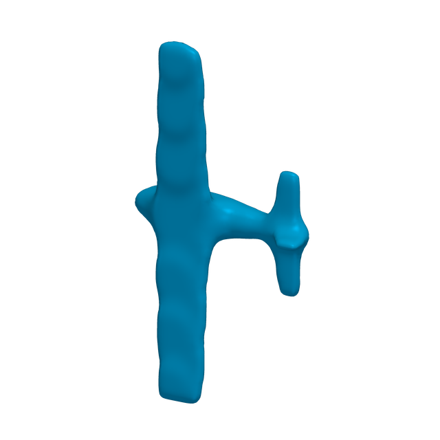 | [airplane1_gao](preview/a.smooth_zero/airplane1_gao.stl) | 0 | 9.417 | 28.245 | 18.830 | [Xifeng Gao](https://cims.nyu.edu/gcl/publications.html) |
| 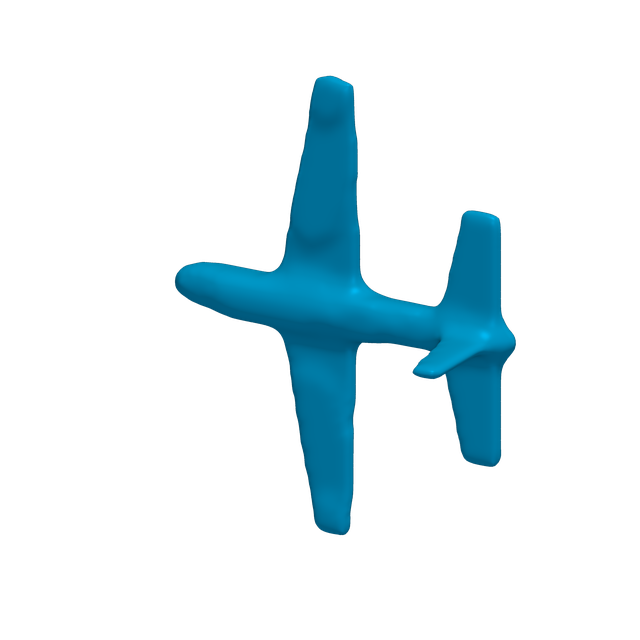 | [airplane2_gao](preview/a.smooth_zero/airplane2_gao.stl) | 0 | 26.806 | 80.412 | 53.608 | [Xifeng Gao](https://cims.nyu.edu/gcl/publications.html) |
| 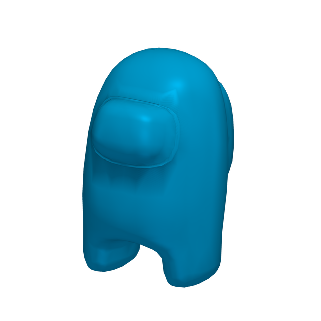 | [amogus_sketchfab](preview/a.smooth_zero/amogus_sketchfab.stl) | 0 | 964 | 2.886 | 1.924 | [joshua facunla](https://sketchfab.com/3d-models/among-us-crewmate-021671fa658d4d0dbb7bd5102b59c1d0) |
| 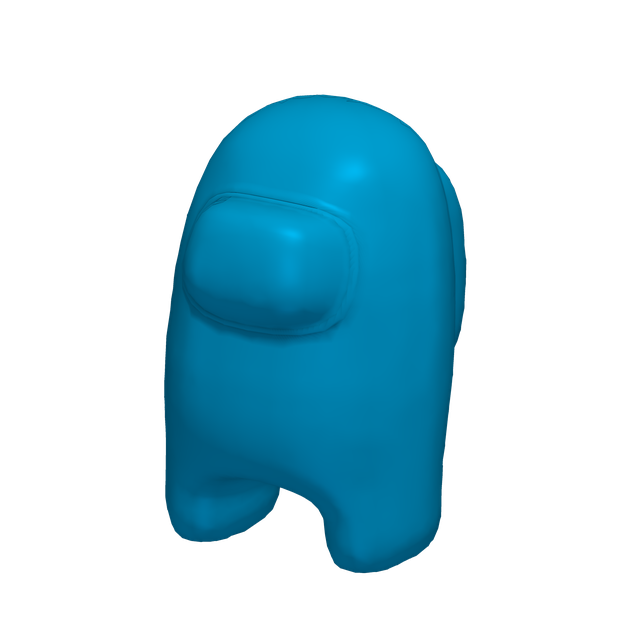 | [amogus_snoep](preview/a.smooth_zero/amogus_snoep.stl) | 0 | 3.061 | 9.177 | 6.118 | Maxim Snoep |
| 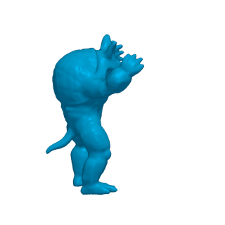 | [armadillo_gao](preview/a.smooth_zero/armadillo_gao.stl) | 0 | 15.508 | 46.518 | 31.012 | [Xifeng Gao](https://cims.nyu.edu/gcl/publications.html) |
| 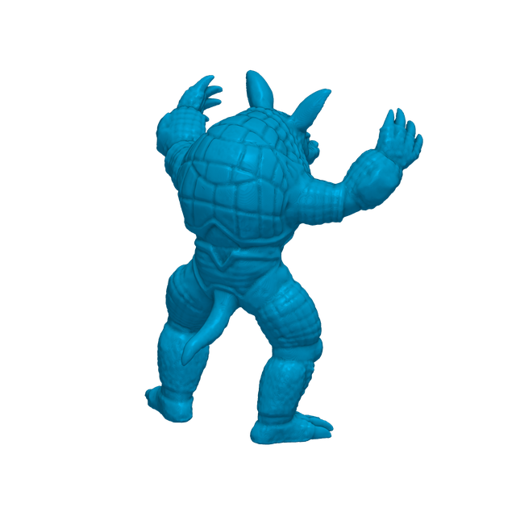 | [armadillo_jacobson](preview/a.smooth_zero/armadillo_jacobson.stl) | 0 | 49.990 | 149.964 | 99.976 | [Alec Jacobson](https://github.com/alecjacobson/common-3d-test-models) |
| 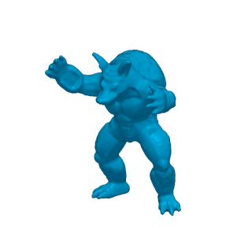 | [armadillo_stein](preview/a.smooth_zero/armadillo_stein.stl) | 0 | 14.587 | 43.755 | 29.170 | [Oded Stein](https://github.com/odedstein/meshes/tree/master/objects/armadillo) |
| 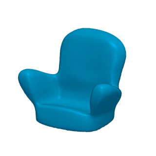 | [armchair_gao](preview/a.smooth_zero/armchair_gao.stl) | 0 | 12.972 | 38.910 | 25.940 | [Xifeng Gao](https://cims.nyu.edu/gcl/publications.html) |
|  | [bimba_gao](preview/a.smooth_zero/bimba_gao.stl) | 0 | 10.797 | 32.385 | 21.590 | [Xifeng Gao](https://cims.nyu.edu/gcl/publications.html) |
| 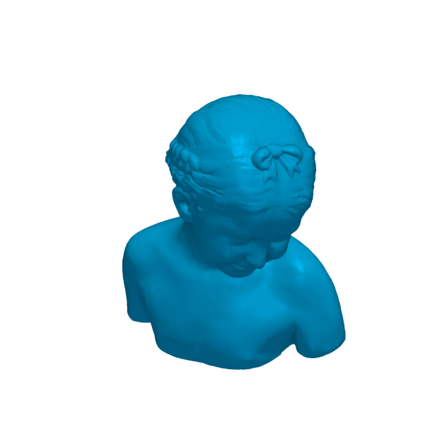 | [bimba_jacobson](preview/a.smooth_zero/bimba_jacobson.stl) | 0 | 29.995 | 89.979 | 59.986 | [Alec Jacobson + Maxim Snoep (simplified)](https://github.com/alecjacobson/common-3d-test-models) |
| 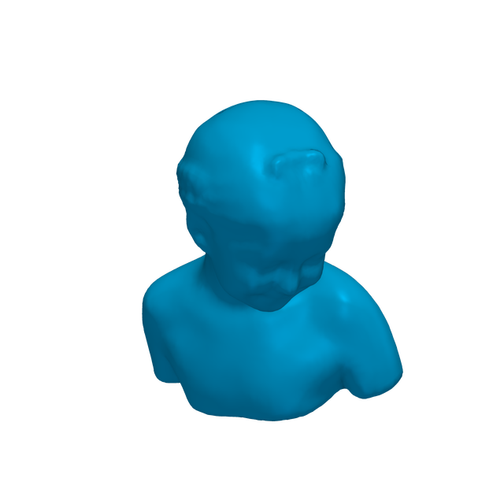 | [bimba_loopy](preview/a.smooth_zero/bimba_loopy.stl) | 0 | 11.772 | 35.310 | 23.540 | [Marco Livesu](https://github.com/mlivesu/LoopyCuts/tree/master/test_data) |
| 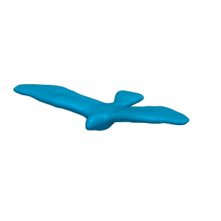 | [bird_gao](preview/a.smooth_zero/bird_gao.stl) | 0 | 17.318 | 51.948 | 34.632 | [Xifeng Gao](https://cims.nyu.edu/gcl/publications.html) |
| 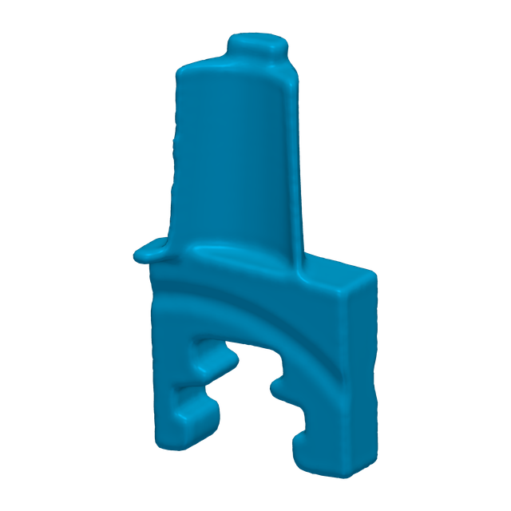 | [blade_gao](preview/a.smooth_zero/blade_gao.stl) | 0 | 14.106 | 42.312 | 28.208 | [Xifeng Gao](https://cims.nyu.edu/gcl/publications.html) |
| 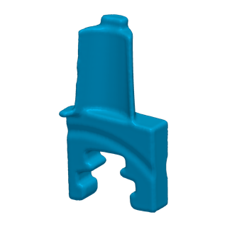 | [blade_loopy](preview/a.smooth_zero/blade_loopy.stl) | 0 | 14.532 | 43.590 | 29.060 | [Marco Livesu](https://github.com/mlivesu/LoopyCuts/tree/master/test_data) |
| 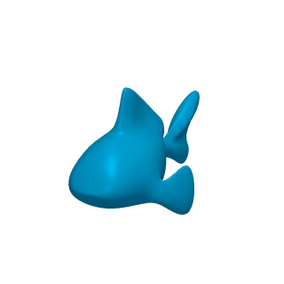 | [blub_crane](preview/a.smooth_zero/blub_crane.stl) | 0 | 7.106 | 21.312 | 14.208 | [Keenan Crane](https://www.cs.cmu.edu/~kmcrane/Projects/ModelRepository/) |
| 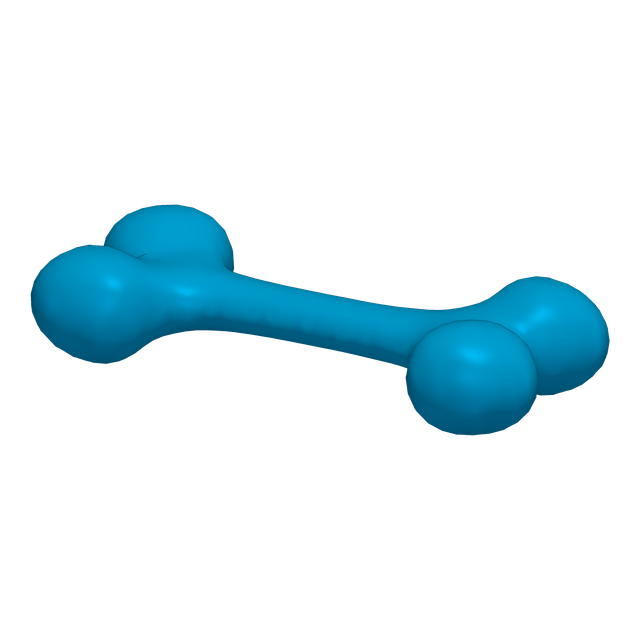 | [bone1_loopy](preview/a.smooth_zero/bone1_loopy.stl) | 0 | 1.566 | 4.692 | 3.128 | [Marco Livesu](https://github.com/mlivesu/LoopyCuts/tree/master/test_data) |
| 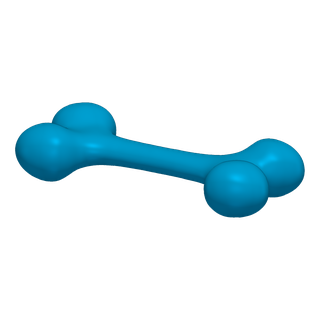 | [bone_gao](preview/a.smooth_zero/bone_gao.stl) | 0 | 6.046 | 18.132 | 12.088 | [Xifeng Gao](https://cims.nyu.edu/gcl/publications.html) |
|  | [bonefemur_loopy](preview/a.smooth_zero/bonefemur_loopy.stl) | 0 | 4.666 | 13.992 | 9.328 | [Marco Livesu](https://github.com/mlivesu/LoopyCuts/tree/master/test_data) |
| 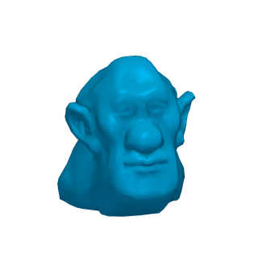 | [brucewick_stein](preview/a.smooth_zero/brucewick_stein.stl) | 0 | 1.431 | 4.287 | 2.858 | [Oded Stein](https://github.com/odedstein/meshes/tree/master/objects/brucewick) |
| 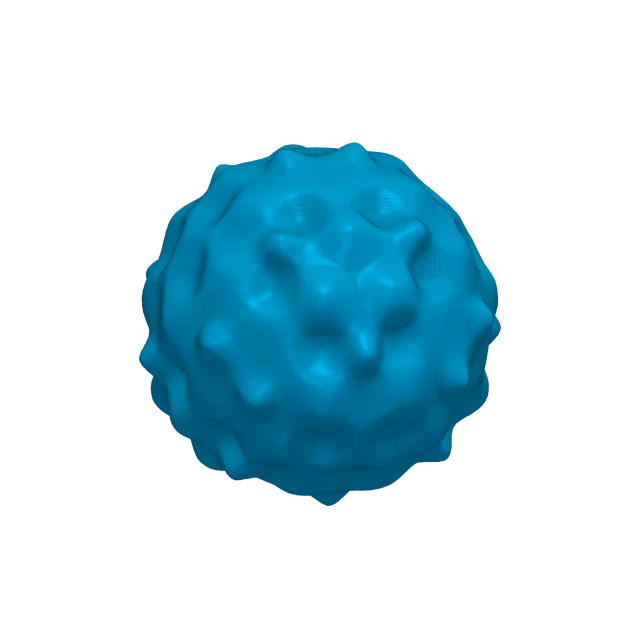 | [bumpysphere_gao](preview/a.smooth_zero/bumpysphere_gao.stl) | 0 | 22.890 | 68.664 | 45.776 | [Xifeng Gao](https://cims.nyu.edu/gcl/publications.html) |
| 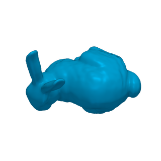 | [bunny_gao](preview/a.smooth_zero/bunny_gao.stl) | 0 | 11.247 | 33.735 | 22.490 | [Xifeng Gao](https://cims.nyu.edu/gcl/publications.html) |
| 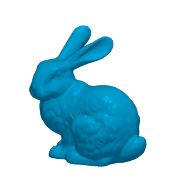 | [bunny_jacobson](preview/a.smooth_zero/bunny_jacobson.stl) | 0 | 35.188 | 105.558 | 70.372 | [Alec Jacobson + Maxim Snoep (repaired)](https://github.com/alecjacobson/common-3d-test-models) |
|  | [bunny_loopy](preview/a.smooth_zero/bunny_loopy.stl) | 0 | 11.120 | 33.354 | 22.236 | [Marco Livesu](https://github.com/mlivesu/LoopyCuts/tree/master/test_data) |
| 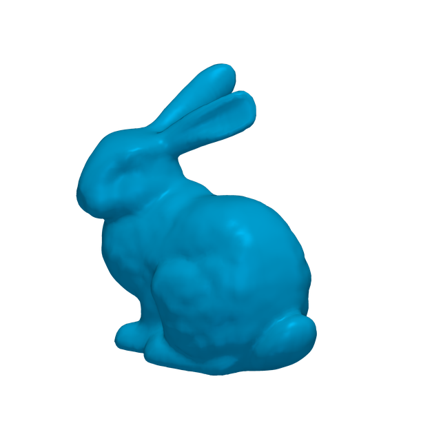 | [bunny_snoep](preview/a.smooth_zero/bunny_snoep.stl) | 0 | 11.120 | 33.354 | 22.236 | [Marco Livesu + Maxim Snoep (re-oriented)](https://github.com/mlivesu/LoopyCuts/tree/master/test_data) |
|  | [bunny_stein](preview/a.smooth_zero/bunny_stein.stl) | 0 | 3.301 | 9.897 | 6.598 | [Oded Stein](https://github.com/odedstein/meshes/tree/master/objects/bunny) |
|  | [buste_gao](preview/a.smooth_zero/buste_gao.stl) | 0 | 17.341 | 52.017 | 34.678 | [Xifeng Gao](https://cims.nyu.edu/gcl/publications.html) |
| 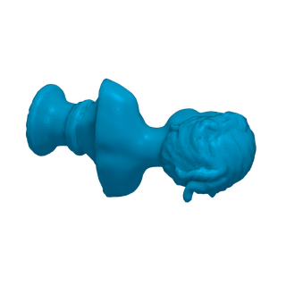 | [buste_loopy](preview/a.smooth_zero/buste_loopy.stl) | 0 | 6.070 | 18.204 | 12.136 | [Marco Livesu](https://github.com/mlivesu/LoopyCuts/tree/master/test_data) |
| 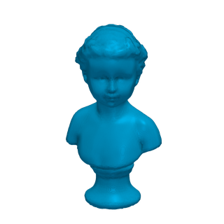 | [buste_snoep](preview/a.smooth_zero/buste_snoep.stl) | 0 | 6.070 | 18.204 | 12.136 | [Marco Livesu + Maxim Snoep (re-oriented)](https://github.com/mlivesu/LoopyCuts/tree/master/test_data) |
| 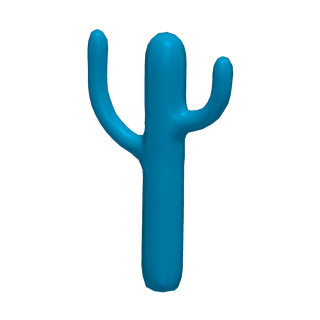 | [cactus_loopy](preview/a.smooth_zero/cactus_loopy.stl) | 0 | 700 | 2.094 | 1.396 | [Marco Livesu](https://github.com/mlivesu/LoopyCuts/tree/master/test_data) |
| 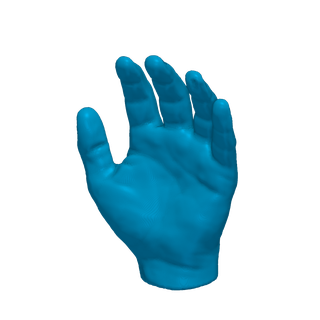 | [camillehand_gao](preview/a.smooth_zero/camillehand_gao.stl) | 0 | 16.565 | 49.689 | 33.126 | [Xifeng Gao](https://cims.nyu.edu/gcl/publications.html) |
| 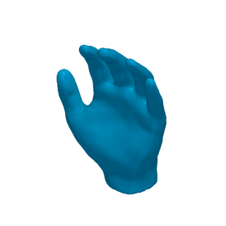 | [camillehand_loopy](preview/a.smooth_zero/camillehand_loopy.stl) | 0 | 3.705 | 11.109 | 7.406 | [Marco Livesu](https://github.com/mlivesu/LoopyCuts/tree/master/test_data) |
| 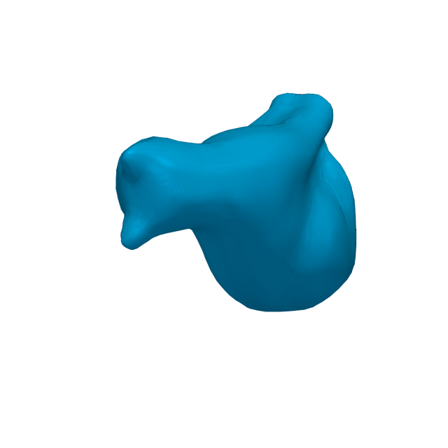 | [cat_loopy](preview/a.smooth_zero/cat_loopy.stl) | 0 | 2.332 | 6.990 | 4.660 | [Marco Livesu](https://github.com/mlivesu/LoopyCuts/tree/master/test_data) |
| 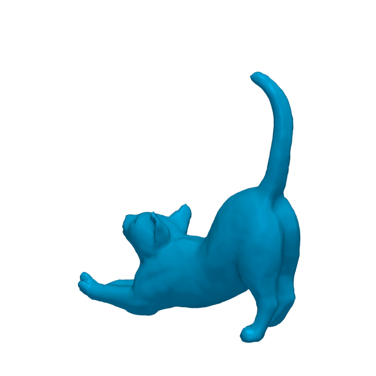 | [cat_stein](preview/a.smooth_zero/cat_stein.stl) | 0 | 7.949 | 23.841 | 15.894 | [Oded Stein](https://github.com/odedstein/meshes/tree/master/objects/cat) |
| 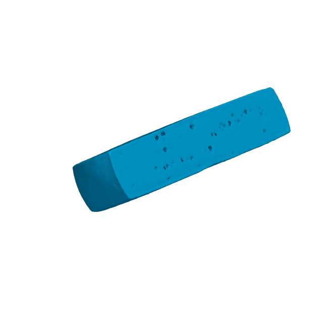 | [cheese_stein](preview/a.smooth_zero/cheese_stein.stl) | 0 | 30.002 | 90.000 | 60.000 | [Oded Stein + Maxim Snoep (simplified)](https://github.com/odedstein/meshes/tree/master/objects/cheese) |
| 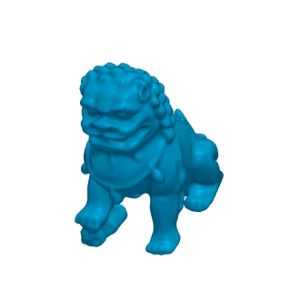 | [chineselion_gao](preview/a.smooth_zero/chineselion_gao.stl) | 0 | 25.194 | 75.576 | 50.384 | [Xifeng Gao](https://cims.nyu.edu/gcl/publications.html) |
| 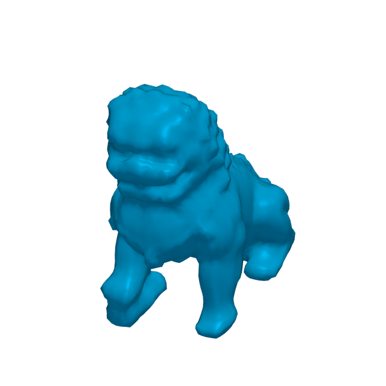 | [chineselion_loopy](preview/a.smooth_zero/chineselion_loopy.stl) | 0 | 4.248 | 12.738 | 8.492 | [Marco Livesu](https://github.com/mlivesu/LoopyCuts/tree/master/test_data) |
| 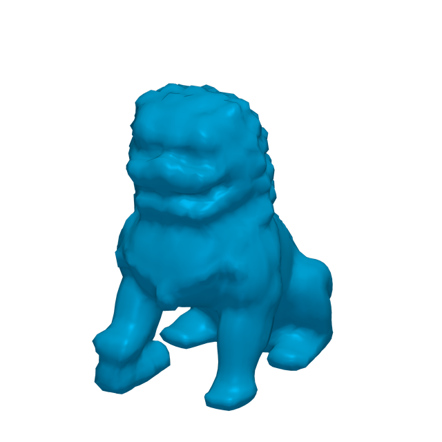 | [chineselion_snoep](preview/a.smooth_zero/chineselion_snoep.stl) | 0 | 4.248 | 12.738 | 8.492 | [Marco Livesu + Maxim Snoep (re-oriented)](https://github.com/mlivesu/LoopyCuts/tree/master/test_data) |
| 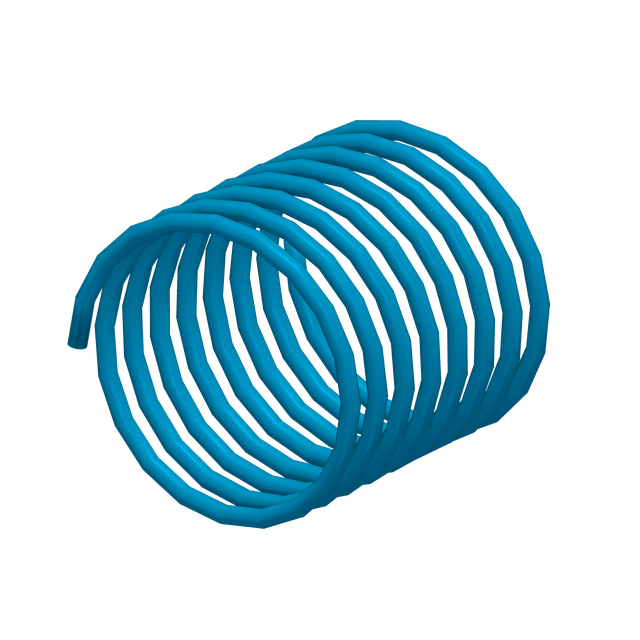 | [completepart16_gao](preview/a.smooth_zero/completepart16_gao.stl) | 0 | 3.840 | 11.514 | 7.676 | [Xifeng Gao](https://cims.nyu.edu/gcl/publications.html) |
| 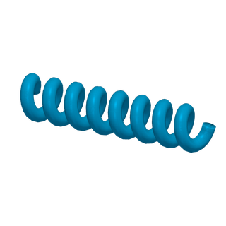 | [completepart63_gao](preview/a.smooth_zero/completepart63_gao.stl) | 0 | 3.840 | 11.514 | 7.676 | [Xifeng Gao](https://cims.nyu.edu/gcl/publications.html) |
| 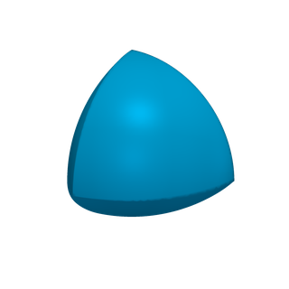 | [constantwidth_crane](preview/a.smooth_zero/constantwidth_crane.stl) | 0 | 19.802 | 59.400 | 39.600 | [Keenan Crane](https://www.cs.cmu.edu/~kmcrane/Projects/ModelRepository/) |
| 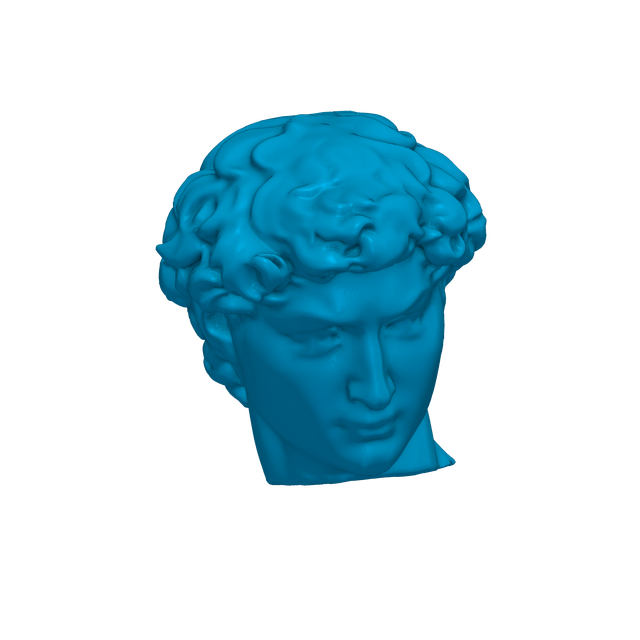 | [david_gao](preview/a.smooth_zero/david_gao.stl) | 0 | 25.434 | 76.296 | 50.864 | [Xifeng Gao](https://cims.nyu.edu/gcl/publications.html) |
| 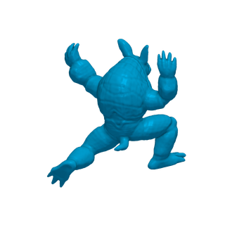 | [deformedarmadillo_gao](preview/a.smooth_zero/deformedarmadillo_gao.stl) | 0 | 87.286 | 261.852 | 174.568 | [Xifeng Gao](https://cims.nyu.edu/gcl/publications.html) |
| 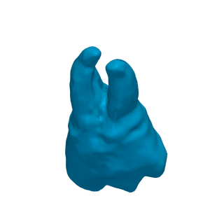 | [dente_gao](preview/a.smooth_zero/dente_gao.stl) | 0 | 12.195 | 36.579 | 24.386 | [Xifeng Gao](https://cims.nyu.edu/gcl/publications.html) |
| 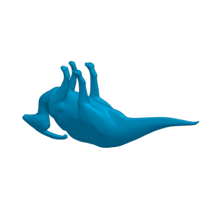 | [dilo_gao](preview/a.smooth_zero/dilo_gao.stl) | 0 | 22.154 | 66.456 | 44.304 | [Xifeng Gao](https://cims.nyu.edu/gcl/publications.html) |
| 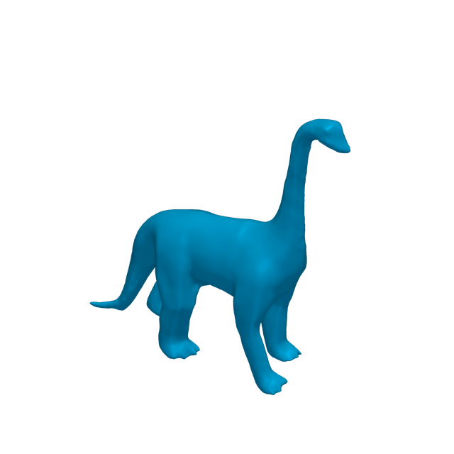 | [dino2_gao](preview/a.smooth_zero/dino2_gao.stl) | 0 | 10.178 | 30.528 | 20.352 | [Xifeng Gao](https://cims.nyu.edu/gcl/publications.html) |
| 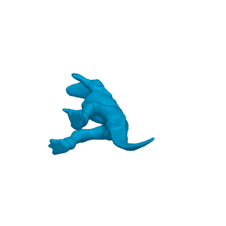 | [dino_gao](preview/a.smooth_zero/dino_gao.stl) | 0 | 16.634 | 49.896 | 33.264 | [Xifeng Gao](https://cims.nyu.edu/gcl/publications.html) |
| 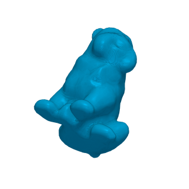 | [dog_loopy](preview/a.smooth_zero/dog_loopy.stl) | 0 | 3.084 | 9.246 | 6.164 | [Marco Livesu](https://github.com/mlivesu/LoopyCuts/tree/master/test_data) |
| 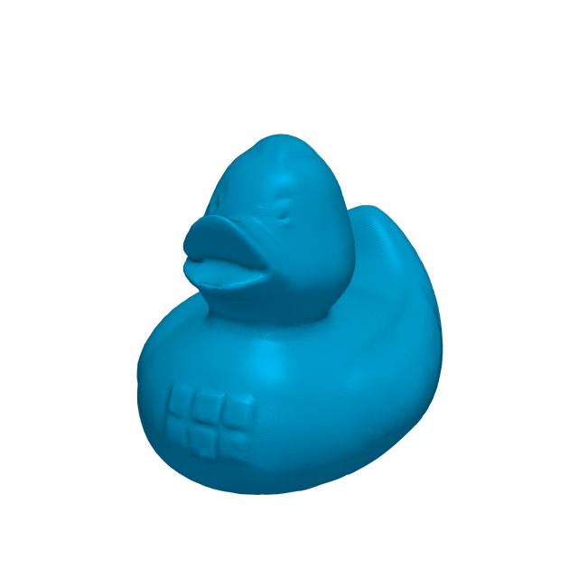 | [duck2_gao](preview/a.smooth_zero/duck2_gao.stl) | 0 | 9.640 | 28.914 | 19.276 | [Xifeng Gao](https://cims.nyu.edu/gcl/publications.html) |
| 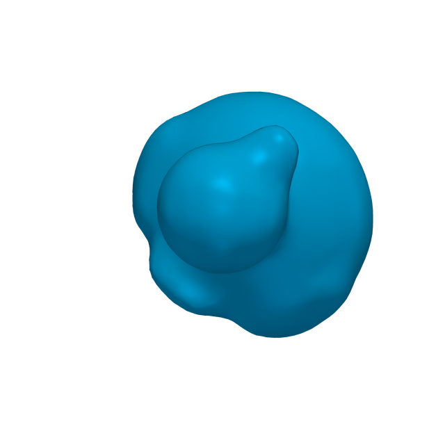 | [duck_gao](preview/a.smooth_zero/duck_gao.stl) | 0 | 3.598 | 10.788 | 7.192 | [Xifeng Gao](https://cims.nyu.edu/gcl/publications.html) |
| 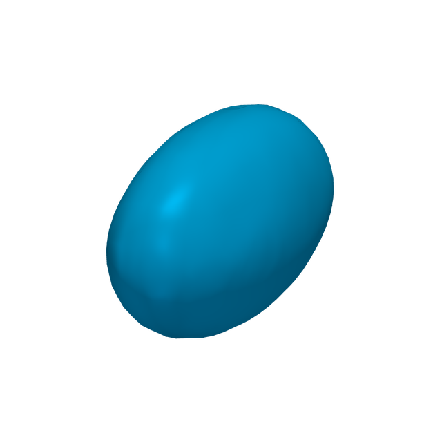 | [ellipse_loopy](preview/a.smooth_zero/ellipse_loopy.stl) | 0 | 554 | 1.656 | 1.104 | [Marco Livesu](https://github.com/mlivesu/LoopyCuts/tree/master/test_data) |
| 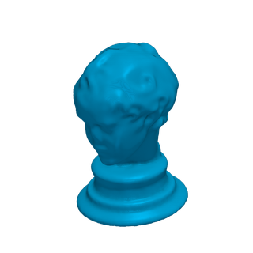 | [eros_gao](preview/a.smooth_zero/eros_gao.stl) | 0 | 25.001 | 74.997 | 49.998 | [Xifeng Gao](https://cims.nyu.edu/gcl/publications.html) |
| 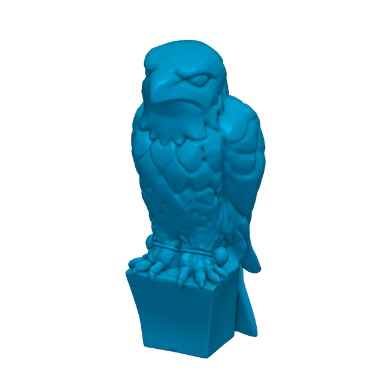 | [falconstatue_stein](preview/a.smooth_zero/falconstatue_stein.stl) | 0 | 25.839 | 77.511 | 51.674 | [Oded Stein](https://github.com/odedstein/meshes/tree/master/objects/falconstatue) |
| 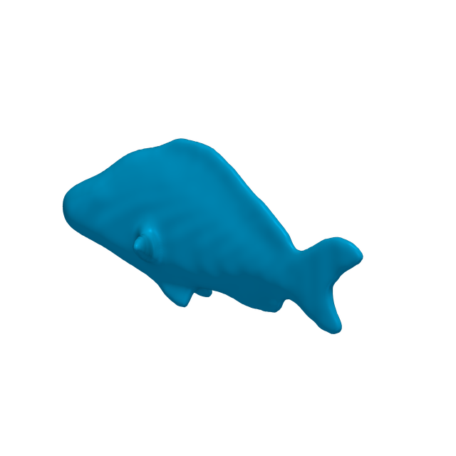 | [fish1_gao](preview/a.smooth_zero/fish1_gao.stl) | 0 | 11.895 | 35.679 | 23.786 | [Xifeng Gao](https://cims.nyu.edu/gcl/publications.html) |
| 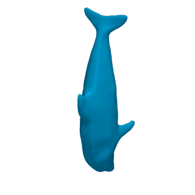 | [fish2_gao](preview/a.smooth_zero/fish2_gao.stl) | 0 | 10.604 | 31.806 | 21.204 | [Xifeng Gao](https://cims.nyu.edu/gcl/publications.html) |
| 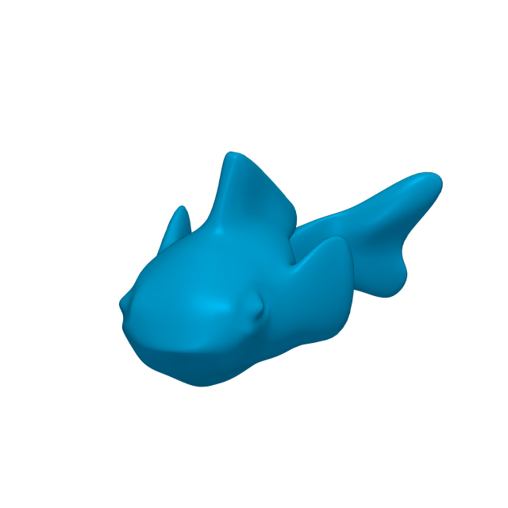 | [fish_stein](preview/a.smooth_zero/fish_stein.stl) | 0 | 10.786 | 32.352 | 21.568 | [Oded Stein](https://github.com/odedstein/meshes/tree/master/objects/fish) |
|  | [foot_gao](preview/a.smooth_zero/foot_gao.stl) | 0 | 10.342 | 31.020 | 20.680 | [Xifeng Gao](https://cims.nyu.edu/gcl/publications.html) |
|  | [gargoyle_gao](preview/a.smooth_zero/gargoyle_gao.stl) | 0 | 13.024 | 39.066 | 26.044 | [Xifeng Gao](https://cims.nyu.edu/gcl/publications.html) |
|  | [ghost_snoep](preview/a.smooth_zero/ghost_snoep.stl) | 0 | 1.698 | 5.088 | 3.392 | [Thingi10K + Maxim Snoep (re-oriented)](https://ten-thousand-models.appspot.com/detail.html?file_id=40746) |
|  | [ghost_thingi](preview/a.smooth_zero/ghost_thingi.stl) | 0 | 1.698 | 5.088 | 3.392 | [Thingi10K](https://ten-thousand-models.appspot.com/detail.html?file_id=40746) |
|  | [glass1_gao](preview/a.smooth_zero/glass1_gao.stl) | 0 | 29.674 | 89.016 | 59.344 | [Xifeng Gao](https://cims.nyu.edu/gcl/publications.html) |
|  | [glass2_gao](preview/a.smooth_zero/glass2_gao.stl) | 0 | 11.710 | 35.124 | 23.416 | [Xifeng Gao](https://cims.nyu.edu/gcl/publications.html) |
|  | [goathead_snoep](preview/a.smooth_zero/goathead_snoep.stl) | 0 | 2.763 | 8.283 | 5.522 | [Oded Stein + Maxim Snoep (re-oriented)](https://github.com/odedstein/meshes/tree/master/objects/goathead) |
|  | [goathead_stein](preview/a.smooth_zero/goathead_stein.stl) | 0 | 2.763 | 8.283 | 5.522 | [Oded Stein](https://github.com/odedstein/meshes/tree/master/objects/goathead) |
|  | [hand_gao](preview/a.smooth_zero/hand_gao.stl) | 0 | 13.982 | 41.940 | 27.960 | [Xifeng Gao](https://cims.nyu.edu/gcl/publications.html) |
|  | [hand_loopy](preview/a.smooth_zero/hand_loopy.stl) | 0 | 2.474 | 7.416 | 4.944 | [Marco Livesu](https://github.com/mlivesu/LoopyCuts/tree/master/test_data) |
|  | [hand_stein](preview/a.smooth_zero/hand_stein.stl) | 0 | 7.993 | 23.973 | 15.982 | [Oded Stein](https://github.com/odedstein/meshes/tree/master/objects/hand) |
|  | [head1_gao](preview/a.smooth_zero/head1_gao.stl) | 0 | 14.399 | 43.191 | 28.794 | [Xifeng Gao](https://cims.nyu.edu/gcl/publications.html) |
|  | [head2_gao](preview/a.smooth_zero/head2_gao.stl) | 0 | 14.754 | 44.256 | 29.504 | [Xifeng Gao](https://cims.nyu.edu/gcl/publications.html) |
|  | [homer_gao](preview/a.smooth_zero/homer_gao.stl) | 0 | 13.639 | 40.911 | 27.274 | [Xifeng Gao](https://cims.nyu.edu/gcl/publications.html) |
|  | [horse_gao](preview/a.smooth_zero/horse_gao.stl) | 0 | 19.851 | 59.547 | 39.698 | [Xifeng Gao](https://cims.nyu.edu/gcl/publications.html) |
|  | [horse_jacobson](preview/a.smooth_zero/horse_jacobson.stl) | 0 | 48.485 | 145.449 | 96.966 | [Alec Jacobson](https://github.com/alecjacobson/common-3d-test-models) |
|  | [human1_gao](preview/a.smooth_zero/human1_gao.stl) | 0 | 10.231 | 30.687 | 20.458 | [Xifeng Gao](https://cims.nyu.edu/gcl/publications.html) |
|  | [human2_gao](preview/a.smooth_zero/human2_gao.stl) | 0 | 12.794 | 38.376 | 25.584 | [Xifeng Gao](https://cims.nyu.edu/gcl/publications.html) |
|  | [human3_gao](preview/a.smooth_zero/human3_gao.stl) | 0 | 12.329 | 36.981 | 24.654 | [Xifeng Gao](https://cims.nyu.edu/gcl/publications.html) |
|  | [humanman_stein](preview/a.smooth_zero/humanman_stein.stl) | 0 | 6.890 | 20.664 | 13.776 | [Oded Stein](https://github.com/odedstein/meshes/tree/master/objects/human) |
|  | [humanneutral_stein](preview/a.smooth_zero/humanneutral_stein.stl) | 0 | 9.437 | 28.305 | 18.870 | [Oded Stein + Maxim Snoep (repaired)](https://github.com/odedstein/meshes/tree/master/objects/human) |
|  | [humanwoman_stein](preview/a.smooth_zero/humanwoman_stein.stl) | 0 | 6.890 | 20.664 | 13.776 | [Oded Stein](https://github.com/odedstein/meshes/tree/master/objects/human) |
|  | [igea_gao](preview/a.smooth_zero/igea_gao.stl) | 0 | 25.282 | 75.840 | 50.560 | [Xifeng Gao](https://cims.nyu.edu/gcl/publications.html) |
|  | [igea_jacobson](preview/a.smooth_zero/igea_jacobson.stl) | 0 | 30.001 | 89.997 | 59.998 | [Alec Jacobson + Maxim Snoep (simplified)](https://github.com/alecjacobson/common-3d-test-models) |
|  | [inigo_crane](preview/a.smooth_zero/inigo_crane.stl) | 0 | 29.995 | 89.979 | 59.986 | [Keenan Crane + Maxim Snoep (repaired, simplified)](https://www.cs.cmu.edu/~kmcrane/Projects/ModelRepository/) |
|  | [insect_gao](preview/a.smooth_zero/insect_gao.stl) | 0 | 39.370 | 118.104 | 78.736 | [Xifeng Gao](https://cims.nyu.edu/gcl/publications.html) |
|  | [isidorehorse_gao](preview/a.smooth_zero/isidorehorse_gao.stl) | 0 | 19.465 | 58.389 | 38.926 | [Xifeng Gao](https://cims.nyu.edu/gcl/publications.html) |
|  | [koala_stein](preview/a.smooth_zero/koala_stein.stl) | 0 | 3.560 | 10.674 | 7.116 | [Oded Stein](https://github.com/odedstein/meshes/tree/master/objects/koala) |
|  | [kong_loopy](preview/a.smooth_zero/kong_loopy.stl) | 0 | 15.778 | 47.328 | 31.552 | [Marco Livesu](https://github.com/mlivesu/LoopyCuts/tree/master/test_data) |
|  | [lion_gao](preview/a.smooth_zero/lion_gao.stl) | 0 | 27.899 | 83.691 | 55.794 | [Xifeng Gao](https://cims.nyu.edu/gcl/publications.html) |
|  | [max_gao](preview/a.smooth_zero/max_gao.stl) | 0 | 9.936 | 29.802 | 19.868 | [Xifeng Gao](https://cims.nyu.edu/gcl/publications.html) |
|  | [max_jacobson](preview/a.smooth_zero/max_jacobson.stl) | 0 | 51.212 | 153.630 | 102.420 | [Alec Jacobson + Maxim Snoep (repaired)](https://github.com/alecjacobson/common-3d-test-models) |
|  | [moai_gao](preview/a.smooth_zero/moai_gao.stl) | 0 | 10.002 | 30.000 | 20.000 | [Xifeng Gao](https://cims.nyu.edu/gcl/publications.html) |
|  | [mouse_gao](preview/a.smooth_zero/mouse_gao.stl) | 0 | 13.961 | 41.877 | 27.918 | [Xifeng Gao](https://cims.nyu.edu/gcl/publications.html) |
|  | [mushroom_stein](preview/a.smooth_zero/mushroom_stein.stl) | 0 | 11.585 | 34.749 | 23.166 | [Oded Stein](https://github.com/odedstein/meshes/tree/master/objects/mushroom) |
|  | [nefertiti_crane](preview/a.smooth_zero/nefertiti_crane.stl) | 0 | 29.999 | 89.991 | 59.994 | [Keenan Crane + Maxim Snoep (simplified)](https://www.cs.cmu.edu/~kmcrane/Projects/ModelRepository/) |
|  | [nefertiti_stein](preview/a.smooth_zero/nefertiti_stein.stl) | 0 | 29.999 | 89.991 | 59.994 | [Oded Stein + Maxim Snoep (simplified)](https://github.com/odedstein/meshes/tree/master/objects/nefertiti) |
|  | [ogre_crane](preview/a.smooth_zero/ogre_crane.stl) | 0 | 19.446 | 58.332 | 38.888 | [Keenan Crane + Maxim Snoep (repaired)](https://www.cs.cmu.edu/~kmcrane/Projects/ModelRepository/) |
|  | [ogre_jacobson](preview/a.smooth_zero/ogre_jacobson.stl) | 0 | 25.669 | 77.001 | 51.334 | [Alec Jacobson + Maxim Snoep (repaired, simplified)](https://github.com/alecjacobson/common-3d-test-models) |
|  | [oni_gao](preview/a.smooth_zero/oni_gao.stl) | 0 | 12.887 | 38.655 | 25.770 | [Xifeng Gao](https://cims.nyu.edu/gcl/publications.html) |
|  | [pear_gao](preview/a.smooth_zero/pear_gao.stl) | 0 | 10.754 | 32.256 | 21.504 | [Xifeng Gao](https://cims.nyu.edu/gcl/publications.html) |
|  | [penguin_stein](preview/a.smooth_zero/penguin_stein.stl) | 0 | 3.362 | 10.080 | 6.720 | [Oded Stein](https://github.com/odedstein/meshes/tree/master/objects/penguin) |
|  | [pensatore_gao](preview/a.smooth_zero/pensatore_gao.stl) | 0 | 19.624 | 58.866 | 39.244 | [Xifeng Gao](https://cims.nyu.edu/gcl/publications.html) |
|  | [pierrot_gao](preview/a.smooth_zero/pierrot_gao.stl) | 0 | 16.551 | 49.647 | 33.098 | [Xifeng Gao](https://cims.nyu.edu/gcl/publications.html) |
|  | [pig_crane](preview/a.smooth_zero/pig_crane.stl) | 0 | 4.434 | 13.296 | 8.864 | [Keenan Crane + Maxim Snoep (repaired)](https://www.cs.cmu.edu/~kmcrane/Projects/ModelRepository/) |
|  | [pig_gao](preview/a.smooth_zero/pig_gao.stl) | 0 | 15.594 | 46.776 | 31.184 | [Xifeng Gao](https://cims.nyu.edu/gcl/publications.html) |
|  | [pig_loopy](preview/a.smooth_zero/pig_loopy.stl) | 0 | 3.166 | 9.492 | 6.328 | [Marco Livesu](https://github.com/mlivesu/LoopyCuts/tree/master/test_data) |
|  | [rabbit_loopy](preview/a.smooth_zero/rabbit_loopy.stl) | 0 | 8.002 | 24.000 | 16.000 | [Marco Livesu](https://github.com/mlivesu/LoopyCuts/tree/master/test_data) |
|  | [ramses_gao](preview/a.smooth_zero/ramses_gao.stl) | 0 | 13.505 | 40.509 | 27.006 | [Xifeng Gao](https://cims.nyu.edu/gcl/publications.html) |
|  | [redbox_gao](preview/a.smooth_zero/redbox_gao.stl) | 0 | 50.002 | 150.000 | 100.000 | [Xifeng Gao](https://cims.nyu.edu/gcl/publications.html) |
|  | [retinal_gao](preview/a.smooth_zero/retinal_gao.stl) | 0 | 14.566 | 43.692 | 29.128 | [Xifeng Gao](https://cims.nyu.edu/gcl/publications.html) |
|  | [santa_gao](preview/a.smooth_zero/santa_gao.stl) | 0 | 10.406 | 31.212 | 20.808 | [Xifeng Gao](https://cims.nyu.edu/gcl/publications.html) |
|  | [scorpion_stein](preview/a.smooth_zero/scorpion_stein.stl) | 0 | 6.315 | 18.939 | 12.626 | [Oded Stein](https://github.com/odedstein/meshes/tree/master/objects/scorpion) |
|  | [screwdriver_gao](preview/a.smooth_zero/screwdriver_gao.stl) | 0 | 24.568 | 73.698 | 49.132 | [Xifeng Gao](https://cims.nyu.edu/gcl/publications.html) |
|  | [sediapatch_gao](preview/a.smooth_zero/sediapatch_gao.stl) | 0 | 15.584 | 46.746 | 31.164 | [Xifeng Gao](https://cims.nyu.edu/gcl/publications.html) |
|  | [sphere_stein](preview/a.smooth_zero/sphere_stein.stl) | 0 | 642 | 1.920 | 1.280 | [Oded Stein](https://github.com/odedstein/meshes/tree/master/objects/sphere) |
|  | [sphinx_gao](preview/a.smooth_zero/sphinx_gao.stl) | 0 | 10.608 | 31.818 | 21.212 | [Xifeng Gao](https://cims.nyu.edu/gcl/publications.html) |
|  | [sphinx_loopy](preview/a.smooth_zero/sphinx_loopy.stl) | 0 | 10.184 | 30.546 | 20.364 | [Marco Livesu](https://github.com/mlivesu/LoopyCuts/tree/master/test_data) |
|  | [spot_crane](preview/a.smooth_zero/spot_crane.stl) | 0 | 2.930 | 8.784 | 5.856 | [Keenan Crane](https://www.cs.cmu.edu/~kmcrane/Projects/ModelRepository/) |
|  | [spot_snoep](preview/a.smooth_zero/spot_snoep.stl) | 0 | 11.533 | 34.593 | 23.062 | [Oded Stein + Maxim Snoep (re-oriented)](https://github.com/odedstein/meshes/tree/master/objects/spot) |
|  | [spot_stein](preview/a.smooth_zero/spot_stein.stl) | 0 | 11.533 | 34.593 | 23.062 | [Oded Stein](https://github.com/odedstein/meshes/tree/master/objects/spot) |
|  | [springer_stein](preview/a.smooth_zero/springer_stein.stl) | 0 | 9.686 | 29.052 | 19.368 | [Oded Stein](https://github.com/odedstein/meshes/tree/master/objects/springer) |
|  | [strawberry_stein](preview/a.smooth_zero/strawberry_stein.stl) | 0 | 29.992 | 89.970 | 59.980 | [Oded Stein + Maxim Snoep (simplified)](https://github.com/odedstein/meshes/tree/master/objects/strawberry) |
|  | [stuffedtoy_stein](preview/a.smooth_zero/stuffedtoy_stein.stl) | 0 | 6.669 | 20.001 | 13.334 | [Oded Stein](https://github.com/odedstein/meshes/tree/master/objects/stuffedtoy) |
|  | [sword_stein](preview/a.smooth_zero/sword_stein.stl) | 0 | 22.293 | 66.873 | 44.582 | [Oded Stein](https://github.com/odedstein/meshes/tree/master/objects/sword) |
|  | [torque1_loopy](preview/a.smooth_zero/torque1_loopy.stl) | 0 | 2.850 | 8.544 | 5.696 | [Marco Livesu](https://github.com/mlivesu/LoopyCuts/tree/master/test_data) |
|  | [torque_loopy](preview/a.smooth_zero/torque_loopy.stl) | 0 | 1.652 | 4.950 | 3.300 | [Marco Livesu](https://github.com/mlivesu/LoopyCuts/tree/master/test_data) |
|  | [toy1_gao](preview/a.smooth_zero/toy1_gao.stl) | 0 | 13.452 | 40.350 | 26.900 | [Xifeng Gao](https://cims.nyu.edu/gcl/publications.html) |
|  | [toy2_gao](preview/a.smooth_zero/toy2_gao.stl) | 0 | 10.755 | 32.259 | 21.506 | [Xifeng Gao](https://cims.nyu.edu/gcl/publications.html) |
|  | [trebol_loopy](preview/a.smooth_zero/trebol_loopy.stl) | 0 | 18.176 | 54.522 | 36.348 | [Marco Livesu](https://github.com/mlivesu/LoopyCuts/tree/master/test_data) |
|  | [tree_stein](preview/a.smooth_zero/tree_stein.stl) | 0 | 30.000 | 89.994 | 59.996 | [Oded Stein + Maxim Snoep (simplified)](https://github.com/odedstein/meshes/tree/master/objects/tree) |
|  | [uumemento_gao](preview/a.smooth_zero/uumemento_gao.stl) | 0 | 46.510 | 139.524 | 93.016 | [Xifeng Gao](https://cims.nyu.edu/gcl/publications.html) |
|  | [venus_gao](preview/a.smooth_zero/venus_gao.stl) | 0 | 10.874 | 32.616 | 21.744 | [Xifeng Gao](https://cims.nyu.edu/gcl/publications.html) |
|  | [vessel_loopy](preview/a.smooth_zero/vessel_loopy.stl) | 0 | 2.658 | 7.968 | 5.312 | [Marco Livesu](https://github.com/mlivesu/LoopyCuts/tree/master/test_data) |
|  | [woodenfish_gao](preview/a.smooth_zero/woodenfish_gao.stl) | 0 | 15.940 | 47.814 | 31.876 | [Xifeng Gao](https://cims.nyu.edu/gcl/publications.html) |

### (b) smooth (g≥1, n=56)
| | model | genus | vertices | edges | triangles | source |
|-|-------|-------|----------|-------|-----------|--------|
|  | [bob_crane](preview/b.smooth_plus/bob_crane.stl) | 1 | 5.344 | 16.032 | 10.688 | [Keenan Crane](https://www.cs.cmu.edu/~kmcrane/Projects/ModelRepository/) |
|  | [boot_stein](preview/b.smooth_plus/boot_stein.stl) | 12 | 19.931 | 59.859 | 39.906 | [Oded Stein](https://github.com/odedstein/meshes/tree/master/objects/boot) |
|  | [botijo_gao](preview/b.smooth_plus/botijo_gao.stl) | 5 | 12.127 | 36.405 | 24.270 | [Xifeng Gao](https://cims.nyu.edu/gcl/publications.html) |
|  | [bottle1_gao](preview/b.smooth_plus/bottle1_gao.stl) | 1 | 14.832 | 44.496 | 29.664 | [Xifeng Gao](https://cims.nyu.edu/gcl/publications.html) |
|  | [bottle2_gao](preview/b.smooth_plus/bottle2_gao.stl) | 1 | 14.595 | 43.785 | 29.190 | [Xifeng Gao](https://cims.nyu.edu/gcl/publications.html) |
|  | [buddha_stanford](preview/b.smooth_plus/buddha_stanford.stl) | 10 | 29.419 | 88.311 | 58.874 | [Stanford + Maxim Snoep (repaired, simplified)](https://graphics.stanford.edu/data/3Dscanrep/) |
|  | [bumpytorus_gao](preview/b.smooth_plus/bumpytorus_gao.stl) | 1 | 15.279 | 45.837 | 30.558 | [Xifeng Gao](https://cims.nyu.edu/gcl/publications.html) |
|  | [camel_gao](preview/b.smooth_plus/camel_gao.stl) | 1 | 34.546 | 103.638 | 69.092 | [Xifeng Gao](https://cims.nyu.edu/gcl/publications.html) |
|  | [centaur_tds](preview/b.smooth_plus/centaur_tds.stl) | 9 | 29.973 | 89.967 | 59.978 | [Three D Scans + Maxim Snoep (repaired, simplified, rescaled)](https://huggingface.co/datasets/alecjacobson/threedscans) |
|  | [chair1_gao](preview/b.smooth_plus/chair1_gao.stl) | 4 | 11.421 | 34.281 | 22.854 | [Xifeng Gao](https://cims.nyu.edu/gcl/publications.html) |
|  | [chair_gao](preview/b.smooth_plus/chair_gao.stl) | 7 | 23.081 | 69.279 | 46.186 | [Xifeng Gao](https://cims.nyu.edu/gcl/publications.html) |
|  | [cow_stein](preview/b.smooth_plus/cow_stein.stl) | 1 | 29.991 | 89.973 | 59.982 | [Oded Stein + Maxim Snoep (simplified)](https://github.com/odedstein/meshes/tree/master/objects/cow) |
|  | [cup1_gao](preview/b.smooth_plus/cup1_gao.stl) | 1 | 15.564 | 46.692 | 31.128 | [Xifeng Gao](https://cims.nyu.edu/gcl/publications.html) |
|  | [cup_gao](preview/b.smooth_plus/cup_gao.stl) | 2 | 10.495 | 31.491 | 20.994 | [Xifeng Gao](https://cims.nyu.edu/gcl/publications.html) |
|  | [dancer2_gao](preview/b.smooth_plus/dancer2_gao.stl) | 1 | 30.248 | 90.744 | 60.496 | [Xifeng Gao](https://cims.nyu.edu/gcl/publications.html) |
|  | [dancer_gao](preview/b.smooth_plus/dancer_gao.stl) | 1 | 12.048 | 36.144 | 24.096 | [Xifeng Gao](https://cims.nyu.edu/gcl/publications.html) |
|  | [dancer_loopy](preview/b.smooth_plus/dancer_loopy.stl) | 1 | 24.998 | 74.994 | 49.996 | [Marco Livesu](https://github.com/mlivesu/LoopyCuts/tree/master/test_data) |
|  | [dancingchildren_gao](preview/b.smooth_plus/dancingchildren_gao.stl) | 8 | 12.163 | 36.531 | 24.354 | [Xifeng Gao](https://cims.nyu.edu/gcl/publications.html) |
|  | [demosthenes_stein](preview/b.smooth_plus/demosthenes_stein.stl) | 1 | 29.965 | 89.895 | 59.930 | [Oded Stein + Maxim Snoep (repaired, simplified)](https://github.com/odedstein/meshes/tree/master/objects/demosthenes) |
|  | [desertrose_crane](preview/b.smooth_plus/desertrose_crane.stl) | 1 | 31.680 | 95.040 | 63.360 | [Keenan Crane + Maxim Snoep (repaired)](https://www.cs.cmu.edu/~kmcrane/Projects/ModelRepository/) |
|  | [dragon_stanford](preview/b.smooth_plus/dragon_stanford.stl) | 3 | 29.750 | 89.262 | 59.508 | [Stanford + Maxim Snoep (repaired, simplified)](https://graphics.stanford.edu/data/3Dscanrep/) |
|  | [dragonstand2_gao](preview/b.smooth_plus/dragonstand2_gao.stl) | 1 | 30.561 | 91.683 | 61.122 | [Xifeng Gao](https://cims.nyu.edu/gcl/publications.html) |
|  | [dragonstand_gao](preview/b.smooth_plus/dragonstand_gao.stl) | 1 | 21.042 | 63.126 | 42.084 | [Xifeng Gao](https://cims.nyu.edu/gcl/publications.html) |
|  | [dtorus_gao](preview/b.smooth_plus/dtorus_gao.stl) | 2 | 10.090 | 30.276 | 20.184 | [Xifeng Gao](https://cims.nyu.edu/gcl/publications.html) |
|  | [eight_gao](preview/b.smooth_plus/eight_gao.stl) | 2 | 5.544 | 16.638 | 11.092 | [Xifeng Gao](https://cims.nyu.edu/gcl/publications.html) |
|  | [elephant_gao](preview/b.smooth_plus/elephant_gao.stl) | 3 | 38.084 | 114.264 | 76.176 | [Xifeng Gao](https://cims.nyu.edu/gcl/publications.html) |
|  | [elk_gao](preview/b.smooth_plus/elk_gao.stl) | 1 | 23.114 | 69.342 | 46.228 | [Xifeng Gao](https://cims.nyu.edu/gcl/publications.html) |
|  | [fertility_gao](preview/b.smooth_plus/fertility_gao.stl) | 4 | 26.222 | 78.684 | 52.456 | [Xifeng Gao](https://cims.nyu.edu/gcl/publications.html) |
|  | [genus3_gao](preview/b.smooth_plus/genus3_gao.stl) | 3 | 33.952 | 101.868 | 67.912 | [Xifeng Gao](https://cims.nyu.edu/gcl/publications.html) |
|  | [grayloc_gao](preview/b.smooth_plus/grayloc_gao.stl) | 9 | 11.339 | 34.065 | 22.710 | [Xifeng Gao](https://cims.nyu.edu/gcl/publications.html) |
|  | [greek_gao](preview/b.smooth_plus/greek_gao.stl) | 4 | 12.501 | 37.521 | 25.014 | [Xifeng Gao](https://cims.nyu.edu/gcl/publications.html) |
|  | [greyhounds_tds](preview/b.smooth_plus/greyhounds_tds.stl) | 5 | 29.981 | 89.967 | 59.978 | [Three D Scans + Maxim Snoep (repaired, simplified)](https://huggingface.co/datasets/alecjacobson/threedscans) |
|  | [holes2_loopy](preview/b.smooth_plus/holes2_loopy.stl) | 2 | 2.922 | 8.772 | 5.848 | [Marco Livesu](https://github.com/mlivesu/LoopyCuts/tree/master/test_data) |
|  | [holes3_gao](preview/b.smooth_plus/holes3_gao.stl) | 3 | 14.396 | 43.200 | 28.800 | [Xifeng Gao](https://cims.nyu.edu/gcl/publications.html) |
|  | [house_stein](preview/b.smooth_plus/house_stein.stl) | 36 | 28.940 | 87.030 | 58.020 | [Oded Stein + Maxim Snoep (repaired, simplified)](https://github.com/odedstein/meshes/tree/master/objects/house) |
|  | [indorelax_loopy](preview/b.smooth_plus/indorelax_loopy.stl) | 2 | 12.128 | 36.390 | 24.260 | [Marco Livesu](https://github.com/mlivesu/LoopyCuts/tree/master/test_data) |
|  | [kiss_gao](preview/b.smooth_plus/kiss_gao.stl) | 3 | 10.192 | 30.588 | 20.392 | [Xifeng Gao](https://cims.nyu.edu/gcl/publications.html) |
|  | [kiss_loopy](preview/b.smooth_plus/kiss_loopy.stl) | 3 | 12.738 | 38.226 | 25.484 | [Marco Livesu](https://github.com/mlivesu/LoopyCuts/tree/master/test_data) |
|  | [kitten_gao](preview/b.smooth_plus/kitten_gao.stl) | 1 | 10.183 | 30.549 | 20.366 | [Xifeng Gao](https://cims.nyu.edu/gcl/publications.html) |
|  | [kitten_loopy](preview/b.smooth_plus/kitten_loopy.stl) | 1 | 3.178 | 9.534 | 6.356 | [Marco Livesu](https://github.com/mlivesu/LoopyCuts/tree/master/test_data) |
|  | [knot1_cgal](preview/b.smooth_plus/knot1_cgal.stl) | 1 | 3.200 | 9.600 | 6.400 | [CGAL](https://github.com/CGAL/cgal/tree/main/Data/data/meshes) |
|  | [knot_cgal](preview/b.smooth_plus/knot_cgal.stl) | 1 | 2.080 | 6.240 | 4.160 | [CGAL](https://github.com/CGAL/cgal/tree/main/Data/data/meshes) |
|  | [lionstatue_stein](preview/b.smooth_plus/lionstatue_stein.stl) | 3 | 37.159 | 111.489 | 74.326 | [Oded Stein + Maxim Snoep (repaired)](https://github.com/odedstein/meshes/tree/master/objects/lionstatue) |
|  | [mastercylinder_gao](preview/b.smooth_plus/mastercylinder_gao.stl) | 3 | 13.689 | 41.079 | 27.386 | [Xifeng Gao](https://cims.nyu.edu/gcl/publications.html) |
|  | [oilpump_gao](preview/b.smooth_plus/oilpump_gao.stl) | 4 | 68.742 | 206.244 | 137.496 | [Xifeng Gao](https://cims.nyu.edu/gcl/publications.html) |
|  | [parsnip_stein](preview/b.smooth_plus/parsnip_stein.stl) | 12 | 29.715 | 89.211 | 59.474 | [Oded Stein + Maxim Snoep (simplified)](https://github.com/odedstein/meshes/tree/master/objects/parsnip) |
|  | [pittsburghbridge_crane](preview/b.smooth_plus/pittsburghbridge_crane.stl) | 3 | 29.995 | 89.997 | 59.998 | [Keenan Crane](https://www.cs.cmu.edu/~kmcrane/Projects/ModelRepository/) |
|  | [pizza_stein](preview/b.smooth_plus/pizza_stein.stl) | 65 | 28.664 | 86.376 | 57.584 | [Oded Stein + Maxim Snoep (repaired)](https://github.com/odedstein/meshes/tree/master/objects/pizza) |
|  | [rollingstage_gao](preview/b.smooth_plus/rollingstage_gao.stl) | 7 | 15.387 | 46.197 | 30.798 | [Xifeng Gao](https://cims.nyu.edu/gcl/publications.html) |
|  | [skull_stein](preview/b.smooth_plus/skull_stein.stl) | 2 | 5.154 | 15.468 | 10.312 | [Oded Stein](https://github.com/odedstein/meshes/tree/master/objects/skull) |
|  | [teapot_gao](preview/b.smooth_plus/teapot_gao.stl) | 1 | 13.464 | 40.392 | 26.928 | [Xifeng Gao](https://cims.nyu.edu/gcl/publications.html) |
|  | [teapot_loopy](preview/b.smooth_plus/teapot_loopy.stl) | 1 | 6.544 | 19.632 | 13.088 | [Marco Livesu](https://github.com/mlivesu/LoopyCuts/tree/master/test_data) |
|  | [thaistatue_gao](preview/b.smooth_plus/thaistatue_gao.stl) | 3 | 20.133 | 60.411 | 40.274 | [Xifeng Gao](https://cims.nyu.edu/gcl/publications.html) |
|  | [torus_stein](preview/b.smooth_plus/torus_stein.stl) | 1 | 2.304 | 6.912 | 4.608 | [Oded Stein](https://github.com/odedstein/meshes/tree/master/objects/torus) |
|  | [violin_stein](preview/b.smooth_plus/violin_stein.stl) | 5 | 29.991 | 89.997 | 59.998 | [Oded Stein + Maxim Snoep (simplified)](https://github.com/odedstein/meshes/tree/master/objects/violin) |
|  | [wrench_gao](preview/b.smooth_plus/wrench_gao.stl) | 1 | 12.997 | 38.991 | 25.994 | [Xifeng Gao](https://cims.nyu.edu/gcl/publications.html) |

### (c) sharp (g=0, n=116)
| | model | genus | vertices | edges | triangles | source |
|-|-------|-------|----------|-------|-----------|--------|
|  | [3035_gao](preview/c.sharp_zero/3035_gao.stl) | 0 | 3.568 | 10.698 | 7.132 | [Xifeng Gao](https://cims.nyu.edu/gcl/publications.html) |
|  | [acuteline_hexme](preview/c.sharp_zero/acuteline_hexme.stl) | 0 | 660 | 1.974 | 1.316 | [HexMe + Maxim Snoep (meshed)](https://github.com/cgg-bern/hex-me-if-you-can) |
|  | [antipentapyramid_hexme](preview/c.sharp_zero/antipentapyramid_hexme.stl) | 0 | 5.915 | 17.739 | 11.826 | [HexMe + Maxim Snoep (meshed)](https://github.com/cgg-bern/hex-me-if-you-can) |
|  | [antipyramid_hexme](preview/c.sharp_zero/antipyramid_hexme.stl) | 0 | 6.011 | 18.027 | 12.018 | [HexMe + Maxim Snoep (meshed)](https://github.com/cgg-bern/hex-me-if-you-can) |
|  | [antiskijump_hexme](preview/c.sharp_zero/antiskijump_hexme.stl) | 0 | 726 | 2.172 | 1.448 | [HexMe + Maxim Snoep (meshed)](https://github.com/cgg-bern/hex-me-if-you-can) |
|  | [aries70_gao](preview/c.sharp_zero/aries70_gao.stl) | 0 | 4.357 | 13.065 | 8.710 | [Xifeng Gao](https://cims.nyu.edu/gcl/publications.html) |
|  | [B0_mambo](preview/c.sharp_zero/B0_mambo.stl) | 0 | 560 | 1.674 | 1.116 | [Franck Ledoux + Maxim Snoep (meshed)](https://gitlab.com/franck.ledoux/mambo) |
|  | [B11_mambo](preview/c.sharp_zero/B11_mambo.stl) | 0 | 1.139 | 3.411 | 2.274 | [Franck Ledoux + Maxim Snoep (meshed)](https://gitlab.com/franck.ledoux/mambo) |
|  | [B12_mambo](preview/c.sharp_zero/B12_mambo.stl) | 0 | 885 | 2.649 | 1.766 | [Franck Ledoux + Maxim Snoep (meshed)](https://gitlab.com/franck.ledoux/mambo) |
|  | [B14_mambo](preview/c.sharp_zero/B14_mambo.stl) | 0 | 74.218 | 222.648 | 148.432 | [Franck Ledoux + Maxim Snoep (meshed)](https://gitlab.com/franck.ledoux/mambo) |
|  | [B15_mambo](preview/c.sharp_zero/B15_mambo.stl) | 0 | 10.769 | 32.301 | 21.534 | [Franck Ledoux + Maxim Snoep (meshed)](https://gitlab.com/franck.ledoux/mambo) |
|  | [B16_mambo](preview/c.sharp_zero/B16_mambo.stl) | 0 | 217 | 645 | 430 | [Franck Ledoux + Maxim Snoep (meshed)](https://gitlab.com/franck.ledoux/mambo) |
|  | [B17_mambo](preview/c.sharp_zero/B17_mambo.stl) | 0 | 363 | 1.083 | 722 | [Franck Ledoux + Maxim Snoep (meshed)](https://gitlab.com/franck.ledoux/mambo) |
|  | [B18_mambo](preview/c.sharp_zero/B18_mambo.stl) | 0 | 329 | 981 | 654 | [Franck Ledoux + Maxim Snoep (meshed)](https://gitlab.com/franck.ledoux/mambo) |
|  | [B19_mambo](preview/c.sharp_zero/B19_mambo.stl) | 0 | 1.641 | 4.917 | 3.278 | [Franck Ledoux + Maxim Snoep (meshed)](https://gitlab.com/franck.ledoux/mambo) |
|  | [B20_mambo](preview/c.sharp_zero/B20_mambo.stl) | 0 | 159 | 471 | 314 | [Franck Ledoux + Maxim Snoep (meshed)](https://gitlab.com/franck.ledoux/mambo) |
|  | [B21_mambo](preview/c.sharp_zero/B21_mambo.stl) | 0 | 478 | 1.428 | 952 | [Franck Ledoux + Maxim Snoep (meshed)](https://gitlab.com/franck.ledoux/mambo) |
|  | [B23_mambo](preview/c.sharp_zero/B23_mambo.stl) | 0 | 211 | 627 | 418 | [Franck Ledoux + Maxim Snoep (meshed)](https://gitlab.com/franck.ledoux/mambo) |
|  | [B25_mambo](preview/c.sharp_zero/B25_mambo.stl) | 0 | 1.816 | 5.442 | 3.628 | [Franck Ledoux + Maxim Snoep (meshed)](https://gitlab.com/franck.ledoux/mambo) |
|  | [B27_mambo](preview/c.sharp_zero/B27_mambo.stl) | 0 | 459 | 1.371 | 914 | [Franck Ledoux + Maxim Snoep (meshed)](https://gitlab.com/franck.ledoux/mambo) |
|  | [B2_mambo](preview/c.sharp_zero/B2_mambo.stl) | 0 | 918 | 2.748 | 1.832 | [Franck Ledoux + Maxim Snoep (meshed)](https://gitlab.com/franck.ledoux/mambo) |
|  | [B30_mambo](preview/c.sharp_zero/B30_mambo.stl) | 0 | 712 | 2.130 | 1.420 | [Franck Ledoux + Maxim Snoep (meshed)](https://gitlab.com/franck.ledoux/mambo) |
|  | [B34_mambo](preview/c.sharp_zero/B34_mambo.stl) | 0 | 514 | 1.536 | 1.024 | [Franck Ledoux + Maxim Snoep (meshed)](https://gitlab.com/franck.ledoux/mambo) |
|  | [B35_mambo](preview/c.sharp_zero/B35_mambo.stl) | 0 | 2.115 | 6.339 | 4.226 | [Franck Ledoux + Maxim Snoep (meshed)](https://gitlab.com/franck.ledoux/mambo) |
|  | [B36_mambo](preview/c.sharp_zero/B36_mambo.stl) | 0 | 3.991 | 11.967 | 7.978 | [Franck Ledoux + Maxim Snoep (meshed)](https://gitlab.com/franck.ledoux/mambo) |
|  | [B37_mambo](preview/c.sharp_zero/B37_mambo.stl) | 0 | 2.668 | 7.998 | 5.332 | [Franck Ledoux + Maxim Snoep (meshed)](https://gitlab.com/franck.ledoux/mambo) |
|  | [B38_mambo](preview/c.sharp_zero/B38_mambo.stl) | 0 | 1.956 | 5.862 | 3.908 | [Franck Ledoux + Maxim Snoep (meshed)](https://gitlab.com/franck.ledoux/mambo) |
|  | [B39_mambo](preview/c.sharp_zero/B39_mambo.stl) | 0 | 3.628 | 10.878 | 7.252 | [Franck Ledoux + Maxim Snoep (meshed)](https://gitlab.com/franck.ledoux/mambo) |
|  | [B40_mambo](preview/c.sharp_zero/B40_mambo.stl) | 0 | 3.171 | 9.507 | 6.338 | [Franck Ledoux + Maxim Snoep (meshed)](https://gitlab.com/franck.ledoux/mambo) |
|  | [B41_mambo](preview/c.sharp_zero/B41_mambo.stl) | 0 | 3.529 | 10.581 | 7.054 | [Franck Ledoux + Maxim Snoep (meshed)](https://gitlab.com/franck.ledoux/mambo) |
|  | [B42_mambo](preview/c.sharp_zero/B42_mambo.stl) | 0 | 1.843 | 5.523 | 3.682 | [Franck Ledoux + Maxim Snoep (meshed)](https://gitlab.com/franck.ledoux/mambo) |
|  | [B43_mambo](preview/c.sharp_zero/B43_mambo.stl) | 0 | 2.626 | 7.872 | 5.248 | [Franck Ledoux + Maxim Snoep (meshed)](https://gitlab.com/franck.ledoux/mambo) |
|  | [B45_mambo](preview/c.sharp_zero/B45_mambo.stl) | 0 | 736 | 2.202 | 1.468 | [Franck Ledoux + Maxim Snoep (meshed)](https://gitlab.com/franck.ledoux/mambo) |
|  | [B46_mambo](preview/c.sharp_zero/B46_mambo.stl) | 0 | 827 | 2.475 | 1.650 | [Franck Ledoux + Maxim Snoep (meshed)](https://gitlab.com/franck.ledoux/mambo) |
|  | [B48_mambo](preview/c.sharp_zero/B48_mambo.stl) | 0 | 1.146 | 3.432 | 2.288 | [Franck Ledoux + Maxim Snoep (meshed)](https://gitlab.com/franck.ledoux/mambo) |
|  | [B49_mambo](preview/c.sharp_zero/B49_mambo.stl) | 0 | 528 | 1.578 | 1.052 | [Franck Ledoux + Maxim Snoep (meshed)](https://gitlab.com/franck.ledoux/mambo) |
|  | [B4_mambo](preview/c.sharp_zero/B4_mambo.stl) | 0 | 1.216 | 3.642 | 2.428 | [Franck Ledoux + Maxim Snoep (meshed)](https://gitlab.com/franck.ledoux/mambo) |
|  | [B50_mambo](preview/c.sharp_zero/B50_mambo.stl) | 0 | 643 | 1.923 | 1.282 | [Franck Ledoux + Maxim Snoep (meshed)](https://gitlab.com/franck.ledoux/mambo) |
|  | [B52_mambo](preview/c.sharp_zero/B52_mambo.stl) | 0 | 545 | 1.629 | 1.086 | [Franck Ledoux + Maxim Snoep (meshed)](https://gitlab.com/franck.ledoux/mambo) |
|  | [B54_mambo](preview/c.sharp_zero/B54_mambo.stl) | 0 | 425 | 1.269 | 846 | [Franck Ledoux + Maxim Snoep (meshed)](https://gitlab.com/franck.ledoux/mambo) |
|  | [B56_mambo](preview/c.sharp_zero/B56_mambo.stl) | 0 | 586 | 1.752 | 1.168 | [Franck Ledoux + Maxim Snoep (meshed)](https://gitlab.com/franck.ledoux/mambo) |
|  | [B57_mambo](preview/c.sharp_zero/B57_mambo.stl) | 0 | 4.951 | 14.847 | 9.898 | [Franck Ledoux + Maxim Snoep (meshed)](https://gitlab.com/franck.ledoux/mambo) |
|  | [B58_mambo](preview/c.sharp_zero/B58_mambo.stl) | 0 | 735 | 2.199 | 1.466 | [Franck Ledoux + Maxim Snoep (meshed)](https://gitlab.com/franck.ledoux/mambo) |
|  | [B59_mambo](preview/c.sharp_zero/B59_mambo.stl) | 0 | 598 | 1.788 | 1.192 | [Franck Ledoux + Maxim Snoep (meshed)](https://gitlab.com/franck.ledoux/mambo) |
|  | [B5_mambo](preview/c.sharp_zero/B5_mambo.stl) | 0 | 613 | 1.833 | 1.222 | [Franck Ledoux + Maxim Snoep (meshed)](https://gitlab.com/franck.ledoux/mambo) |
|  | [B60_mambo](preview/c.sharp_zero/B60_mambo.stl) | 0 | 1.043 | 3.123 | 2.082 | [Franck Ledoux + Maxim Snoep (meshed)](https://gitlab.com/franck.ledoux/mambo) |
|  | [B61_mambo](preview/c.sharp_zero/B61_mambo.stl) | 0 | 1.125 | 3.369 | 2.246 | [Franck Ledoux + Maxim Snoep (meshed)](https://gitlab.com/franck.ledoux/mambo) |
|  | [B67_mambo](preview/c.sharp_zero/B67_mambo.stl) | 0 | 1.279 | 3.831 | 2.554 | [Franck Ledoux + Maxim Snoep (meshed)](https://gitlab.com/franck.ledoux/mambo) |
|  | [B68_mambo](preview/c.sharp_zero/B68_mambo.stl) | 0 | 1.137 | 3.405 | 2.270 | [Franck Ledoux + Maxim Snoep (meshed)](https://gitlab.com/franck.ledoux/mambo) |
|  | [B69_mambo](preview/c.sharp_zero/B69_mambo.stl) | 0 | 2.119 | 6.351 | 4.234 | [Franck Ledoux + Maxim Snoep (meshed)](https://gitlab.com/franck.ledoux/mambo) |
|  | [B6_mambo](preview/c.sharp_zero/B6_mambo.stl) | 0 | 659 | 1.971 | 1.314 | [Franck Ledoux + Maxim Snoep (meshed)](https://gitlab.com/franck.ledoux/mambo) |
|  | [B70_mambo](preview/c.sharp_zero/B70_mambo.stl) | 0 | 2.280 | 6.834 | 4.556 | [Franck Ledoux + Maxim Snoep (meshed)](https://gitlab.com/franck.ledoux/mambo) |
|  | [B71_mambo](preview/c.sharp_zero/B71_mambo.stl) | 0 | 2.175 | 6.519 | 4.346 | [Franck Ledoux + Maxim Snoep (meshed)](https://gitlab.com/franck.ledoux/mambo) |
|  | [B72_mambo](preview/c.sharp_zero/B72_mambo.stl) | 0 | 1.685 | 5.049 | 3.366 | [Franck Ledoux + Maxim Snoep (meshed)](https://gitlab.com/franck.ledoux/mambo) |
|  | [B74_mambo](preview/c.sharp_zero/B74_mambo.stl) | 0 | 1.313 | 3.933 | 2.622 | [Franck Ledoux + Maxim Snoep (meshed)](https://gitlab.com/franck.ledoux/mambo) |
|  | [B75_mambo](preview/c.sharp_zero/B75_mambo.stl) | 0 | 1.709 | 5.121 | 3.414 | [Franck Ledoux + Maxim Snoep (meshed)](https://gitlab.com/franck.ledoux/mambo) |
|  | [B76_mambo](preview/c.sharp_zero/B76_mambo.stl) | 0 | 508 | 1.518 | 1.012 | [Franck Ledoux + Maxim Snoep (meshed)](https://gitlab.com/franck.ledoux/mambo) |
|  | [B7_mambo](preview/c.sharp_zero/B7_mambo.stl) | 0 | 498 | 1.488 | 992 | [Franck Ledoux + Maxim Snoep (meshed)](https://gitlab.com/franck.ledoux/mambo) |
|  | [B8_mambo](preview/c.sharp_zero/B8_mambo.stl) | 0 | 2.794 | 8.376 | 5.584 | [Franck Ledoux + Maxim Snoep (meshed)](https://gitlab.com/franck.ledoux/mambo) |
|  | [B9_mambo](preview/c.sharp_zero/B9_mambo.stl) | 0 | 790 | 2.364 | 1.576 | [Franck Ledoux + Maxim Snoep (meshed)](https://gitlab.com/franck.ledoux/mambo) |
|  | [bladefem_loopy](preview/c.sharp_zero/bladefem_loopy.stl) | 0 | 6.086 | 18.252 | 12.168 | [Marco Livesu](https://github.com/mlivesu/LoopyCuts/tree/master/test_data) |
|  | [blocktopus_snoep](preview/c.sharp_zero/blocktopus_snoep.stl) | 0 | 7.569 | 22.701 | 15.134 | [Thingi10K + Maxim Snoep (remeshed, re-oriented)](https://ten-thousand-models.appspot.com/detail.html?file_id=86849) |
|  | [blocktopus_thingi](preview/c.sharp_zero/blocktopus_thingi.stl) | 0 | 5.054 | 15.156 | 10.104 | [Thingi10K](https://ten-thousand-models.appspot.com/detail.html?file_id=86849) |
|  | [boat_loopy](preview/c.sharp_zero/boat_loopy.stl) | 0 | 11.389 | 34.161 | 22.774 | [Marco Livesu](https://github.com/mlivesu/LoopyCuts/tree/master/test_data) |
|  | [boat_stein](preview/c.sharp_zero/boat_stein.stl) | 0 | 16.210 | 48.624 | 32.416 | [Oded Stein](https://github.com/odedstein/meshes/tree/master/objects/boat) |
|  | [chesspawn_mambo](preview/c.sharp_zero/chesspawn_mambo.stl) | 0 | 11.613 | 34.833 | 23.222 | [Franck Ledoux + Maxim Snoep (meshed)](https://gitlab.com/franck.ledoux/mambo) |
|  | [chessrook_mambo](preview/c.sharp_zero/chessrook_mambo.stl) | 0 | 9.170 | 27.504 | 18.336 | [Franck Ledoux + Maxim Snoep (meshed)](https://gitlab.com/franck.ledoux/mambo) |
|  | [clef_loopy](preview/c.sharp_zero/clef_loopy.stl) | 0 | 1.392 | 4.170 | 2.780 | [Marco Livesu](https://github.com/mlivesu/LoopyCuts/tree/master/test_data) |
|  | [coverrear_gao](preview/c.sharp_zero/coverrear_gao.stl) | 0 | 39.982 | 119.940 | 79.960 | [Xifeng Gao](https://cims.nyu.edu/gcl/publications.html) |
|  | [crosscyls_hexme](preview/c.sharp_zero/crosscyls_hexme.stl) | 0 | 345 | 1.029 | 686 | [HexMe + Maxim Snoep (meshed)](https://github.com/cgg-bern/hex-me-if-you-can) |
|  | [cube_stein](preview/c.sharp_zero/cube_stein.stl) | 0 | 26 | 72 | 48 | [Oded Stein](https://github.com/odedstein/meshes/tree/master/objects/cube) |
|  | [cubecarved_loopy](preview/c.sharp_zero/cubecarved_loopy.stl) | 0 | 1.820 | 5.454 | 3.636 | [Marco Livesu](https://github.com/mlivesu/LoopyCuts/tree/master/test_data) |
|  | [cubeminussphere_loopy](preview/c.sharp_zero/cubeminussphere_loopy.stl) | 0 | 2.066 | 6.192 | 4.128 | [Marco Livesu](https://github.com/mlivesu/LoopyCuts/tree/master/test_data) |
|  | [cup_loopy](preview/c.sharp_zero/cup_loopy.stl) | 0 | 214 | 636 | 424 | [Marco Livesu](https://github.com/mlivesu/LoopyCuts/tree/master/test_data) |
|  | [cylinderplate_loopy](preview/c.sharp_zero/cylinderplate_loopy.stl) | 0 | 908 | 2.718 | 1.812 | [Marco Livesu](https://github.com/mlivesu/LoopyCuts/tree/master/test_data) |
|  | [dpw6g0_nlr](preview/c.sharp_zero/dpw6g0_nlr.stl) | 0 | 31.124 | 93.366 | 62.244 | [NASA + Stevie-Ray Janssen (meshed)](https://aiaa-dpw.larc.nasa.gov/) |
|  | [dpw7_nlr](preview/c.sharp_zero/dpw7_nlr.stl) | 0 | 3.964 | 11.886 | 7.924 | [NASA + Stevie-Ray Janssen (meshed)](https://aiaa-dpw.larc.nasa.gov/) |
|  | [eraserball_loopy](preview/c.sharp_zero/eraserball_loopy.stl) | 0 | 2.624 | 7.866 | 5.244 | [Marco Livesu](https://github.com/mlivesu/LoopyCuts/tree/master/test_data) |
|  | [fandisk_jacobson](preview/c.sharp_zero/fandisk_jacobson.stl) | 0 | 6.475 | 19.419 | 12.946 | [Alec Jacobson](https://github.com/alecjacobson/common-3d-test-models) |
|  | [fandisk_libigl](preview/c.sharp_zero/fandisk_libigl.stl) | 0 | 7.229 | 21.681 | 14.454 | [libigl](https://github.com/libigl/libigl-tutorial-data) |
|  | [featureloft_mambo](preview/c.sharp_zero/featureloft_mambo.stl) | 0 | 9.242 | 27.720 | 18.480 | [Franck Ledoux + Maxim Snoep (meshed)](https://gitlab.com/franck.ledoux/mambo) |
|  | [gear_loopy](preview/c.sharp_zero/gear_loopy.stl) | 0 | 3.931 | 11.787 | 7.858 | [Marco Livesu](https://github.com/mlivesu/LoopyCuts/tree/master/test_data) |
|  | [halvedobliquescarf3_loopy](preview/c.sharp_zero/halvedobliquescarf3_loopy.stl) | 0 | 36 | 102 | 68 | [Marco Livesu](https://github.com/mlivesu/LoopyCuts/tree/master/test_data) |
|  | [hammer_stein](preview/c.sharp_zero/hammer_stein.stl) | 0 | 30.082 | 90.240 | 60.160 | [Oded Stein](https://github.com/odedstein/meshes/tree/master/objects/hammer) |
|  | [hlpw4_nlr](preview/c.sharp_zero/hlpw4_nlr.stl) | 0 | 33.144 | 99.426 | 66.284 | [NASA + Stevie-Ray Janssen (meshed)](https://www.nasa.gov/reference/aiaa-cfd-high-lift-prediction-workshop/) |
|  | [hlpw5_nlr](preview/c.sharp_zero/hlpw5_nlr.stl) | 0 | 20.730 | 62.184 | 41.456 | [NASA + Stevie-Ray Janssen (meshed)](https://www.nasa.gov/reference/aiaa-cfd-high-lift-prediction-workshop/) |
|  | [icosahedron_hexme](preview/c.sharp_zero/icosahedron_hexme.stl) | 0 | 6.252 | 18.750 | 12.500 | [HexMe + Maxim Snoep (meshed)](https://github.com/cgg-bern/hex-me-if-you-can) |
|  | [inlaydovetail3_loopy](preview/c.sharp_zero/inlaydovetail3_loopy.stl) | 0 | 32 | 90 | 60 | [Marco Livesu](https://github.com/mlivesu/LoopyCuts/tree/master/test_data) |
|  | [jwb_nasa](preview/c.sharp_zero/jwb_nasa.stl) | 0 | 21.673 | 65.013 | 43.342 | [NASA + Maxim Snoep (meshed)](https://lbpw.larc.nasa.gov/) |
|  | [legoblock_mambo](preview/c.sharp_zero/legoblock_mambo.stl) | 0 | 21.494 | 64.476 | 42.984 | [Franck Ledoux + Maxim Snoep (meshed)](https://gitlab.com/franck.ledoux/mambo) |
|  | [legoman_mambo](preview/c.sharp_zero/legoman_mambo.stl) | 0 | 7.059 | 21.171 | 14.114 | [Franck Ledoux + Maxim Snoep (meshed)](https://gitlab.com/franck.ledoux/mambo) |
|  | [limitcycleg0_hexme](preview/c.sharp_zero/limitcycleg0_hexme.stl) | 0 | 7.640 | 22.914 | 15.276 | [HexMe + Maxim Snoep (meshed)](https://github.com/cgg-bern/hex-me-if-you-can) |
|  | [mech10_loopy](preview/c.sharp_zero/mech10_loopy.stl) | 0 | 256 | 762 | 508 | [Marco Livesu](https://github.com/mlivesu/LoopyCuts/tree/master/test_data) |
|  | [mechanical02_loopy](preview/c.sharp_zero/mechanical02_loopy.stl) | 0 | 3.588 | 10.758 | 7.172 | [Marco Livesu](https://github.com/mlivesu/LoopyCuts/tree/master/test_data) |
|  | [mechanical05_loopy](preview/c.sharp_zero/mechanical05_loopy.stl) | 0 | 4.082 | 12.240 | 8.160 | [Marco Livesu](https://github.com/mlivesu/LoopyCuts/tree/master/test_data) |
|  | [mechpiece_loopy](preview/c.sharp_zero/mechpiece_loopy.stl) | 0 | 2.089 | 6.261 | 4.174 | [Marco Livesu](https://github.com/mlivesu/LoopyCuts/tree/master/test_data) |
|  | [octaflower_gao](preview/c.sharp_zero/octaflower_gao.stl) | 0 | 7.919 | 23.751 | 15.834 | [Xifeng Gao](https://cims.nyu.edu/gcl/publications.html) |
|  | [octahedron_hexme](preview/c.sharp_zero/octahedron_hexme.stl) | 0 | 3.366 | 10.092 | 6.728 | [HexMe + Maxim Snoep (meshed)](https://github.com/cgg-bern/hex-me-if-you-can) |
|  | [oloid_crane](preview/c.sharp_zero/oloid_crane.stl) | 0 | 4.098 | 12.288 | 8.192 | [Keenan Crane](https://www.cs.cmu.edu/~kmcrane/Projects/ModelRepository/) |
|  | [pentapyramid_hexme](preview/c.sharp_zero/pentapyramid_hexme.stl) | 0 | 961 | 2.877 | 1.918 | [HexMe + Maxim Snoep (meshed)](https://github.com/cgg-bern/hex-me-if-you-can) |
|  | [plane_stein](preview/c.sharp_zero/plane_stein.stl) | 0 | 8.730 | 26.184 | 17.456 | [Oded Stein](https://github.com/odedstein/meshes/tree/master/objects/plane) |
|  | [plate1_loopy](preview/c.sharp_zero/plate1_loopy.stl) | 0 | 5.980 | 17.934 | 11.956 | [Marco Livesu](https://github.com/mlivesu/LoopyCuts/tree/master/test_data) |
|  | [plate2_loopy](preview/c.sharp_zero/plate2_loopy.stl) | 0 | 4.199 | 12.591 | 8.394 | [Marco Livesu](https://github.com/mlivesu/LoopyCuts/tree/master/test_data) |
|  | [plate3_loopy](preview/c.sharp_zero/plate3_loopy.stl) | 0 | 2.467 | 7.395 | 4.930 | [Marco Livesu](https://github.com/mlivesu/LoopyCuts/tree/master/test_data) |
|  | [plate4_loopy](preview/c.sharp_zero/plate4_loopy.stl) | 0 | 17.795 | 53.379 | 35.586 | [Marco Livesu](https://github.com/mlivesu/LoopyCuts/tree/master/test_data) |
|  | [prism_loopy](preview/c.sharp_zero/prism_loopy.stl) | 0 | 990 | 2.964 | 1.976 | [Marco Livesu](https://github.com/mlivesu/LoopyCuts/tree/master/test_data) |
|  | [pyramid_hexme](preview/c.sharp_zero/pyramid_hexme.stl) | 0 | 1.274 | 3.816 | 2.544 | [HexMe + Maxim Snoep (meshed)](https://github.com/cgg-bern/hex-me-if-you-can) |
|  | [S37_mambo](preview/c.sharp_zero/S37_mambo.stl) | 0 | 15.725 | 47.169 | 31.446 | [Franck Ledoux + Maxim Snoep (meshed)](https://gitlab.com/franck.ledoux/mambo) |
|  | [sbpw1_nlr](preview/c.sharp_zero/sbpw1_nlr.stl) | 0 | 22.799 | 68.391 | 45.594 | [NASA + Stevie-Ray Janssen (meshed)](https://lbpw.larc.nasa.gov/) |
|  | [sbpw2_nlr](preview/c.sharp_zero/sbpw2_nlr.stl) | 0 | 32.691 | 98.067 | 65.378 | [NASA + Stevie-Ray Janssen (meshed)](https://lbpw.larc.nasa.gov/) |
|  | [sbpw3_nlr](preview/c.sharp_zero/sbpw3_nlr.stl) | 0 | 32.348 | 97.038 | 64.692 | [NASA + Stevie-Ray Janssen (meshed)](https://lbpw.larc.nasa.gov/) |
|  | [skijump_hexme](preview/c.sharp_zero/skijump_hexme.stl) | 0 | 848 | 2.538 | 1.692 | [HexMe + Maxim Snoep (meshed)](https://github.com/cgg-bern/hex-me-if-you-can) |
|  | [trisclosed_loopy](preview/c.sharp_zero/trisclosed_loopy.stl) | 0 | 690 | 2.064 | 1.376 | [Marco Livesu](https://github.com/mlivesu/LoopyCuts/tree/master/test_data) |
|  | [wave_loopy](preview/c.sharp_zero/wave_loopy.stl) | 0 | 576 | 1.722 | 1.148 | [Marco Livesu + Maxim Snoep (repaired)](https://github.com/mlivesu/LoopyCuts/tree/master/test_data) |
|  | [wedge_loopy](preview/c.sharp_zero/wedge_loopy.stl) | 0 | 2.236 | 6.702 | 4.468 | [Marco Livesu](https://github.com/mlivesu/LoopyCuts/tree/master/test_data) |
|  | [wingnut_stein](preview/c.sharp_zero/wingnut_stein.stl) | 0 | 3.047 | 9.135 | 6.090 | [Oded Stein](https://github.com/odedstein/meshes/tree/master/objects/wingnut) |

### (d) sharp (g≥1, n=135)
| | model | genus | vertices | edges | triangles | source |
|-|-------|-------|----------|-------|-----------|--------|
|  | [anc101_gao](preview/d.sharp_plus/anc101_gao.stl) | 5 | 3.970 | 11.934 | 7.956 | [Xifeng Gao](https://cims.nyu.edu/gcl/publications.html) |
|  | [aries155_gao](preview/d.sharp_plus/aries155_gao.stl) | 6 | 2.336 | 7.038 | 4.692 | [Xifeng Gao](https://cims.nyu.edu/gcl/publications.html) |
|  | [B10_mambo](preview/d.sharp_plus/B10_mambo.stl) | 1 | 1.506 | 4.518 | 3.012 | [Franck Ledoux + Maxim Snoep (meshed)](https://gitlab.com/franck.ledoux/mambo) |
|  | [B13_mambo](preview/d.sharp_plus/B13_mambo.stl) | 1 | 2.065 | 6.195 | 4.130 | [Franck Ledoux + Maxim Snoep (meshed)](https://gitlab.com/franck.ledoux/mambo) |
|  | [B1_mambo](preview/d.sharp_plus/B1_mambo.stl) | 1 | 1.741 | 5.223 | 3.482 | [Franck Ledoux + Maxim Snoep (meshed)](https://gitlab.com/franck.ledoux/mambo) |
|  | [B28_mambo](preview/d.sharp_plus/B28_mambo.stl) | 1 | 1.128 | 3.384 | 2.256 | [Franck Ledoux + Maxim Snoep (meshed)](https://gitlab.com/franck.ledoux/mambo) |
|  | [B29_mambo](preview/d.sharp_plus/B29_mambo.stl) | 1 | 1.941 | 5.823 | 3.882 | [Franck Ledoux + Maxim Snoep (meshed)](https://gitlab.com/franck.ledoux/mambo) |
|  | [B31_mambo](preview/d.sharp_plus/B31_mambo.stl) | 1 | 1.317 | 3.951 | 2.634 | [Franck Ledoux + Maxim Snoep (meshed)](https://gitlab.com/franck.ledoux/mambo) |
|  | [B32_mambo](preview/d.sharp_plus/B32_mambo.stl) | 1 | 1.364 | 4.092 | 2.728 | [Franck Ledoux + Maxim Snoep (meshed)](https://gitlab.com/franck.ledoux/mambo) |
|  | [B33_mambo](preview/d.sharp_plus/B33_mambo.stl) | 1 | 2.268 | 6.804 | 4.536 | [Franck Ledoux + Maxim Snoep (meshed)](https://gitlab.com/franck.ledoux/mambo) |
|  | [B3_mambo](preview/d.sharp_plus/B3_mambo.stl) | 2 | 3.495 | 10.491 | 6.994 | [Franck Ledoux + Maxim Snoep (meshed)](https://gitlab.com/franck.ledoux/mambo) |
|  | [B44_mambo](preview/d.sharp_plus/B44_mambo.stl) | 1 | 2.265 | 6.795 | 4.530 | [Franck Ledoux + Maxim Snoep (meshed)](https://gitlab.com/franck.ledoux/mambo) |
|  | [B47_mambo](preview/d.sharp_plus/B47_mambo.stl) | 1 | 2.161 | 6.483 | 4.322 | [Franck Ledoux + Maxim Snoep (meshed)](https://gitlab.com/franck.ledoux/mambo) |
|  | [B51_mambo](preview/d.sharp_plus/B51_mambo.stl) | 1 | 1.169 | 3.507 | 2.338 | [Franck Ledoux + Maxim Snoep (meshed)](https://gitlab.com/franck.ledoux/mambo) |
|  | [B53_mambo](preview/d.sharp_plus/B53_mambo.stl) | 1 | 984 | 2.952 | 1.968 | [Franck Ledoux + Maxim Snoep (meshed)](https://gitlab.com/franck.ledoux/mambo) |
|  | [B55_mambo](preview/d.sharp_plus/B55_mambo.stl) | 1 | 802 | 2.406 | 1.604 | [Franck Ledoux + Maxim Snoep (meshed)](https://gitlab.com/franck.ledoux/mambo) |
|  | [B62_mambo](preview/d.sharp_plus/B62_mambo.stl) | 1 | 1.016 | 3.048 | 2.032 | [Franck Ledoux + Maxim Snoep (meshed)](https://gitlab.com/franck.ledoux/mambo) |
|  | [B63_mambo](preview/d.sharp_plus/B63_mambo.stl) | 1 | 990 | 2.970 | 1.980 | [Franck Ledoux + Maxim Snoep (meshed)](https://gitlab.com/franck.ledoux/mambo) |
|  | [B64_mambo](preview/d.sharp_plus/B64_mambo.stl) | 1 | 852 | 2.556 | 1.704 | [Franck Ledoux + Maxim Snoep (meshed)](https://gitlab.com/franck.ledoux/mambo) |
|  | [B65_mambo](preview/d.sharp_plus/B65_mambo.stl) | 1 | 936 | 2.808 | 1.872 | [Franck Ledoux + Maxim Snoep (meshed)](https://gitlab.com/franck.ledoux/mambo) |
|  | [B66_mambo](preview/d.sharp_plus/B66_mambo.stl) | 2 | 1.159 | 3.483 | 2.322 | [Franck Ledoux + Maxim Snoep (meshed)](https://gitlab.com/franck.ledoux/mambo) |
|  | [B73_mambo](preview/d.sharp_plus/B73_mambo.stl) | 1 | 2.320 | 6.960 | 4.640 | [Franck Ledoux + Maxim Snoep (meshed)](https://gitlab.com/franck.ledoux/mambo) |
|  | [bearingplate_loopy](preview/d.sharp_plus/bearingplate_loopy.stl) | 5 | 4.907 | 14.745 | 9.830 | [Marco Livesu](https://github.com/mlivesu/LoopyCuts/tree/master/test_data) |
|  | [beveledshoulder2_loopy](preview/d.sharp_plus/beveledshoulder2_loopy.stl) | 1 | 22 | 66 | 44 | [Marco Livesu](https://github.com/mlivesu/LoopyCuts/tree/master/test_data) |
|  | [block_gao](preview/d.sharp_plus/block_gao.stl) | 3 | 8.052 | 24.168 | 16.112 | [Xifeng Gao](https://cims.nyu.edu/gcl/publications.html) |
|  | [bolt_loopy](preview/d.sharp_plus/bolt_loopy.stl) | 1 | 4.752 | 14.256 | 9.504 | [Marco Livesu](https://github.com/mlivesu/LoopyCuts/tree/master/test_data) |
|  | [boxpcyls_hexme](preview/d.sharp_plus/boxpcyls_hexme.stl) | 1 | 1.122 | 3.366 | 2.244 | [HexMe + Maxim Snoep (meshed)](https://github.com/cgg-bern/hex-me-if-you-can) |
|  | [bracket2_gao](preview/d.sharp_plus/bracket2_gao.stl) | 3 | 1.328 | 3.996 | 2.664 | [Xifeng Gao](https://cims.nyu.edu/gcl/publications.html) |
|  | [bracketinches_loopy](preview/d.sharp_plus/bracketinches_loopy.stl) | 6 | 8.301 | 24.933 | 16.622 | [Marco Livesu](https://github.com/mlivesu/LoopyCuts/tree/master/test_data) |
|  | [c25dflowthru_nasa](preview/d.sharp_plus/c25dflowthru_nasa.stl) | 1 | 32.818 | 98.454 | 65.636 | [NASA + Maxim Snoep (meshed)](https://lbpw.larc.nasa.gov/) |
|  | [cami1_gao](preview/d.sharp_plus/cami1_gao.stl) | 5 | 1.210 | 3.654 | 2.436 | [Xifeng Gao](https://cims.nyu.edu/gcl/publications.html) |
|  | [cami2_gao](preview/d.sharp_plus/cami2_gao.stl) | 1 | 654 | 1.962 | 1.308 | [Xifeng Gao](https://cims.nyu.edu/gcl/publications.html) |
|  | [carter_gao](preview/d.sharp_plus/carter_gao.stl) | 7 | 67.436 | 202.344 | 134.896 | [Xifeng Gao](https://cims.nyu.edu/gcl/publications.html) |
|  | [casting_gao](preview/d.sharp_plus/casting_gao.stl) | 9 | 26.034 | 78.150 | 52.100 | [Xifeng Gao](https://cims.nyu.edu/gcl/publications.html) |
|  | [cheese2_gao](preview/d.sharp_plus/cheese2_gao.stl) | 28 | 4.776 | 14.490 | 9.660 | [Xifeng Gao](https://cims.nyu.edu/gcl/publications.html) |
|  | [cheese3_gao](preview/d.sharp_plus/cheese3_gao.stl) | 81 | 14.156 | 42.948 | 28.632 | [Xifeng Gao](https://cims.nyu.edu/gcl/publications.html) |
|  | [cheese_gao](preview/d.sharp_plus/cheese_gao.stl) | 176 | 31.240 | 94.770 | 63.180 | [Xifeng Gao](https://cims.nyu.edu/gcl/publications.html) |
|  | [cimplex_gao](preview/d.sharp_plus/cimplex_gao.stl) | 6 | 14.806 | 44.448 | 29.632 | [Xifeng Gao](https://cims.nyu.edu/gcl/publications.html) |
|  | [clevis23_gao](preview/d.sharp_plus/clevis23_gao.stl) | 9 | 2.478 | 7.482 | 4.988 | [Xifeng Gao](https://cims.nyu.edu/gcl/publications.html) |
|  | [ctc01_nist](preview/d.sharp_plus/ctc01_nist.stl) | 10 | 24.141 | 72.477 | 48.318 | [NIST + Maxim Snoep (meshed)](https://www.nist.gov/ctl/smart-connected-systems-division/smart-connected-manufacturing-systems-group/mbe-pmi-0) |
|  | [ctc03_nist](preview/d.sharp_plus/ctc03_nist.stl) | 17 | 39.785 | 119.451 | 79.634 | [NIST + Maxim Snoep (meshed)](https://www.nist.gov/ctl/smart-connected-systems-division/smart-connected-manufacturing-systems-group/mbe-pmi-0) |
|  | [deckel_gao](preview/d.sharp_plus/deckel_gao.stl) | 4 | 20.018 | 60.072 | 40.048 | [Xifeng Gao](https://cims.nyu.edu/gcl/publications.html) |
|  | [deckel_loopy](preview/d.sharp_plus/deckel_loopy.stl) | 4 | 5.000 | 15.018 | 10.012 | [Marco Livesu](https://github.com/mlivesu/LoopyCuts/tree/master/test_data) |
|  | [des6_loopy](preview/d.sharp_plus/des6_loopy.stl) | 1 | 5.695 | 17.085 | 11.390 | [Marco Livesu](https://github.com/mlivesu/LoopyCuts/tree/master/test_data) |
|  | [dpw6g1_nlr](preview/d.sharp_plus/dpw6g1_nlr.stl) | 1 | 31.591 | 94.773 | 63.182 | [NASA + Stevie-Ray Janssen (meshed)](https://aiaa-dpw.larc.nasa.gov/) |
|  | [ftc06_nist](preview/d.sharp_plus/ftc06_nist.stl) | 10 | 69.446 | 208.392 | 138.928 | [NIST + Maxim Snoep (meshed)](https://www.nist.gov/ctl/smart-connected-systems-division/smart-connected-manufacturing-systems-group/mbe-pmi-0) |
|  | [ftc07_nist](preview/d.sharp_plus/ftc07_nist.stl) | 15 | 258.863 | 776.673 | 517.782 | [NIST + Maxim Snoep (meshed)](https://www.nist.gov/ctl/smart-connected-systems-division/smart-connected-manufacturing-systems-group/mbe-pmi-0) |
|  | [ftc08_nist](preview/d.sharp_plus/ftc08_nist.stl) | 25 | 167.330 | 502.134 | 334.756 | [NIST + Maxim Snoep (meshed)](https://www.nist.gov/ctl/smart-connected-systems-division/smart-connected-manufacturing-systems-group/mbe-pmi-0) |
|  | [ftc09_nist](preview/d.sharp_plus/ftc09_nist.stl) | 34 | 41.888 | 125.862 | 83.908 | [NIST + Maxim Snoep (meshed)](https://www.nist.gov/ctl/smart-connected-systems-division/smart-connected-manufacturing-systems-group/mbe-pmi-0) |
|  | [ftc10_nist](preview/d.sharp_plus/ftc10_nist.stl) | 22 | 106.281 | 318.969 | 212.646 | [NIST + Maxim Snoep (meshed)](https://www.nist.gov/ctl/smart-connected-systems-division/smart-connected-manufacturing-systems-group/mbe-pmi-0) |
|  | [ftc11_nist](preview/d.sharp_plus/ftc11_nist.stl) | 1 | 13.533 | 40.599 | 27.066 | [NIST + Maxim Snoep (meshed)](https://www.nist.gov/ctl/smart-connected-systems-division/smart-connected-manufacturing-systems-group/mbe-pmi-0) |
|  | [gehaeuse_gao](preview/d.sharp_plus/gehaeuse_gao.stl) | 3 | 4.241 | 12.735 | 8.490 | [Xifeng Gao](https://cims.nyu.edu/gcl/publications.html) |
|  | [gimbal_gao](preview/d.sharp_plus/gimbal_gao.stl) | 5 | 838 | 2.538 | 1.692 | [Xifeng Gao](https://cims.nyu.edu/gcl/publications.html) |
|  | [gyroidpuzzle_loopy](preview/d.sharp_plus/gyroidpuzzle_loopy.stl) | 15 | 13.077 | 39.315 | 26.210 | [Marco Livesu](https://github.com/mlivesu/LoopyCuts/tree/master/test_data) |
|  | [hanger_gao](preview/d.sharp_plus/hanger_gao.stl) | 2 | 16.110 | 48.336 | 32.224 | [Xifeng Gao](https://cims.nyu.edu/gcl/publications.html) |
|  | [hanger_loopy](preview/d.sharp_plus/hanger_loopy.stl) | 2 | 4.026 | 12.084 | 8.056 | [Marco Livesu](https://github.com/mlivesu/LoopyCuts/tree/master/test_data) |
|  | [hilbertcube_thingi](preview/d.sharp_plus/hilbertcube_thingi.stl) | 8 | 240 | 762 | 508 | [Thingi10K](https://ten-thousand-models.appspot.com/detail.html?file_id=53757) |
|  | [hinge_loopy](preview/d.sharp_plus/hinge_loopy.stl) | 5 | 9.544 | 28.656 | 19.104 | [Marco Livesu](https://github.com/mlivesu/LoopyCuts/tree/master/test_data) |
|  | [holes10_gao](preview/d.sharp_plus/holes10_gao.stl) | 100 | 4.808 | 15.018 | 10.012 | [Xifeng Gao](https://cims.nyu.edu/gcl/publications.html) |
|  | [impeller_loopy](preview/d.sharp_plus/impeller_loopy.stl) | 1 | 13.063 | 39.189 | 26.126 | [Marco Livesu](https://github.com/mlivesu/LoopyCuts/tree/master/test_data) |
|  | [impellerhousing_gao](preview/d.sharp_plus/impellerhousing_gao.stl) | 1 | 1.024 | 3.072 | 2.048 | [Xifeng Gao](https://cims.nyu.edu/gcl/publications.html) |
|  | [joint_gao](preview/d.sharp_plus/joint_gao.stl) | 2 | 8.014 | 24.048 | 16.032 | [Xifeng Gao](https://cims.nyu.edu/gcl/publications.html) |
|  | [joint_loopy](preview/d.sharp_plus/joint_loopy.stl) | 2 | 4.381 | 13.149 | 8.766 | [Marco Livesu](https://github.com/mlivesu/LoopyCuts/tree/master/test_data) |
|  | [knob_loopy](preview/d.sharp_plus/knob_loopy.stl) | 1 | 6.908 | 20.724 | 13.816 | [Marco Livesu](https://github.com/mlivesu/LoopyCuts/tree/master/test_data) |
|  | [leverarm_loopy](preview/d.sharp_plus/leverarm_loopy.stl) | 2 | 4.028 | 12.090 | 8.060 | [Marco Livesu](https://github.com/mlivesu/LoopyCuts/tree/master/test_data) |
|  | [limitcycle_hexme](preview/d.sharp_plus/limitcycle_hexme.stl) | 1 | 8.413 | 25.239 | 16.826 | [HexMe + Maxim Snoep (meshed)](https://github.com/cgg-bern/hex-me-if-you-can) |
|  | [lock_gao](preview/d.sharp_plus/lock_gao.stl) | 3 | 85.084 | 255.264 | 170.176 | [Xifeng Gao](https://cims.nyu.edu/gcl/publications.html) |
|  | [M1_mambo](preview/d.sharp_plus/M1_mambo.stl) | 9 | 52.248 | 156.792 | 104.528 | [Franck Ledoux + Maxim Snoep (meshed)](https://gitlab.com/franck.ledoux/mambo) |
|  | [M2_mambo](preview/d.sharp_plus/M2_mambo.stl) | 3 | 4.268 | 12.816 | 8.544 | [Franck Ledoux + Maxim Snoep (meshed)](https://gitlab.com/franck.ledoux/mambo) |
|  | [M3_mambo](preview/d.sharp_plus/M3_mambo.stl) | 5 | 74.796 | 224.412 | 149.608 | [Franck Ledoux + Maxim Snoep (meshed)](https://gitlab.com/franck.ledoux/mambo) |
|  | [M4_mambo](preview/d.sharp_plus/M4_mambo.stl) | 3 | 31.868 | 95.616 | 63.744 | [Franck Ledoux + Maxim Snoep (meshed)](https://gitlab.com/franck.ledoux/mambo) |
|  | [M5_mambo](preview/d.sharp_plus/M5_mambo.stl) | 7 | 57.780 | 173.376 | 115.584 | [Franck Ledoux + Maxim Snoep (meshed)](https://gitlab.com/franck.ledoux/mambo) |
|  | [M6_mambo](preview/d.sharp_plus/M6_mambo.stl) | 4 | 54.507 | 163.539 | 109.026 | [Franck Ledoux + Maxim Snoep (meshed)](https://gitlab.com/franck.ledoux/mambo) |
|  | [M8_mambo](preview/d.sharp_plus/M8_mambo.stl) | 1 | 146.305 | 438.915 | 292.610 | [Franck Ledoux + Maxim Snoep (meshed)](https://gitlab.com/franck.ledoux/mambo) |
|  | [M9_mambo](preview/d.sharp_plus/M9_mambo.stl) | 5 | 67.770 | 203.334 | 135.556 | [Franck Ledoux + Maxim Snoep (meshed)](https://gitlab.com/franck.ledoux/mambo) |
|  | [mechanical06_loopy](preview/d.sharp_plus/mechanical06_loopy.stl) | 1 | 4.545 | 13.635 | 9.090 | [Marco Livesu](https://github.com/mlivesu/LoopyCuts/tree/master/test_data) |
|  | [mechanical08_loopy](preview/d.sharp_plus/mechanical08_loopy.stl) | 1 | 1.464 | 4.392 | 2.928 | [Marco Livesu](https://github.com/mlivesu/LoopyCuts/tree/master/test_data) |
|  | [metatron_loopy](preview/d.sharp_plus/metatron_loopy.stl) | 11 | 7.171 | 21.573 | 14.382 | [Marco Livesu](https://github.com/mlivesu/LoopyCuts/tree/master/test_data) |
|  | [motortail_loopy](preview/d.sharp_plus/motortail_loopy.stl) | 13 | 7.600 | 22.872 | 15.248 | [Marco Livesu](https://github.com/mlivesu/LoopyCuts/tree/master/test_data) |
|  | [orion_nasa](preview/d.sharp_plus/orion_nasa.stl) | 7 | 25.852 | 77.592 | 51.728 | [NASA + Maxim Snoep (repaired)](https://github.com/nasa/NASA-3D-Resources/tree/master/3D%20Printing/Orion%20Capsule) |
|  | [part10_gao](preview/d.sharp_plus/part10_gao.stl) | 3 | 1.288 | 3.876 | 2.584 | [Xifeng Gao](https://cims.nyu.edu/gcl/publications.html) |
|  | [part11_gao](preview/d.sharp_plus/part11_gao.stl) | 6 | 4.530 | 13.620 | 9.080 | [Xifeng Gao](https://cims.nyu.edu/gcl/publications.html) |
|  | [part_gao](preview/d.sharp_plus/part_gao.stl) | 3 | 17.056 | 51.180 | 34.120 | [Xifeng Gao](https://cims.nyu.edu/gcl/publications.html) |
|  | [pinion_gao](preview/d.sharp_plus/pinion_gao.stl) | 1 | 1.298 | 3.894 | 2.596 | [Xifeng Gao](https://cims.nyu.edu/gcl/publications.html) |
|  | [pinion_loopy](preview/d.sharp_plus/pinion_loopy.stl) | 1 | 21.439 | 64.317 | 42.878 | [Marco Livesu](https://github.com/mlivesu/LoopyCuts/tree/master/test_data) |
|  | [rocker_gao](preview/d.sharp_plus/rocker_gao.stl) | 1 | 26.656 | 79.968 | 53.312 | [Xifeng Gao](https://cims.nyu.edu/gcl/publications.html) |
|  | [rocker_jacobson](preview/d.sharp_plus/rocker_jacobson.stl) | 1 | 10.044 | 30.132 | 20.088 | [Alec Jacobson](https://github.com/alecjacobson/common-3d-test-models) |
|  | [rod_gao](preview/d.sharp_plus/rod_gao.stl) | 2 | 8.814 | 26.448 | 17.632 | [Xifeng Gao](https://cims.nyu.edu/gcl/publications.html) |
|  | [rod_loopy](preview/d.sharp_plus/rod_loopy.stl) | 2 | 2.202 | 6.612 | 4.408 | [Marco Livesu](https://github.com/mlivesu/LoopyCuts/tree/master/test_data) |
|  | [S0_mambo](preview/d.sharp_plus/S0_mambo.stl) | 3 | 85.962 | 257.898 | 171.932 | [Franck Ledoux + Maxim Snoep (meshed)](https://gitlab.com/franck.ledoux/mambo) |
|  | [S1_mambo](preview/d.sharp_plus/S1_mambo.stl) | 3 | 60.440 | 181.332 | 120.888 | [Franck Ledoux + Maxim Snoep (meshed)](https://gitlab.com/franck.ledoux/mambo) |
|  | [S20_mambo](preview/d.sharp_plus/S20_mambo.stl) | 7 | 10.211 | 30.669 | 20.446 | [Franck Ledoux + Maxim Snoep (meshed)](https://gitlab.com/franck.ledoux/mambo) |
|  | [S22_mambo](preview/d.sharp_plus/S22_mambo.stl) | 3 | 42.465 | 127.407 | 84.938 | [Franck Ledoux + Maxim Snoep (meshed)](https://gitlab.com/franck.ledoux/mambo) |
|  | [S23_mambo](preview/d.sharp_plus/S23_mambo.stl) | 2 | 37.229 | 111.693 | 74.462 | [Franck Ledoux + Maxim Snoep (meshed)](https://gitlab.com/franck.ledoux/mambo) |
|  | [S24_mambo](preview/d.sharp_plus/S24_mambo.stl) | 3 | 59.706 | 179.130 | 119.420 | [Franck Ledoux + Maxim Snoep (meshed)](https://gitlab.com/franck.ledoux/mambo) |
|  | [S25_mambo](preview/d.sharp_plus/S25_mambo.stl) | 3 | 78.708 | 236.136 | 157.424 | [Franck Ledoux + Maxim Snoep (meshed)](https://gitlab.com/franck.ledoux/mambo) |
|  | [S26_mambo](preview/d.sharp_plus/S26_mambo.stl) | 4 | 107.960 | 323.898 | 215.932 | [Franck Ledoux + Maxim Snoep (meshed)](https://gitlab.com/franck.ledoux/mambo) |
|  | [S27_mambo](preview/d.sharp_plus/S27_mambo.stl) | 5 | 25.417 | 76.275 | 50.850 | [Franck Ledoux + Maxim Snoep (meshed)](https://gitlab.com/franck.ledoux/mambo) |
|  | [S31_mambo](preview/d.sharp_plus/S31_mambo.stl) | 7 | 13.704 | 41.148 | 27.432 | [Franck Ledoux + Maxim Snoep (meshed)](https://gitlab.com/franck.ledoux/mambo) |
|  | [S33_mambo](preview/d.sharp_plus/S33_mambo.stl) | 1 | 12.097 | 36.291 | 24.194 | [Franck Ledoux + Maxim Snoep (meshed)](https://gitlab.com/franck.ledoux/mambo) |
|  | [S34_mambo](preview/d.sharp_plus/S34_mambo.stl) | 3 | 51.472 | 154.428 | 102.952 | [Franck Ledoux + Maxim Snoep (meshed)](https://gitlab.com/franck.ledoux/mambo) |
|  | [S35_mambo](preview/d.sharp_plus/S35_mambo.stl) | 1 | 30.639 | 91.917 | 61.278 | [Franck Ledoux + Maxim Snoep (meshed)](https://gitlab.com/franck.ledoux/mambo) |
|  | [S36_mambo](preview/d.sharp_plus/S36_mambo.stl) | 1 | 126.068 | 378.204 | 252.136 | [Franck Ledoux + Maxim Snoep (meshed)](https://gitlab.com/franck.ledoux/mambo) |
|  | [S38_mambo](preview/d.sharp_plus/S38_mambo.stl) | 3 | 21.918 | 65.766 | 43.844 | [Franck Ledoux + Maxim Snoep (meshed)](https://gitlab.com/franck.ledoux/mambo) |
|  | [S39_mambo](preview/d.sharp_plus/S39_mambo.stl) | 2 | 23.428 | 70.290 | 46.860 | [Franck Ledoux + Maxim Snoep (meshed)](https://gitlab.com/franck.ledoux/mambo) |
|  | [S3_mambo](preview/d.sharp_plus/S3_mambo.stl) | 2 | 3.298 | 9.900 | 6.600 | [Franck Ledoux + Maxim Snoep (meshed)](https://gitlab.com/franck.ledoux/mambo) |
|  | [S40_mambo](preview/d.sharp_plus/S40_mambo.stl) | 1 | 37.574 | 112.722 | 75.148 | [Franck Ledoux + Maxim Snoep (meshed)](https://gitlab.com/franck.ledoux/mambo) |
|  | [S41_mambo](preview/d.sharp_plus/S41_mambo.stl) | 1 | 36.315 | 108.945 | 72.630 | [Franck Ledoux + Maxim Snoep (meshed)](https://gitlab.com/franck.ledoux/mambo) |
|  | [S42_mambo](preview/d.sharp_plus/S42_mambo.stl) | 1 | 35.625 | 106.875 | 71.250 | [Franck Ledoux + Maxim Snoep (meshed)](https://gitlab.com/franck.ledoux/mambo) |
|  | [S43_mambo](preview/d.sharp_plus/S43_mambo.stl) | 1 | 35.242 | 105.726 | 70.484 | [Franck Ledoux + Maxim Snoep (meshed)](https://gitlab.com/franck.ledoux/mambo) |
|  | [S44_mambo](preview/d.sharp_plus/S44_mambo.stl) | 1 | 35.363 | 106.089 | 70.726 | [Franck Ledoux + Maxim Snoep (meshed)](https://gitlab.com/franck.ledoux/mambo) |
|  | [S45_mambo](preview/d.sharp_plus/S45_mambo.stl) | 1 | 34.921 | 104.763 | 69.842 | [Franck Ledoux + Maxim Snoep (meshed)](https://gitlab.com/franck.ledoux/mambo) |
|  | [S4_mambo](preview/d.sharp_plus/S4_mambo.stl) | 3 | 31.644 | 94.944 | 63.296 | [Franck Ledoux + Maxim Snoep (meshed)](https://gitlab.com/franck.ledoux/mambo) |
|  | [S5_mambo](preview/d.sharp_plus/S5_mambo.stl) | 7 | 41.492 | 124.512 | 83.008 | [Franck Ledoux + Maxim Snoep (meshed)](https://gitlab.com/franck.ledoux/mambo) |
|  | [S6_mambo](preview/d.sharp_plus/S6_mambo.stl) | 5 | 68.976 | 206.952 | 137.968 | [Franck Ledoux + Maxim Snoep (meshed)](https://gitlab.com/franck.ledoux/mambo) |
|  | [S7_mambo](preview/d.sharp_plus/S7_mambo.stl) | 2 | 61.013 | 183.045 | 122.030 | [Franck Ledoux + Maxim Snoep (meshed)](https://gitlab.com/franck.ledoux/mambo) |
|  | [S8_mambo](preview/d.sharp_plus/S8_mambo.stl) | 1 | 48.998 | 146.994 | 97.996 | [Franck Ledoux + Maxim Snoep (meshed)](https://gitlab.com/franck.ledoux/mambo) |
|  | [S9_mambo](preview/d.sharp_plus/S9_mambo.stl) | 3 | 281.281 | 843.855 | 562.570 | [Franck Ledoux + Maxim Snoep (meshed)](https://gitlab.com/franck.ledoux/mambo) |
|  | [sbracket_gao](preview/d.sharp_plus/sbracket_gao.stl) | 2 | 1.300 | 3.906 | 2.604 | [Xifeng Gao](https://cims.nyu.edu/gcl/publications.html) |
|  | [sculpt_gao](preview/d.sharp_plus/sculpt_gao.stl) | 2 | 14.682 | 44.052 | 29.368 | [Xifeng Gao](https://cims.nyu.edu/gcl/publications.html) |
|  | [sculpt_loopy](preview/d.sharp_plus/sculpt_loopy.stl) | 2 | 3.669 | 11.013 | 7.342 | [Marco Livesu](https://github.com/mlivesu/LoopyCuts/tree/master/test_data) |
|  | [simp_hexme](preview/d.sharp_plus/simp_hexme.stl) | 1 | 5.024 | 15.072 | 10.048 | [HexMe + Maxim Snoep (meshed)](https://github.com/cgg-bern/hex-me-if-you-can) |
|  | [sls_nasa](preview/d.sharp_plus/sls_nasa.stl) | 7 | 29.988 | 90.000 | 60.000 | [NASA + Maxim Snoep (repaired, simplified)](https://github.com/nasa/NASA-3D-Resources/tree/master/3D%20Printing/Space%20Launch%20System%20(SLS)%20Block%201) |
|  | [socket1_gao](preview/d.sharp_plus/socket1_gao.stl) | 7 | 1.194 | 3.618 | 2.412 | [Xifeng Gao](https://cims.nyu.edu/gcl/publications.html) |
|  | [socket2_gao](preview/d.sharp_plus/socket2_gao.stl) | 7 | 1.198 | 3.630 | 2.420 | [Xifeng Gao](https://cims.nyu.edu/gcl/publications.html) |
|  | [supportframe_gao](preview/d.sharp_plus/supportframe_gao.stl) | 5 | 554 | 1.686 | 1.124 | [Xifeng Gao](https://cims.nyu.edu/gcl/publications.html) |
|  | [swivel2_gao](preview/d.sharp_plus/swivel2_gao.stl) | 2 | 406 | 1.224 | 816 | [Xifeng Gao](https://cims.nyu.edu/gcl/publications.html) |
|  | [team2_gao](preview/d.sharp_plus/team2_gao.stl) | 9 | 4.303 | 12.957 | 8.638 | [Xifeng Gao](https://cims.nyu.edu/gcl/publications.html) |
|  | [threecees_paardekooper](preview/d.sharp_plus/threecees_paardekooper.stl) | 1 | 1.788 | 5.364 | 3.576 | Bas Paardekooper |
|  | [tower_stein](preview/d.sharp_plus/tower_stein.stl) | 2 | 29.966 | 89.904 | 59.936 | [Oded Stein + Maxim Snoep (simplified)](https://github.com/odedstein/meshes/tree/master/objects/tower) |
|  | [triangularbase_mambo](preview/d.sharp_plus/triangularbase_mambo.stl) | 4 | 15.070 | 45.228 | 30.152 | [Franck Ledoux + Maxim Snoep (meshed)](https://gitlab.com/franck.ledoux/mambo) |
|  | [trisopen_loopy](preview/d.sharp_plus/trisopen_loopy.stl) | 1 | 720 | 2.160 | 1.440 | [Marco Livesu](https://github.com/mlivesu/LoopyCuts/tree/master/test_data) |
|  | [ujoint_loopy](preview/d.sharp_plus/ujoint_loopy.stl) | 2 | 5.574 | 16.728 | 11.152 | [Marco Livesu](https://github.com/mlivesu/LoopyCuts/tree/master/test_data) |
|  | [well_stein](preview/d.sharp_plus/well_stein.stl) | 48 | 29.822 | 89.748 | 59.832 | [Oded Stein + Maxim Snoep (simplified)](https://github.com/odedstein/meshes/tree/master/objects/well) |
|  | [wrench_loopy](preview/d.sharp_plus/wrench_loopy.stl) | 1 | 2.248 | 6.744 | 4.496 | [Marco Livesu](https://github.com/mlivesu/LoopyCuts/tree/master/test_data) |

### (e) nightmares (g≥0, n=21)
| | model | genus | vertices | edges | triangles | source |
|-|-------|-------|----------|-------|-----------|--------|
|  | [7connected_nop](preview/e.nightmares/7connected_nop.stl) | 0 | 76.326 | 228.972 | 152.648 | [Sébastien Mestrallet](https://github.com/LIHPC-Computational-Geometry/nightmare_of_polycubes) |
|  | [7connected_snoep](preview/e.nightmares/7connected_snoep.stl) | 0 | 6.890 | 20.664 | 13.776 | [Sébastien Mestrallet + Maxim Snoep (simplified)](https://github.com/LIHPC-Computational-Geometry/nightmare_of_polycubes) |
|  | [8connected_nop](preview/e.nightmares/8connected_nop.stl) | 0 | 114.112 | 342.330 | 228.220 | [Sébastien Mestrallet](https://github.com/LIHPC-Computational-Geometry/nightmare_of_polycubes) |
|  | [8connected_snoep](preview/e.nightmares/8connected_snoep.stl) | 0 | 10.424 | 31.266 | 20.844 | [Sébastien Mestrallet + Maxim Snoep (simplified)](https://github.com/LIHPC-Computational-Geometry/nightmare_of_polycubes) |
|  | [catalanwire_thingi](preview/e.nightmares/catalanwire_thingi.stl) | 119 | 28.564 | 86.400 | 57.600 | [Thingi10K](https://ten-thousand-models.appspot.com/detail.html?file_id=509316) |
|  | [csaszar_crane](preview/e.nightmares/csaszar_crane.stl) | 1 | 448 | 1.344 | 896 | [Keenan Crane + Maxim Snoep (remeshed)](https://www.cs.cmu.edu/~kmcrane/Projects/ModelRepository/) |
|  | [encrusted_nop](preview/e.nightmares/encrusted_nop.stl) | 0 | 24.823 | 74.463 | 49.642 | [Sébastien Mestrallet](https://github.com/LIHPC-Computational-Geometry/nightmare_of_polycubes) |
|  | [encrusted_snoep](preview/e.nightmares/encrusted_snoep.stl) | 0 | 17.660 | 52.974 | 35.316 | [Sébastien Mestrallet + Maxim Snoep (simplified)](https://github.com/LIHPC-Computational-Geometry/nightmare_of_polycubes) |
|  | [involumeknot_nop](preview/e.nightmares/involumeknot_nop.stl) | 1 | 13.375 | 40.125 | 26.750 | [Sébastien Mestrallet + Maxim Snoep (meshed)](https://github.com/LIHPC-Computational-Geometry/nightmare_of_polycubes) |
|  | [pipehelix7_nop](preview/e.nightmares/pipehelix7_nop.stl) | 7 | 90.136 | 270.444 | 180.296 | [Sébastien Mestrallet](https://github.com/LIHPC-Computational-Geometry/nightmare_of_polycubes) |
|  | [pipehelix_nop](preview/e.nightmares/pipehelix_nop.stl) | 1 | 53.939 | 161.817 | 107.878 | [Sébastien Mestrallet](https://github.com/LIHPC-Computational-Geometry/nightmare_of_polycubes) |
|  | [screw_nop](preview/e.nightmares/screw_nop.stl) | 0 | 88.075 | 264.219 | 176.146 | [Sébastien Mestrallet](https://github.com/LIHPC-Computational-Geometry/nightmare_of_polycubes) |
|  | [screw_snoep](preview/e.nightmares/screw_snoep.stl) | 0 | 15.424 | 46.266 | 30.844 | [Sébastien Mestrallet + Maxim Snoep (simplified)](https://github.com/LIHPC-Computational-Geometry/nightmare_of_polycubes) |
|  | [torusstep_nop](preview/e.nightmares/torusstep_nop.stl) | 1 | 80.371 | 241.113 | 160.742 | [Sébastien Mestrallet](https://github.com/LIHPC-Computational-Geometry/nightmare_of_polycubes) |
|  | [torusstep_snoep](preview/e.nightmares/torusstep_snoep.stl) | 1 | 4.268 | 12.804 | 8.536 | [Sébastien Mestrallet + Maxim Snoep (simplified)](https://github.com/LIHPC-Computational-Geometry/nightmare_of_polycubes) |
|  | [traystep_nop](preview/e.nightmares/traystep_nop.stl) | 0 | 79.151 | 237.447 | 158.298 | [Sébastien Mestrallet](https://github.com/LIHPC-Computational-Geometry/nightmare_of_polycubes) |
|  | [traystep_snoep](preview/e.nightmares/traystep_snoep.stl) | 0 | 8.562 | 25.680 | 17.120 | [Sébastien Mestrallet + Maxim Snoep (simplified)](https://github.com/LIHPC-Computational-Geometry/nightmare_of_polycubes) |
|  | [twins_nop](preview/e.nightmares/twins_nop.stl) | 0 | 63.873 | 191.613 | 127.742 | [Sébastien Mestrallet](https://github.com/LIHPC-Computational-Geometry/nightmare_of_polycubes) |
|  | [twins_snoep](preview/e.nightmares/twins_snoep.stl) | 0 | 9.272 | 27.810 | 18.540 | [Sébastien Mestrallet + Maxim Snoep (simplified)](https://github.com/LIHPC-Computational-Geometry/nightmare_of_polycubes) |
|  | [twist_nop](preview/e.nightmares/twist_nop.stl) | 2 | 78.524 | 235.578 | 157.052 | [Sébastien Mestrallet](https://github.com/LIHPC-Computational-Geometry/nightmare_of_polycubes) |
|  | [yeahright_crane](preview/e.nightmares/yeahright_crane.stl) | 131 | 377.084 | 1.132.032 | 754.688 | [Keenan Crane](https://www.cs.cmu.edu/~kmcrane/Projects/ModelRepository/) |
