This repository contains a curated collection of 727 triangle meshes spanning a wide variety of shapes. All meshes are verified to be connected, watertight, orientable, and manifold. You can refer to a specific version of the dataset (e.g., in a publication) through the [releases](https://github.com/tue-alga/meshes/releases) page.

> 💡 **Tip:** GitHub has a built-in STL viewer. Click on any model name in the tables below to preview it interactively in 3D.

The meshes are stored as `.obj` files in `dataset/`. The `preview/` folder contains a thumbnail and `.stl` copy such that the models can be viewed using GitHub's built-in 3D viewer. The collection is organized into five categories based on geometric character and topological complexity: (a) **smooth genus 0**, (b) **smooth genus ≥ 1**, (c) **sharp genus 0**, (d) **sharp genus ≥ 1**, and (e) **nightmares**. Here, *smooth* refers to organic or freeform shapes, *sharp* to CAD-like shapes with flat faces and sharp edges, and *nightmares* to very challenging shapes with unusual geometric or topological quirks.

### (a) smooth (g=0, n=214)
| &nbsp;&nbsp;&nbsp;&nbsp;&nbsp;&nbsp;&nbsp;&nbsp;&nbsp;&nbsp;&nbsp;&nbsp;&nbsp;&nbsp;&nbsp;&nbsp;&nbsp;&nbsp;&nbsp;&nbsp;&nbsp;&nbsp;&nbsp;&nbsp;&nbsp;&nbsp;&nbsp;&nbsp;&nbsp;&nbsp;&nbsp;&nbsp;&nbsp;&nbsp; | model | genus | vertices | edges | triangles | source |
|-|-------|-------|----------|-------|-----------|--------|
| 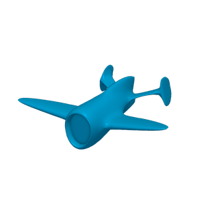 | [aircraft_quadwild](preview/a.smooth_zero/aircraft_quadwild.stl) | 0 | 13.687 | 41.055 | 27.370 | [^1] (repaired) |
|  | [airplane1_gao](preview/a.smooth_zero/airplane1_gao.stl) | 0 | 9.417 | 28.245 | 18.830 | [^2] |
|  | [airplane2_gao](preview/a.smooth_zero/airplane2_gao.stl) | 0 | 26.806 | 80.412 | 53.608 | [^2] |
|  | [amogus_sketchfab](preview/a.smooth_zero/amogus_sketchfab.stl) | 0 | 964 | 2.886 | 1.924 | [^3] |
|  | [amogus_snoep](preview/a.smooth_zero/amogus_snoep.stl) | 0 | 3.061 | 9.177 | 6.118 | [^3] (remeshed) |
| 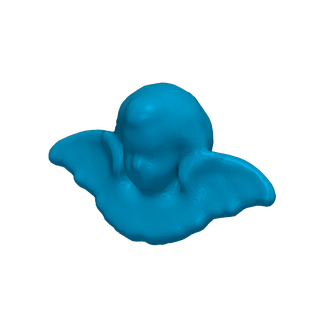 | [angel_quadwild](preview/a.smooth_zero/angel_quadwild.stl) | 0 | 4.468 | 13.398 | 8.932 | [^1] |
| 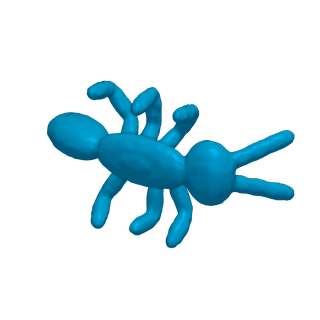 | [ants_shrec11](preview/a.smooth_zero/ants_shrec11.stl) | 0 | 9.497 | 28.485 | 18.990 | [^4] |
|  | [armadillo_gao](preview/a.smooth_zero/armadillo_gao.stl) | 0 | 15.508 | 46.518 | 31.012 | [^2] |
|  | [armadillo_jacobson](preview/a.smooth_zero/armadillo_jacobson.stl) | 0 | 49.990 | 149.964 | 99.976 | [^5] |
| 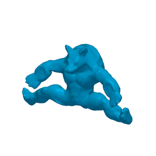 | [armadillo_shrec11](preview/a.smooth_zero/armadillo_shrec11.stl) | 0 | 9.485 | 28.449 | 18.966 | [^4] |
|  | [armadillo_stein](preview/a.smooth_zero/armadillo_stein.stl) | 0 | 14.587 | 43.755 | 29.170 | [^6] |
|  | [armchair_gao](preview/a.smooth_zero/armchair_gao.stl) | 0 | 12.972 | 38.910 | 25.940 | [^2] |
|  | [asiandragon_skel](preview/a.smooth_zero/asiandragon_skel.stl) | 0 | 29.999 | 89.991 | 59.994 | [^7] (repaired, simplified) |
| 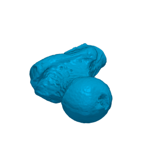 | [balljoint_skel](preview/a.smooth_zero/balljoint_skel.stl) | 0 | 137.062 | 411.180 | 274.120 | [^7] |
| 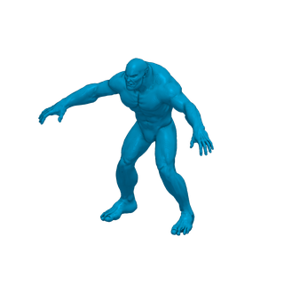 | [beast_jacobson](preview/a.smooth_zero/beast_jacobson.stl) | 0 | 30.544 | 91.626 | 61.084 | [^5] (repaired) |
| 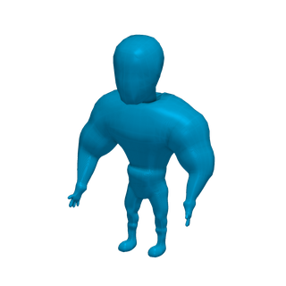 | [bigguy_quadwild](preview/a.smooth_zero/bigguy_quadwild.stl) | 0 | 6.786 | 20.352 | 13.568 | [^1] |
|  | [bimba_gao](preview/a.smooth_zero/bimba_gao.stl) | 0 | 10.797 | 32.385 | 21.590 | [^2] |
|  | [bimba_jacobson](preview/a.smooth_zero/bimba_jacobson.stl) | 0 | 29.995 | 89.979 | 59.986 | [^5] (simplified) |
|  | [bimba_loopy](preview/a.smooth_zero/bimba_loopy.stl) | 0 | 11.772 | 35.310 | 23.540 | [^8] |
| 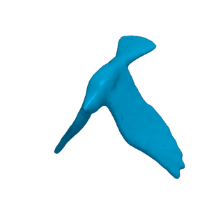 | [bird1_shrec11](preview/a.smooth_zero/bird1_shrec11.stl) | 0 | 9.500 | 28.494 | 18.996 | [^4] |
| 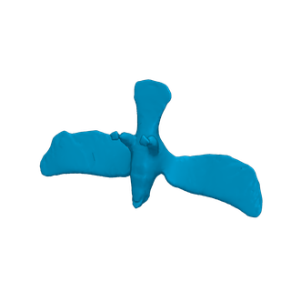 | [bird2_shrec11](preview/a.smooth_zero/bird2_shrec11.stl) | 0 | 9.441 | 28.317 | 18.878 | [^4] |
|  | [bird_gao](preview/a.smooth_zero/bird_gao.stl) | 0 | 17.318 | 51.948 | 34.632 | [^2] |
|  | [blade_gao](preview/a.smooth_zero/blade_gao.stl) | 0 | 14.106 | 42.312 | 28.208 | [^2] |
|  | [blade_loopy](preview/a.smooth_zero/blade_loopy.stl) | 0 | 14.532 | 43.590 | 29.060 | [^8] |
|  | [blub_crane](preview/a.smooth_zero/blub_crane.stl) | 0 | 7.106 | 21.312 | 14.208 | [^9] |
|  | [bone1_loopy](preview/a.smooth_zero/bone1_loopy.stl) | 0 | 1.566 | 4.692 | 3.128 | [^8] |
|  | [bone_gao](preview/a.smooth_zero/bone_gao.stl) | 0 | 6.046 | 18.132 | 12.088 | [^2] |
|  | [bonefemur_loopy](preview/a.smooth_zero/bonefemur_loopy.stl) | 0 | 4.666 | 13.992 | 9.328 | [^8] |
|  | [brain_skel](preview/a.smooth_zero/brain_skel.stl) | 0 | 29.906 | 89.712 | 59.808 | [^7] (repaired, simplified) |
|  | [brucewick_stein](preview/a.smooth_zero/brucewick_stein.stl) | 0 | 1.431 | 4.287 | 2.858 | [^6] |
|  | [bumpysphere_gao](preview/a.smooth_zero/bumpysphere_gao.stl) | 0 | 22.890 | 68.664 | 45.776 | [^2] |
| 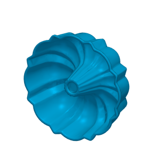 | [bundtpan_gso](preview/a.smooth_zero/bundtpan_gso.stl) | 0 | 8.028 | 24.078 | 16.052 | [^10] |
|  | [bunny_gao](preview/a.smooth_zero/bunny_gao.stl) | 0 | 11.247 | 33.735 | 22.490 | [^2] |
|  | [bunny_jacobson](preview/a.smooth_zero/bunny_jacobson.stl) | 0 | 35.188 | 105.558 | 70.372 | [^5] (repaired) |
|  | [bunny_loopy](preview/a.smooth_zero/bunny_loopy.stl) | 0 | 11.120 | 33.354 | 22.236 | [^8] |
| 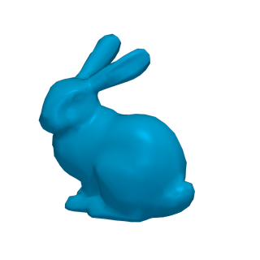 | [bunny_quadwild](preview/a.smooth_zero/bunny_quadwild.stl) | 0 | 1.077 | 3.225 | 2.150 | [^1] |
|  | [bunny_skel](preview/a.smooth_zero/bunny_skel.stl) | 0 | 35.188 | 105.558 | 70.372 | [^7] (repaired) |
|  | [bunny_snoep](preview/a.smooth_zero/bunny_snoep.stl) | 0 | 11.120 | 33.354 | 22.236 | [^8] (re-oriented) |
|  | [bunny_stein](preview/a.smooth_zero/bunny_stein.stl) | 0 | 3.301 | 9.897 | 6.598 | [^6] |
|  | [buste_gao](preview/a.smooth_zero/buste_gao.stl) | 0 | 17.341 | 52.017 | 34.678 | [^2] |
|  | [buste_loopy](preview/a.smooth_zero/buste_loopy.stl) | 0 | 6.070 | 18.204 | 12.136 | [^8] |
|  | [buste_polycut](preview/a.smooth_zero/buste_polycut.stl) | 0 | 30.002 | 90.000 | 60.000 | [^11] (simplified) |
|  | [buste_snoep](preview/a.smooth_zero/buste_snoep.stl) | 0 | 6.070 | 18.204 | 12.136 | [^8] (re-oriented) |
| 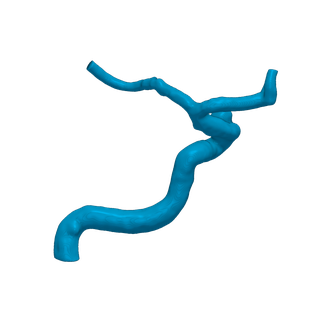 | [c0089_quadwild](preview/a.smooth_zero/c0089_quadwild.stl) | 0 | 30.386 | 91.152 | 60.768 | [^1] |
|  | [cactus_loopy](preview/a.smooth_zero/cactus_loopy.stl) | 0 | 700 | 2.094 | 1.396 | [^8] |
| 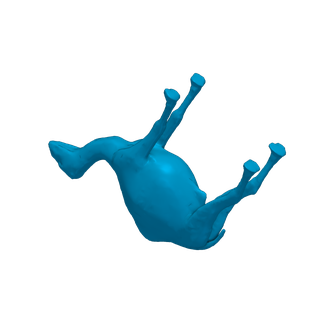 | [camel_shrec11](preview/a.smooth_zero/camel_shrec11.stl) | 0 | 9.184 | 27.546 | 18.364 | [^4] |
|  | [camillehand_gao](preview/a.smooth_zero/camillehand_gao.stl) | 0 | 16.565 | 49.689 | 33.126 | [^2] |
|  | [camillehand_loopy](preview/a.smooth_zero/camillehand_loopy.stl) | 0 | 3.705 | 11.109 | 7.406 | [^8] |
|  | [cat_loopy](preview/a.smooth_zero/cat_loopy.stl) | 0 | 2.332 | 6.990 | 4.660 | [^8] |
| 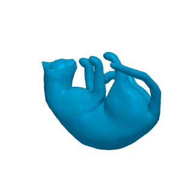 | [cat_shrec11](preview/a.smooth_zero/cat_shrec11.stl) | 0 | 9.497 | 28.485 | 18.990 | [^4] |
|  | [cat_stein](preview/a.smooth_zero/cat_stein.stl) | 0 | 7.949 | 23.841 | 15.894 | [^6] |
| 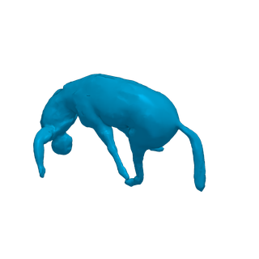 | [centaur_shrec11](preview/a.smooth_zero/centaur_shrec11.stl) | 0 | 9.404 | 28.206 | 18.804 | [^4] |
|  | [cheese_stein](preview/a.smooth_zero/cheese_stein.stl) | 0 | 30.002 | 90.000 | 60.000 | [^6] (simplified) |
| 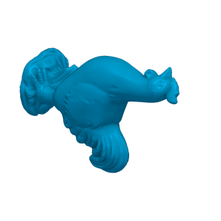 | [chicken_skel](preview/a.smooth_zero/chicken_skel.stl) | 0 | 30.001 | 89.997 | 59.998 | [^7] (simplified) |
|  | [chineselion_gao](preview/a.smooth_zero/chineselion_gao.stl) | 0 | 25.194 | 75.576 | 50.384 | [^2] |
|  | [chineselion_loopy](preview/a.smooth_zero/chineselion_loopy.stl) | 0 | 4.248 | 12.738 | 8.492 | [^8] |
|  | [chineselion_snoep](preview/a.smooth_zero/chineselion_snoep.stl) | 0 | 4.248 | 12.738 | 8.492 | [^8] (re-oriented) |
|  | [completepart16_gao](preview/a.smooth_zero/completepart16_gao.stl) | 0 | 3.840 | 11.514 | 7.676 | [^2] |
|  | [completepart63_gao](preview/a.smooth_zero/completepart63_gao.stl) | 0 | 3.840 | 11.514 | 7.676 | [^2] |
|  | [constantwidth_crane](preview/a.smooth_zero/constantwidth_crane.stl) | 0 | 19.802 | 59.400 | 39.600 | [^9] |
| 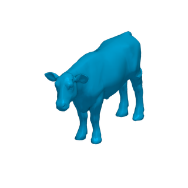 | [cow2_quadwild](preview/a.smooth_zero/cow2_quadwild.stl) | 0 | 4.315 | 12.939 | 8.626 | [^1] |
| 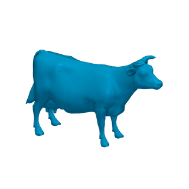 | [cow_jacobson](preview/a.smooth_zero/cow_jacobson.stl) | 0 | 2.903 | 8.706 | 5.804 | [^5] |
|  | [david_gao](preview/a.smooth_zero/david_gao.stl) | 0 | 25.434 | 76.296 | 50.864 | [^2] |
|  | [deformedarmadillo_gao](preview/a.smooth_zero/deformedarmadillo_gao.stl) | 0 | 87.286 | 261.852 | 174.568 | [^2] |
|  | [dente_gao](preview/a.smooth_zero/dente_gao.stl) | 0 | 12.195 | 36.579 | 24.386 | [^2] |
| 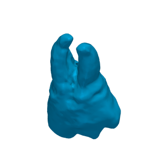 | [dente_skel](preview/a.smooth_zero/dente_skel.stl) | 0 | 9.337 | 28.005 | 18.670 | [^7] |
|  | [dilo_gao](preview/a.smooth_zero/dilo_gao.stl) | 0 | 22.154 | 66.456 | 44.304 | [^2] |
| 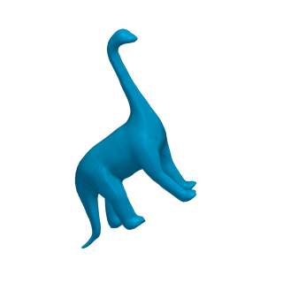 | [dino0_quadwild](preview/a.smooth_zero/dino0_quadwild.stl) | 0 | 4.514 | 13.536 | 9.024 | [^1] |
| 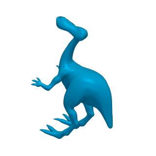 | [dino1_quadwild](preview/a.smooth_zero/dino1_quadwild.stl) | 0 | 9.058 | 27.168 | 18.112 | [^1] |
|  | [dino2_gao](preview/a.smooth_zero/dino2_gao.stl) | 0 | 10.178 | 30.528 | 20.352 | [^2] |
|  | [dino_gao](preview/a.smooth_zero/dino_gao.stl) | 0 | 16.634 | 49.896 | 33.264 | [^2] |
| 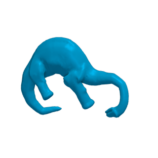 | [dinosaur_shrec11](preview/a.smooth_zero/dinosaur_shrec11.stl) | 0 | 9.503 | 28.503 | 19.002 | [^4] |
| 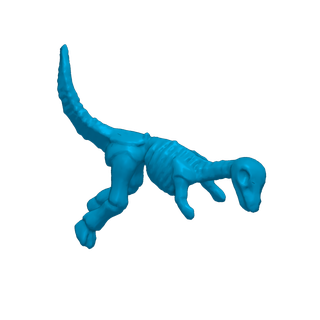 | [dinoskeleton_shrec11](preview/a.smooth_zero/dinoskeleton_shrec11.stl) | 0 | 9.501 | 28.497 | 18.998 | [^4] |
| 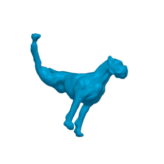 | [dog1_shrec11](preview/a.smooth_zero/dog1_shrec11.stl) | 0 | 9.450 | 28.344 | 18.896 | [^4] |
| 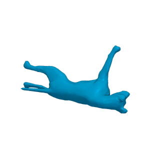 | [dog2_shrec11](preview/a.smooth_zero/dog2_shrec11.stl) | 0 | 9.403 | 28.203 | 18.802 | [^4] |
|  | [dog_loopy](preview/a.smooth_zero/dog_loopy.stl) | 0 | 3.084 | 9.246 | 6.164 | [^8] |
|  | [duck2_gao](preview/a.smooth_zero/duck2_gao.stl) | 0 | 9.640 | 28.914 | 19.276 | [^2] |
|  | [duck_gao](preview/a.smooth_zero/duck_gao.stl) | 0 | 3.598 | 10.788 | 7.192 | [^2] |
|  | [ellipse_loopy](preview/a.smooth_zero/ellipse_loopy.stl) | 0 | 554 | 1.656 | 1.104 | [^8] |
|  | [eros_gao](preview/a.smooth_zero/eros_gao.stl) | 0 | 25.001 | 74.997 | 49.998 | [^2] |
|  | [falconstatue_stein](preview/a.smooth_zero/falconstatue_stein.stl) | 0 | 25.839 | 77.511 | 51.674 | [^6] |
| 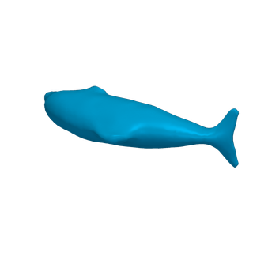 | [fish0_quadwild](preview/a.smooth_zero/fish0_quadwild.stl) | 0 | 3.048 | 9.138 | 6.092 | [^1] |
|  | [fish1_gao](preview/a.smooth_zero/fish1_gao.stl) | 0 | 11.895 | 35.679 | 23.786 | [^2] |
|  | [fish2_gao](preview/a.smooth_zero/fish2_gao.stl) | 0 | 10.604 | 31.806 | 21.204 | [^2] |
|  | [fish_stein](preview/a.smooth_zero/fish_stein.stl) | 0 | 10.786 | 32.352 | 21.568 | [^6] |
|  | [flamingo_shrec11](preview/a.smooth_zero/flamingo_shrec11.stl) | 0 | 9.148 | 27.438 | 18.292 | [^4] |
|  | [foot_gao](preview/a.smooth_zero/foot_gao.stl) | 0 | 10.342 | 31.020 | 20.680 | [^2] |
| 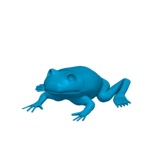 | [frog_skel](preview/a.smooth_zero/frog_skel.stl) | 0 | 37.225 | 111.669 | 74.446 | [^7] |
| 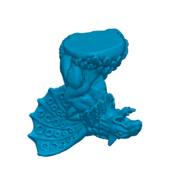 | [gargoyle2_quadwild](preview/a.smooth_zero/gargoyle2_quadwild.stl) | 0 | 50.002 | 150.000 | 100.000 | [^1] |
|  | [gargoyle_gao](preview/a.smooth_zero/gargoyle_gao.stl) | 0 | 13.024 | 39.066 | 26.044 | [^2] |
|  | [ghost_snoep](preview/a.smooth_zero/ghost_snoep.stl) | 0 | 1.698 | 5.088 | 3.392 | [^12] (re-oriented) |
|  | [ghost_thingi](preview/a.smooth_zero/ghost_thingi.stl) | 0 | 1.698 | 5.088 | 3.392 | [^12] |
|  | [glass1_gao](preview/a.smooth_zero/glass1_gao.stl) | 0 | 29.674 | 89.016 | 59.344 | [^2] |
|  | [glass2_gao](preview/a.smooth_zero/glass2_gao.stl) | 0 | 11.710 | 35.124 | 23.416 | [^2] |
| 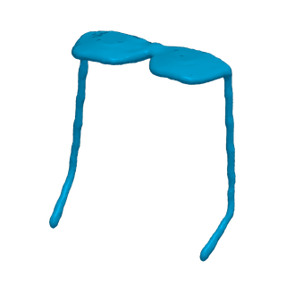 | [glasses_shrec11](preview/a.smooth_zero/glasses_shrec11.stl) | 0 | 9.500 | 28.494 | 18.996 | [^4] |
|  | [goathead_snoep](preview/a.smooth_zero/goathead_snoep.stl) | 0 | 2.763 | 8.283 | 5.522 | [^6] (re-oriented) |
|  | [goathead_stein](preview/a.smooth_zero/goathead_stein.stl) | 0 | 2.763 | 8.283 | 5.522 | [^6] |
| 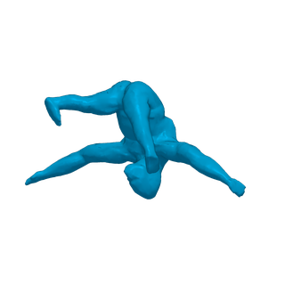 | [gorilla_shrec11](preview/a.smooth_zero/gorilla_shrec11.stl) | 0 | 9.318 | 27.948 | 18.632 | [^4] |
| 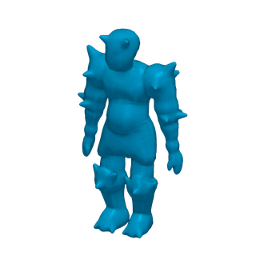 | [guy_quadwild](preview/a.smooth_zero/guy_quadwild.stl) | 0 | 9.474 | 28.416 | 18.944 | [^1] |
|  | [hand_gao](preview/a.smooth_zero/hand_gao.stl) | 0 | 13.982 | 41.940 | 27.960 | [^2] |
|  | [hand_loopy](preview/a.smooth_zero/hand_loopy.stl) | 0 | 2.474 | 7.416 | 4.944 | [^8] |
| 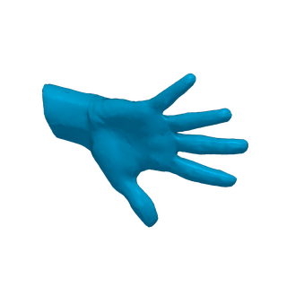 | [hand_shrec11](preview/a.smooth_zero/hand_shrec11.stl) | 0 | 9.497 | 28.485 | 18.990 | [^4] |
|  | [hand_stein](preview/a.smooth_zero/hand_stein.stl) | 0 | 7.993 | 23.973 | 15.982 | [^6] |
|  | [head1_gao](preview/a.smooth_zero/head1_gao.stl) | 0 | 14.399 | 43.191 | 28.794 | [^2] |
|  | [head2_gao](preview/a.smooth_zero/head2_gao.stl) | 0 | 14.754 | 44.256 | 29.504 | [^2] |
|  | [hh_skel](preview/a.smooth_zero/hh_skel.stl) | 0 | 52.098 | 156.288 | 104.192 | [^7] (repaired) |
| 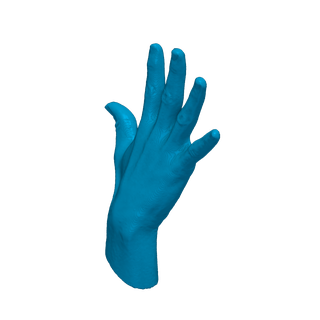 | [hht_skel](preview/a.smooth_zero/hht_skel.stl) | 0 | 55.693 | 167.073 | 111.382 | [^7] (repaired) |
| 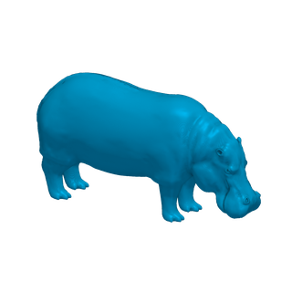 | [hippo_skel](preview/a.smooth_zero/hippo_skel.stl) | 0 | 39.548 | 118.638 | 79.092 | [^7] (repaired) |
|  | [homer_gao](preview/a.smooth_zero/homer_gao.stl) | 0 | 13.639 | 40.911 | 27.274 | [^2] |
| 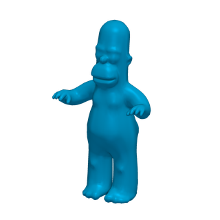 | [homer_jacobson](preview/a.smooth_zero/homer_jacobson.stl) | 0 | 6.002 | 18.000 | 12.000 | [^5] |
|  | [horse_gao](preview/a.smooth_zero/horse_gao.stl) | 0 | 19.851 | 59.547 | 39.698 | [^2] |
|  | [horse_jacobson](preview/a.smooth_zero/horse_jacobson.stl) | 0 | 48.485 | 145.449 | 96.966 | [^5] |
| 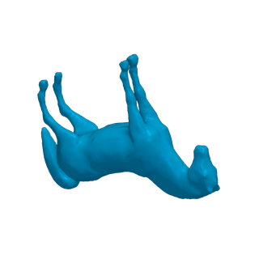 | [horse_shrec11](preview/a.smooth_zero/horse_shrec11.stl) | 0 | 9.497 | 28.485 | 18.990 | [^4] |
|  | [human1_gao](preview/a.smooth_zero/human1_gao.stl) | 0 | 10.231 | 30.687 | 20.458 | [^2] |
|  | [human2_gao](preview/a.smooth_zero/human2_gao.stl) | 0 | 12.794 | 38.376 | 25.584 | [^2] |
|  | [human3_gao](preview/a.smooth_zero/human3_gao.stl) | 0 | 12.329 | 36.981 | 24.654 | [^2] |
|  | [humanhand_skel](preview/a.smooth_zero/humanhand_skel.stl) | 0 | 52.345 | 157.029 | 104.686 | [^7] (repaired) |
|  | [humanman_stein](preview/a.smooth_zero/humanman_stein.stl) | 0 | 6.890 | 20.664 | 13.776 | [^6] |
|  | [humanneutral_stein](preview/a.smooth_zero/humanneutral_stein.stl) | 0 | 9.437 | 28.305 | 18.870 | [^6] (repaired) |
|  | [humanwoman_stein](preview/a.smooth_zero/humanwoman_stein.stl) | 0 | 6.890 | 20.664 | 13.776 | [^6] |
| 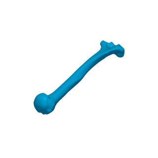 | [humerus_skel](preview/a.smooth_zero/humerus_skel.stl) | 0 | 35.002 | 105.000 | 70.000 | [^7] |
|  | [igea_gao](preview/a.smooth_zero/igea_gao.stl) | 0 | 25.282 | 75.840 | 50.560 | [^2] |
|  | [igea_jacobson](preview/a.smooth_zero/igea_jacobson.stl) | 0 | 30.001 | 89.997 | 59.998 | [^5] (simplified) |
|  | [inigo_crane](preview/a.smooth_zero/inigo_crane.stl) | 0 | 29.995 | 89.979 | 59.986 | [^9] (repaired, simplified) |
|  | [insect_gao](preview/a.smooth_zero/insect_gao.stl) | 0 | 39.370 | 118.104 | 78.736 | [^2] |
|  | [isidorehorse_gao](preview/a.smooth_zero/isidorehorse_gao.stl) | 0 | 19.465 | 58.389 | 38.926 | [^2] |
| 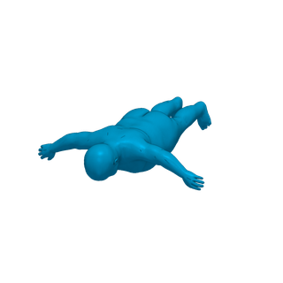 | [kid00_topkids](preview/a.smooth_zero/kid00_topkids.stl) | 0 | 11.510 | 34.524 | 23.016 | [^13] (repaired) |
|  | [koala_stein](preview/a.smooth_zero/koala_stein.stl) | 0 | 3.560 | 10.674 | 7.116 | [^6] |
|  | [kong_loopy](preview/a.smooth_zero/kong_loopy.stl) | 0 | 15.778 | 47.328 | 31.552 | [^8] |
| 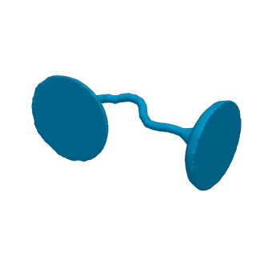 | [lamp_shrec11](preview/a.smooth_zero/lamp_shrec11.stl) | 0 | 9.493 | 28.473 | 18.982 | [^4] |
| 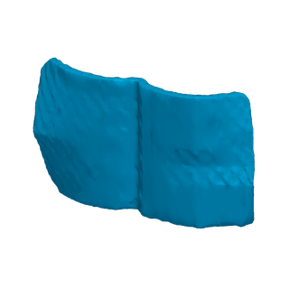 | [laptop_shrec11](preview/a.smooth_zero/laptop_shrec11.stl) | 0 | 9.493 | 28.473 | 18.982 | [^4] |
| 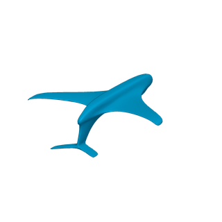 | [lenka_quadwild](preview/a.smooth_zero/lenka_quadwild.stl) | 0 | 6.001 | 17.997 | 11.998 | [^1] |
|  | [lion_gao](preview/a.smooth_zero/lion_gao.stl) | 0 | 27.899 | 83.691 | 55.794 | [^2] |
| 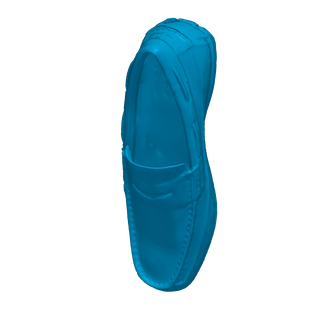 | [loafer_gso](preview/a.smooth_zero/loafer_gso.stl) | 0 | 14.098 | 42.288 | 28.192 | [^10] |
| 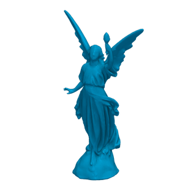 | [lucy_quadwild](preview/a.smooth_zero/lucy_quadwild.stl) | 0 | 46.090 | 138.264 | 92.176 | [^1] |
| 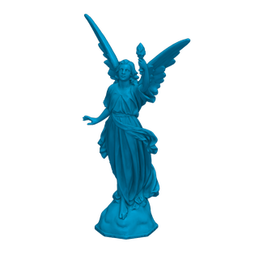 | [lucy_skel](preview/a.smooth_zero/lucy_skel.stl) | 0 | 29.989 | 89.961 | 59.974 | [^7] (simplified) |
| 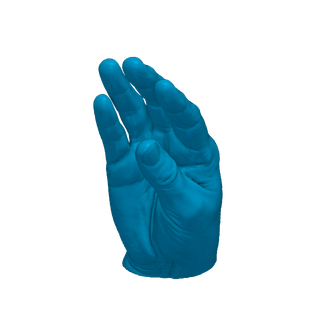 | [magaliehand_quadwild](preview/a.smooth_zero/magaliehand_quadwild.stl) | 0 | 50.002 | 150.000 | 100.000 | [^1] |
| 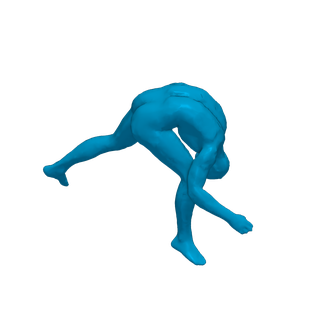 | [man_shrec11](preview/a.smooth_zero/man_shrec11.stl) | 0 | 9.369 | 28.101 | 18.734 | [^4] |
|  | [mannequindevil_quadwild](preview/a.smooth_zero/mannequindevil_quadwild.stl) | 0 | 15.445 | 46.329 | 30.886 | [^1] (repaired) |
| 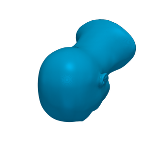 | [mannequinmc_quadwild](preview/a.smooth_zero/mannequinmc_quadwild.stl) | 0 | 30.002 | 90.000 | 60.000 | [^1] (repaired, simplified) |
|  | [max_gao](preview/a.smooth_zero/max_gao.stl) | 0 | 9.936 | 29.802 | 19.868 | [^2] |
|  | [max_jacobson](preview/a.smooth_zero/max_jacobson.stl) | 0 | 51.212 | 153.630 | 102.420 | [^5] (repaired) |
| 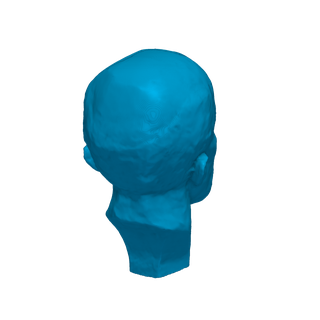 | [maxplanck_quadwild](preview/a.smooth_zero/maxplanck_quadwild.stl) | 0 | 54.032 | 162.090 | 108.060 | [^1] (repaired) |
| 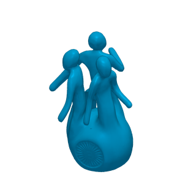 | [memento_skel](preview/a.smooth_zero/memento_skel.stl) | 0 | 26.277 | 78.825 | 52.550 | [^7] |
| 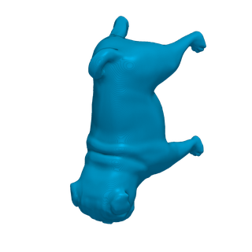 | [mesh18_quadwild](preview/a.smooth_zero/mesh18_quadwild.stl) | 0 | 25.002 | 75.000 | 50.000 | [^1] (repaired) |
|  | [moai_gao](preview/a.smooth_zero/moai_gao.stl) | 0 | 10.002 | 30.000 | 20.000 | [^2] |
|  | [mouse_gao](preview/a.smooth_zero/mouse_gao.stl) | 0 | 13.961 | 41.877 | 27.918 | [^2] |
|  | [mushroom_stein](preview/a.smooth_zero/mushroom_stein.stl) | 0 | 11.585 | 34.749 | 23.166 | [^6] |
|  | [nefertiti_crane](preview/a.smooth_zero/nefertiti_crane.stl) | 0 | 29.999 | 89.991 | 59.994 | [^9] (simplified) |
|  | [nefertiti_jacobson](preview/a.smooth_zero/nefertiti_jacobson.stl) | 0 | 49.971 | 149.907 | 99.938 | [^5] |
|  | [nefertiti_stein](preview/a.smooth_zero/nefertiti_stein.stl) | 0 | 29.999 | 89.991 | 59.994 | [^6] (simplified) |
|  | [noisydino_skel](preview/a.smooth_zero/noisydino_skel.stl) | 0 | 23.208 | 69.618 | 46.412 | [^7] (repaired) |
|  | [octopus_quadwild](preview/a.smooth_zero/octopus_quadwild.stl) | 0 | 3.258 | 9.768 | 6.512 | [^1] |
|  | [octopus_shrec11](preview/a.smooth_zero/octopus_shrec11.stl) | 0 | 9.495 | 28.479 | 18.986 | [^4] |
|  | [ogre_crane](preview/a.smooth_zero/ogre_crane.stl) | 0 | 19.446 | 58.332 | 38.888 | [^9] (repaired) |
|  | [ogre_jacobson](preview/a.smooth_zero/ogre_jacobson.stl) | 0 | 25.669 | 77.001 | 51.334 | [^5] (repaired, simplified) |
|  | [oni_gao](preview/a.smooth_zero/oni_gao.stl) | 0 | 12.887 | 38.655 | 25.770 | [^2] |
|  | [panda_gso](preview/a.smooth_zero/panda_gso.stl) | 0 | 5.311 | 15.927 | 10.618 | [^10] |
|  | [pear_gao](preview/a.smooth_zero/pear_gao.stl) | 0 | 10.754 | 32.256 | 21.504 | [^2] |
|  | [penguin_stein](preview/a.smooth_zero/penguin_stein.stl) | 0 | 3.362 | 10.080 | 6.720 | [^6] |
|  | [pensatore_gao](preview/a.smooth_zero/pensatore_gao.stl) | 0 | 19.624 | 58.866 | 39.244 | [^2] |
|  | [pierrot_gao](preview/a.smooth_zero/pierrot_gao.stl) | 0 | 16.551 | 49.647 | 33.098 | [^2] |
|  | [pig_crane](preview/a.smooth_zero/pig_crane.stl) | 0 | 4.434 | 13.296 | 8.864 | [^9] (repaired) |
|  | [pig_gao](preview/a.smooth_zero/pig_gao.stl) | 0 | 15.594 | 46.776 | 31.184 | [^2] |
|  | [pig_loopy](preview/a.smooth_zero/pig_loopy.stl) | 0 | 3.166 | 9.492 | 6.328 | [^8] |
|  | [pliers_shrec11](preview/a.smooth_zero/pliers_shrec11.stl) | 0 | 9.499 | 28.491 | 18.994 | [^4] |
|  | [polygirl_quadwild](preview/a.smooth_zero/polygirl_quadwild.stl) | 0 | 8.506 | 25.512 | 17.008 | [^1] (repaired) |
|  | [rabbit_loopy](preview/a.smooth_zero/rabbit_loopy.stl) | 0 | 8.002 | 24.000 | 16.000 | [^8] |
|  | [rabbit_shrec11](preview/a.smooth_zero/rabbit_shrec11.stl) | 0 | 9.484 | 28.446 | 18.964 | [^4] |
|  | [ramses_gao](preview/a.smooth_zero/ramses_gao.stl) | 0 | 13.505 | 40.509 | 27.006 | [^2] |
|  | [rcube_skel](preview/a.smooth_zero/rcube_skel.stl) | 0 | 24.578 | 73.728 | 49.152 | [^7] |
|  | [redbox_gao](preview/a.smooth_zero/redbox_gao.stl) | 0 | 50.002 | 150.000 | 100.000 | [^2] |
|  | [redcircularbox_quadwild](preview/a.smooth_zero/redcircularbox_quadwild.stl) | 0 | 50.002 | 150.000 | 100.000 | [^1] |
|  | [retinal_gao](preview/a.smooth_zero/retinal_gao.stl) | 0 | 14.566 | 43.692 | 29.128 | [^2] |
|  | [rgbdragon_quadwild](preview/a.smooth_zero/rgbdragon_quadwild.stl) | 0 | 52.513 | 157.533 | 105.022 | [^1] |
|  | [santa_gao](preview/a.smooth_zero/santa_gao.stl) | 0 | 10.406 | 31.212 | 20.808 | [^2] |
|  | [santa_shrec11](preview/a.smooth_zero/santa_shrec11.stl) | 0 | 9.501 | 28.497 | 18.998 | [^4] |
|  | [scapula_skel](preview/a.smooth_zero/scapula_skel.stl) | 0 | 30.001 | 89.997 | 59.998 | [^7] (simplified) |
|  | [scissors_shrec11](preview/a.smooth_zero/scissors_shrec11.stl) | 0 | 9.454 | 28.356 | 18.904 | [^4] |
|  | [scorpion_stein](preview/a.smooth_zero/scorpion_stein.stl) | 0 | 6.315 | 18.939 | 12.626 | [^6] |
|  | [screwdriver_gao](preview/a.smooth_zero/screwdriver_gao.stl) | 0 | 24.568 | 73.698 | 49.132 | [^2] |
|  | [sediapatch_gao](preview/a.smooth_zero/sediapatch_gao.stl) | 0 | 15.584 | 46.746 | 31.164 | [^2] |
|  | [shark_quadwild](preview/a.smooth_zero/shark_quadwild.stl) | 0 | 10.054 | 30.156 | 20.104 | [^1] |
|  | [shark_shrec11](preview/a.smooth_zero/shark_shrec11.stl) | 0 | 7.734 | 23.196 | 15.464 | [^4] |
|  | [snake_shrec11](preview/a.smooth_zero/snake_shrec11.stl) | 0 | 9.497 | 28.485 | 18.990 | [^4] |
|  | [sphere_stein](preview/a.smooth_zero/sphere_stein.stl) | 0 | 642 | 1.920 | 1.280 | [^6] |
|  | [sphinx_gao](preview/a.smooth_zero/sphinx_gao.stl) | 0 | 10.608 | 31.818 | 21.212 | [^2] |
|  | [sphinx_loopy](preview/a.smooth_zero/sphinx_loopy.stl) | 0 | 10.184 | 30.546 | 20.364 | [^8] |
|  | [spider_skel](preview/a.smooth_zero/spider_skel.stl) | 0 | 882 | 2.640 | 1.760 | [^7] (repaired) |
|  | [spiders_shrec11](preview/a.smooth_zero/spiders_shrec11.stl) | 0 | 9.501 | 28.497 | 18.998 | [^4] |
|  | [spot_crane](preview/a.smooth_zero/spot_crane.stl) | 0 | 2.930 | 8.784 | 5.856 | [^9] |
|  | [spot_snoep](preview/a.smooth_zero/spot_snoep.stl) | 0 | 11.533 | 34.593 | 23.062 | [^6] (re-oriented) |
|  | [spot_stein](preview/a.smooth_zero/spot_stein.stl) | 0 | 11.533 | 34.593 | 23.062 | [^6] |
|  | [springer_stein](preview/a.smooth_zero/springer_stein.stl) | 0 | 9.686 | 29.052 | 19.368 | [^6] |
|  | [squirrel_polycut](preview/a.smooth_zero/squirrel_polycut.stl) | 0 | 29.210 | 87.624 | 58.416 | [^11] |
|  | [strawberry_stein](preview/a.smooth_zero/strawberry_stein.stl) | 0 | 29.992 | 89.970 | 59.980 | [^6] (simplified) |
|  | [stuffedtoy_stein](preview/a.smooth_zero/stuffedtoy_stein.stl) | 0 | 6.669 | 20.001 | 13.334 | [^6] |
|  | [sword_stein](preview/a.smooth_zero/sword_stein.stl) | 0 | 22.293 | 66.873 | 44.582 | [^6] |
|  | [torque1_loopy](preview/a.smooth_zero/torque1_loopy.stl) | 0 | 2.850 | 8.544 | 5.696 | [^8] |
|  | [torque_loopy](preview/a.smooth_zero/torque_loopy.stl) | 0 | 1.652 | 4.950 | 3.300 | [^8] |
|  | [torso_quadwild](preview/a.smooth_zero/torso_quadwild.stl) | 0 | 50.002 | 150.000 | 100.000 | [^1] |
|  | [toy1_gao](preview/a.smooth_zero/toy1_gao.stl) | 0 | 13.452 | 40.350 | 26.900 | [^2] |
|  | [toy1_quadwild](preview/a.smooth_zero/toy1_quadwild.stl) | 0 | 5.018 | 15.048 | 10.032 | [^1] |
|  | [toy2_gao](preview/a.smooth_zero/toy2_gao.stl) | 0 | 10.755 | 32.259 | 21.506 | [^2] |
|  | [toy2_quadwild](preview/a.smooth_zero/toy2_quadwild.stl) | 0 | 4.290 | 12.864 | 8.576 | [^1] |
|  | [trebol_loopy](preview/a.smooth_zero/trebol_loopy.stl) | 0 | 18.176 | 54.522 | 36.348 | [^8] |
|  | [tree_stein](preview/a.smooth_zero/tree_stein.stl) | 0 | 30.000 | 89.994 | 59.996 | [^6] (simplified) |
|  | [twoballs_shrec11](preview/a.smooth_zero/twoballs_shrec11.stl) | 0 | 9.500 | 28.494 | 18.996 | [^4] |
|  | [uumemento_gao](preview/a.smooth_zero/uumemento_gao.stl) | 0 | 46.510 | 139.524 | 93.016 | [^2] |
|  | [vaselion_quadwild](preview/a.smooth_zero/vaselion_quadwild.stl) | 0 | 26.681 | 80.037 | 53.358 | [^1] |
|  | [venus_gao](preview/a.smooth_zero/venus_gao.stl) | 0 | 10.874 | 32.616 | 21.744 | [^2] |
|  | [vessel_loopy](preview/a.smooth_zero/vessel_loopy.stl) | 0 | 2.658 | 7.968 | 5.312 | [^8] |
|  | [woman_shrec11](preview/a.smooth_zero/woman_shrec11.stl) | 0 | 9.229 | 27.681 | 18.454 | [^4] |
|  | [woodenfish_gao](preview/a.smooth_zero/woodenfish_gao.stl) | 0 | 15.940 | 47.814 | 31.876 | [^2] |

### (b) smooth (g≥1, n=101)
| &nbsp;&nbsp;&nbsp;&nbsp;&nbsp;&nbsp;&nbsp;&nbsp;&nbsp;&nbsp;&nbsp;&nbsp;&nbsp;&nbsp;&nbsp;&nbsp;&nbsp;&nbsp;&nbsp;&nbsp;&nbsp;&nbsp;&nbsp;&nbsp;&nbsp;&nbsp;&nbsp;&nbsp;&nbsp;&nbsp;&nbsp;&nbsp;&nbsp;&nbsp; | model | genus | vertices | edges | triangles | source |
|-|-------|-------|----------|-------|-----------|--------|
|  | [17674_skel](preview/b.smooth_plus/17674_skel.stl) | 2 | 29.211 | 87.639 | 58.426 | [^7] (repaired, simplified) |
|  | [3holes_quadwild](preview/b.smooth_plus/3holes_quadwild.stl) | 3 | 9.847 | 29.553 | 19.702 | [^1] |
|  | [alien_shrec11](preview/b.smooth_plus/alien_shrec11.stl) | 1 | 9.388 | 28.164 | 18.776 | [^4] |
|  | [backdoor_esb](preview/b.smooth_plus/backdoor_esb.stl) | 1 | 1.368 | 4.104 | 2.736 | [^14] |
|  | [bamboopen_quadwild](preview/b.smooth_plus/bamboopen_quadwild.stl) | 8 | 17.832 | 53.538 | 35.692 | [^1] |
|  | [bob_crane](preview/b.smooth_plus/bob_crane.stl) | 1 | 5.344 | 16.032 | 10.688 | [^9] |
|  | [boot_stein](preview/b.smooth_plus/boot_stein.stl) | 12 | 19.931 | 59.859 | 39.906 | [^6] |
|  | [botijo_gao](preview/b.smooth_plus/botijo_gao.stl) | 5 | 12.127 | 36.405 | 24.270 | [^2] |
|  | [bottle1_gao](preview/b.smooth_plus/bottle1_gao.stl) | 1 | 14.832 | 44.496 | 29.664 | [^2] |
|  | [bottle2_gao](preview/b.smooth_plus/bottle2_gao.stl) | 1 | 14.595 | 43.785 | 29.190 | [^2] |
|  | [bozbezbozzel_quadwild](preview/b.smooth_plus/bozbezbozzel_quadwild.stl) | 5 | 24.992 | 75.000 | 50.000 | [^1] |
|  | [brain_quadwild](preview/b.smooth_plus/brain_quadwild.stl) | 57 | 49.888 | 150.000 | 100.000 | [^1] |
|  | [buddha_stanford](preview/b.smooth_plus/buddha_stanford.stl) | 10 | 29.419 | 88.311 | 58.874 | [^15] (repaired, simplified) |
|  | [bumpytorus_gao](preview/b.smooth_plus/bumpytorus_gao.stl) | 1 | 15.279 | 45.837 | 30.558 | [^2] |
|  | [camel_gao](preview/b.smooth_plus/camel_gao.stl) | 1 | 34.546 | 103.638 | 69.092 | [^2] |
|  | [centaur_tds](preview/b.smooth_plus/centaur_tds.stl) | 9 | 29.973 | 89.967 | 59.978 | [^16] (repaired, simplified, rescaled) |
|  | [chair1_gao](preview/b.smooth_plus/chair1_gao.stl) | 4 | 11.421 | 34.281 | 22.854 | [^2] |
|  | [chair_gao](preview/b.smooth_plus/chair_gao.stl) | 7 | 23.081 | 69.279 | 46.186 | [^2] |
|  | [coffeemug_gso](preview/b.smooth_plus/coffeemug_gso.stl) | 1 | 5.612 | 16.836 | 11.224 | [^10] |
|  | [cow_stein](preview/b.smooth_plus/cow_stein.stl) | 1 | 29.991 | 89.973 | 59.982 | [^6] (simplified) |
|  | [cup1_gao](preview/b.smooth_plus/cup1_gao.stl) | 1 | 15.564 | 46.692 | 31.128 | [^2] |
|  | [cup_gao](preview/b.smooth_plus/cup_gao.stl) | 2 | 10.495 | 31.491 | 20.994 | [^2] |
|  | [dancer2_gao](preview/b.smooth_plus/dancer2_gao.stl) | 1 | 30.248 | 90.744 | 60.496 | [^2] |
|  | [dancer_gao](preview/b.smooth_plus/dancer_gao.stl) | 1 | 12.048 | 36.144 | 24.096 | [^2] |
|  | [dancer_loopy](preview/b.smooth_plus/dancer_loopy.stl) | 1 | 24.998 | 74.994 | 49.996 | [^8] |
|  | [dancingchildren_gao](preview/b.smooth_plus/dancingchildren_gao.stl) | 8 | 12.163 | 36.531 | 24.354 | [^2] |
|  | [demosthenes_stein](preview/b.smooth_plus/demosthenes_stein.stl) | 1 | 29.965 | 89.895 | 59.930 | [^6] (repaired, simplified) |
|  | [desertrose_crane](preview/b.smooth_plus/desertrose_crane.stl) | 1 | 31.680 | 95.040 | 63.360 | [^9] (repaired) |
|  | [doubletorus_quadwild](preview/b.smooth_plus/doubletorus_quadwild.stl) | 2 | 2.353 | 7.065 | 4.710 | [^1] |
|  | [dragon0_quadwild](preview/b.smooth_plus/dragon0_quadwild.stl) | 1 | 26.176 | 78.528 | 52.352 | [^1] |
|  | [dragon_stanford](preview/b.smooth_plus/dragon_stanford.stl) | 3 | 29.750 | 89.262 | 59.508 | [^15] (repaired, simplified) |
|  | [dragonstand2_gao](preview/b.smooth_plus/dragonstand2_gao.stl) | 1 | 30.561 | 91.683 | 61.122 | [^2] |
|  | [dragonstand_gao](preview/b.smooth_plus/dragonstand_gao.stl) | 1 | 21.042 | 63.126 | 42.084 | [^2] |
|  | [dtorus_gao](preview/b.smooth_plus/dtorus_gao.stl) | 2 | 10.090 | 30.276 | 20.184 | [^2] |
|  | [dustpan_gso](preview/b.smooth_plus/dustpan_gso.stl) | 4 | 7.322 | 21.984 | 14.656 | [^10] |
|  | [eight_gao](preview/b.smooth_plus/eight_gao.stl) | 2 | 5.544 | 16.638 | 11.092 | [^2] |
|  | [ele_skel](preview/b.smooth_plus/ele_skel.stl) | 3 | 50.484 | 151.464 | 100.976 | [^7] |
|  | [elephant_gao](preview/b.smooth_plus/elephant_gao.stl) | 3 | 38.084 | 114.264 | 76.176 | [^2] |
|  | [elk_gao](preview/b.smooth_plus/elk_gao.stl) | 1 | 23.114 | 69.342 | 46.228 | [^2] |
|  | [feline_quadwild](preview/b.smooth_plus/feline_quadwild.stl) | 2 | 20.659 | 61.983 | 41.322 | [^1] |
|  | [femur_quadwild](preview/b.smooth_plus/femur_quadwild.stl) | 2 | 3.897 | 11.697 | 7.798 | [^1] |
|  | [fertility_gao](preview/b.smooth_plus/fertility_gao.stl) | 4 | 26.222 | 78.684 | 52.456 | [^2] |
|  | [filigree_quadwild](preview/b.smooth_plus/filigree_quadwild.stl) | 65 | 49.872 | 150.000 | 100.000 | [^1] |
|  | [genus3_gao](preview/b.smooth_plus/genus3_gao.stl) | 3 | 33.952 | 101.868 | 67.912 | [^2] |
|  | [grayloc_gao](preview/b.smooth_plus/grayloc_gao.stl) | 9 | 11.339 | 34.065 | 22.710 | [^2] |
|  | [greek_gao](preview/b.smooth_plus/greek_gao.stl) | 4 | 12.501 | 37.521 | 25.014 | [^2] |
|  | [greeksculpture_quadwild](preview/b.smooth_plus/greeksculpture_quadwild.stl) | 4 | 24.994 | 75.000 | 50.000 | [^1] |
|  | [greyhounds_tds](preview/b.smooth_plus/greyhounds_tds.stl) | 5 | 29.981 | 89.967 | 59.978 | [^16] (repaired, simplified) |
|  | [helmet_quadwild](preview/b.smooth_plus/helmet_quadwild.stl) | 3 | 496 | 1.500 | 1.000 | [^1] |
|  | [heptoroid_skel](preview/b.smooth_plus/heptoroid_skel.stl) | 22 | 29.957 | 89.997 | 59.998 | [^7] (simplified) |
|  | [holes2_loopy](preview/b.smooth_plus/holes2_loopy.stl) | 2 | 2.922 | 8.772 | 5.848 | [^8] |
|  | [holes3_gao](preview/b.smooth_plus/holes3_gao.stl) | 3 | 14.396 | 43.200 | 28.800 | [^2] |
|  | [hound_skel](preview/b.smooth_plus/hound_skel.stl) | 6 | 7.538 | 22.644 | 15.096 | [^7] (repaired) |
|  | [house_stein](preview/b.smooth_plus/house_stein.stl) | 36 | 28.940 | 87.030 | 58.020 | [^6] (repaired, simplified) |
|  | [indorelax_loopy](preview/b.smooth_plus/indorelax_loopy.stl) | 2 | 12.128 | 36.390 | 24.260 | [^8] |
|  | [jbs003_quadwild](preview/b.smooth_plus/jbs003_quadwild.stl) | 4 | 24.994 | 75.000 | 50.000 | [^1] |
|  | [kid14_topkids](preview/b.smooth_plus/kid14_topkids.stl) | 8 | 9.585 | 28.797 | 19.198 | [^13] (repaired) |
|  | [kid15_topkids](preview/b.smooth_plus/kid15_topkids.stl) | 6 | 8.860 | 26.610 | 17.740 | [^13] (repaired) |
|  | [kid18_topkids](preview/b.smooth_plus/kid18_topkids.stl) | 5 | 11.176 | 33.552 | 22.368 | [^13] (repaired) |
|  | [kiss_gao](preview/b.smooth_plus/kiss_gao.stl) | 3 | 10.192 | 30.588 | 20.392 | [^2] |
|  | [kiss_loopy](preview/b.smooth_plus/kiss_loopy.stl) | 3 | 12.738 | 38.226 | 25.484 | [^8] |
|  | [kitten_gao](preview/b.smooth_plus/kitten_gao.stl) | 1 | 10.183 | 30.549 | 20.366 | [^2] |
|  | [kitten_loopy](preview/b.smooth_plus/kitten_loopy.stl) | 1 | 3.178 | 9.534 | 6.356 | [^8] |
|  | [knot10102_knotplot](preview/b.smooth_plus/knot10102_knotplot.stl) | 1 | 4.312 | 12.936 | 8.624 | [^17] |
|  | [knot1_cgal](preview/b.smooth_plus/knot1_cgal.stl) | 1 | 3.200 | 9.600 | 6.400 | [^18] |
|  | [knot_cgal](preview/b.smooth_plus/knot_cgal.stl) | 1 | 2.080 | 6.240 | 4.160 | [^18] |
|  | [laurenthand_quadwild](preview/b.smooth_plus/laurenthand_quadwild.stl) | 1 | 55.957 | 167.871 | 111.914 | [^1] (repaired) |
|  | [lionstatue_stein](preview/b.smooth_plus/lionstatue_stein.stl) | 3 | 37.159 | 111.489 | 74.326 | [^6] (repaired) |
|  | [lissajous_knotplot](preview/b.smooth_plus/lissajous_knotplot.stl) | 1 | 1.995 | 5.985 | 3.990 | [^17] |
|  | [mastercylinder_gao](preview/b.smooth_plus/mastercylinder_gao.stl) | 3 | 13.689 | 41.079 | 27.386 | [^2] |
|  | [milkfrother_gso](preview/b.smooth_plus/milkfrother_gso.stl) | 10 | 10.771 | 32.367 | 21.578 | [^10] (repaired) |
|  | [mug_gso](preview/b.smooth_plus/mug_gso.stl) | 1 | 4.358 | 13.074 | 8.716 | [^10] |
|  | [neptune_quadwild](preview/b.smooth_plus/neptune_quadwild.stl) | 3 | 23.687 | 71.073 | 47.382 | [^1] |
|  | [neptune_skel](preview/b.smooth_plus/neptune_skel.stl) | 3 | 28.052 | 84.168 | 56.112 | [^7] |
|  | [oilpump_gao](preview/b.smooth_plus/oilpump_gao.stl) | 4 | 68.742 | 206.244 | 137.496 | [^2] |
|  | [parsnip_stein](preview/b.smooth_plus/parsnip_stein.stl) | 12 | 29.715 | 89.211 | 59.474 | [^6] (simplified) |
|  | [pegaso_quadwild](preview/b.smooth_plus/pegaso_quadwild.stl) | 6 | 15.319 | 45.987 | 30.658 | [^1] |
|  | [pittsburghbridge_crane](preview/b.smooth_plus/pittsburghbridge_crane.stl) | 3 | 29.995 | 89.997 | 59.998 | [^9] |
|  | [pizza_stein](preview/b.smooth_plus/pizza_stein.stl) | 65 | 28.664 | 86.376 | 57.584 | [^6] (repaired) |
|  | [raptor_quadwild](preview/b.smooth_plus/raptor_quadwild.stl) | 10 | 23.269 | 69.861 | 46.574 | [^1] |
|  | [rhino_skel](preview/b.smooth_plus/rhino_skel.stl) | 1 | 2.963 | 8.889 | 5.926 | [^7] (repaired) |
|  | [robocatdeci_quadwild](preview/b.smooth_plus/robocatdeci_quadwild.stl) | 1 | 3.756 | 11.268 | 7.512 | [^1] |
|  | [rockerarm_skel](preview/b.smooth_plus/rockerarm_skel.stl) | 1 | 40.177 | 120.531 | 80.354 | [^7] |
|  | [sacrum_skel](preview/b.smooth_plus/sacrum_skel.stl) | 17 | 29.968 | 90.000 | 60.000 | [^7] (simplified) |
|  | [scissors_gso](preview/b.smooth_plus/scissors_gso.stl) | 7 | 3.396 | 10.224 | 6.816 | [^10] |
|  | [seabowl_skel](preview/b.smooth_plus/seabowl_skel.stl) | 4 | 45.095 | 135.303 | 90.202 | [^7] |
|  | [seahorse2_quadwild](preview/b.smooth_plus/seahorse2_quadwild.stl) | 8 | 49.986 | 150.000 | 100.000 | [^1] |
|  | [skotknot_knotplot](preview/b.smooth_plus/skotknot_knotplot.stl) | 1 | 308 | 924 | 616 | [^17] |
|  | [skull_stein](preview/b.smooth_plus/skull_stein.stl) | 2 | 5.154 | 15.468 | 10.312 | [^6] |
|  | [teapot_gao](preview/b.smooth_plus/teapot_gao.stl) | 1 | 13.464 | 40.392 | 26.928 | [^2] |
|  | [teapot_loopy](preview/b.smooth_plus/teapot_loopy.stl) | 1 | 6.544 | 19.632 | 13.088 | [^8] |
|  | [thaistatue_gao](preview/b.smooth_plus/thaistatue_gao.stl) | 3 | 20.133 | 60.411 | 40.274 | [^2] |
|  | [torus2_quadwild](preview/b.smooth_plus/torus2_quadwild.stl) | 2 | 2.915 | 8.751 | 5.834 | [^1] (repaired) |
|  | [torus_stein](preview/b.smooth_plus/torus_stein.stl) | 1 | 2.304 | 6.912 | 4.608 | [^6] |
|  | [tower_stein](preview/b.smooth_plus/tower_stein.stl) | 2 | 29.966 | 89.904 | 59.936 | [^6] (simplified) |
|  | [vase0_quadwild](preview/b.smooth_plus/vase0_quadwild.stl) | 1 | 2.651 | 7.953 | 5.302 | [^1] |
|  | [vertebrae_quadwild](preview/b.smooth_plus/vertebrae_quadwild.stl) | 1 | 43.912 | 131.736 | 87.824 | [^1] |
|  | [violin_stein](preview/b.smooth_plus/violin_stein.stl) | 5 | 29.991 | 89.997 | 59.998 | [^6] (simplified) |
|  | [wagon_gso](preview/b.smooth_plus/wagon_gso.stl) | 4 | 6.162 | 18.504 | 12.336 | [^10] |
|  | [well_stein](preview/b.smooth_plus/well_stein.stl) | 48 | 29.822 | 89.748 | 59.832 | [^6] (simplified) |
|  | [wrench_gao](preview/b.smooth_plus/wrench_gao.stl) | 1 | 12.997 | 38.991 | 25.994 | [^2] |

### (c) sharp (g=0, n=156)
| &nbsp;&nbsp;&nbsp;&nbsp;&nbsp;&nbsp;&nbsp;&nbsp;&nbsp;&nbsp;&nbsp;&nbsp;&nbsp;&nbsp;&nbsp;&nbsp;&nbsp;&nbsp;&nbsp;&nbsp;&nbsp;&nbsp;&nbsp;&nbsp;&nbsp;&nbsp;&nbsp;&nbsp;&nbsp;&nbsp;&nbsp;&nbsp;&nbsp;&nbsp; | model | genus | vertices | edges | triangles | source |
|-|-------|-------|----------|-------|-----------|--------|
|  | [18020_skel](preview/c.sharp_zero/18020_skel.stl) | 0 | 24.786 | 74.352 | 49.568 | [^7] (repaired) |
|  | [20306_skel](preview/c.sharp_zero/20306_skel.stl) | 0 | 300 | 894 | 596 | [^7] |
|  | [21464_skel](preview/c.sharp_zero/21464_skel.stl) | 0 | 1.015 | 3.039 | 2.026 | [^7] (repaired) |
|  | [21788_skel](preview/c.sharp_zero/21788_skel.stl) | 0 | 4.877 | 14.625 | 9.750 | [^7] (repaired) |
|  | [22701_skel](preview/c.sharp_zero/22701_skel.stl) | 0 | 52.784 | 158.346 | 105.564 | [^7] (repaired) |
|  | [22826_skel](preview/c.sharp_zero/22826_skel.stl) | 0 | 1.765 | 5.289 | 3.526 | [^7] (repaired) |
|  | [23091_skel](preview/c.sharp_zero/23091_skel.stl) | 0 | 4.120 | 12.354 | 8.236 | [^7] |
|  | [3035_gao](preview/c.sharp_zero/3035_gao.stl) | 0 | 3.568 | 10.698 | 7.132 | [^2] |
|  | [acuteline_hexme](preview/c.sharp_zero/acuteline_hexme.stl) | 0 | 660 | 1.974 | 1.316 | [^19] (meshed) |
|  | [antipentapyramid_hexme](preview/c.sharp_zero/antipentapyramid_hexme.stl) | 0 | 5.915 | 17.739 | 11.826 | [^19] (meshed) |
|  | [antipyramid_hexme](preview/c.sharp_zero/antipyramid_hexme.stl) | 0 | 6.011 | 18.027 | 12.018 | [^19] (meshed) |
|  | [antiskijump_hexme](preview/c.sharp_zero/antiskijump_hexme.stl) | 0 | 726 | 2.172 | 1.448 | [^19] (meshed) |
|  | [aries70_gao](preview/c.sharp_zero/aries70_gao.stl) | 0 | 4.357 | 13.065 | 8.710 | [^2] |
|  | [b0_mambo](preview/c.sharp_zero/b0_mambo.stl) | 0 | 560 | 1.674 | 1.116 | [^20] (meshed) |
|  | [b11_mambo](preview/c.sharp_zero/b11_mambo.stl) | 0 | 1.139 | 3.411 | 2.274 | [^20] (meshed) |
|  | [b12_mambo](preview/c.sharp_zero/b12_mambo.stl) | 0 | 885 | 2.649 | 1.766 | [^20] (meshed) |
|  | [b14_mambo](preview/c.sharp_zero/b14_mambo.stl) | 0 | 74.218 | 222.648 | 148.432 | [^20] (meshed) |
|  | [b15_mambo](preview/c.sharp_zero/b15_mambo.stl) | 0 | 10.769 | 32.301 | 21.534 | [^20] (meshed) |
|  | [b16_mambo](preview/c.sharp_zero/b16_mambo.stl) | 0 | 217 | 645 | 430 | [^20] (meshed) |
|  | [b17_mambo](preview/c.sharp_zero/b17_mambo.stl) | 0 | 363 | 1.083 | 722 | [^20] (meshed) |
|  | [b18_mambo](preview/c.sharp_zero/b18_mambo.stl) | 0 | 329 | 981 | 654 | [^20] (meshed) |
|  | [b19_mambo](preview/c.sharp_zero/b19_mambo.stl) | 0 | 1.641 | 4.917 | 3.278 | [^20] (meshed) |
|  | [b20_mambo](preview/c.sharp_zero/b20_mambo.stl) | 0 | 159 | 471 | 314 | [^20] (meshed) |
|  | [b21_mambo](preview/c.sharp_zero/b21_mambo.stl) | 0 | 478 | 1.428 | 952 | [^20] (meshed) |
|  | [b23_mambo](preview/c.sharp_zero/b23_mambo.stl) | 0 | 211 | 627 | 418 | [^20] (meshed) |
|  | [b25_mambo](preview/c.sharp_zero/b25_mambo.stl) | 0 | 1.816 | 5.442 | 3.628 | [^20] (meshed) |
|  | [b27_mambo](preview/c.sharp_zero/b27_mambo.stl) | 0 | 459 | 1.371 | 914 | [^20] (meshed) |
|  | [b2_mambo](preview/c.sharp_zero/b2_mambo.stl) | 0 | 918 | 2.748 | 1.832 | [^20] (meshed) |
|  | [b30_mambo](preview/c.sharp_zero/b30_mambo.stl) | 0 | 712 | 2.130 | 1.420 | [^20] (meshed) |
|  | [b34_mambo](preview/c.sharp_zero/b34_mambo.stl) | 0 | 514 | 1.536 | 1.024 | [^20] (meshed) |
|  | [b35_mambo](preview/c.sharp_zero/b35_mambo.stl) | 0 | 2.115 | 6.339 | 4.226 | [^20] (meshed) |
|  | [b36_mambo](preview/c.sharp_zero/b36_mambo.stl) | 0 | 3.991 | 11.967 | 7.978 | [^20] (meshed) |
|  | [b37_mambo](preview/c.sharp_zero/b37_mambo.stl) | 0 | 2.668 | 7.998 | 5.332 | [^20] (meshed) |
|  | [b38_mambo](preview/c.sharp_zero/b38_mambo.stl) | 0 | 1.956 | 5.862 | 3.908 | [^20] (meshed) |
|  | [b39_mambo](preview/c.sharp_zero/b39_mambo.stl) | 0 | 3.628 | 10.878 | 7.252 | [^20] (meshed) |
|  | [b40_mambo](preview/c.sharp_zero/b40_mambo.stl) | 0 | 3.171 | 9.507 | 6.338 | [^20] (meshed) |
|  | [b41_mambo](preview/c.sharp_zero/b41_mambo.stl) | 0 | 3.529 | 10.581 | 7.054 | [^20] (meshed) |
|  | [b42_mambo](preview/c.sharp_zero/b42_mambo.stl) | 0 | 1.843 | 5.523 | 3.682 | [^20] (meshed) |
|  | [b43_mambo](preview/c.sharp_zero/b43_mambo.stl) | 0 | 2.626 | 7.872 | 5.248 | [^20] (meshed) |
|  | [b45_mambo](preview/c.sharp_zero/b45_mambo.stl) | 0 | 736 | 2.202 | 1.468 | [^20] (meshed) |
|  | [b46_mambo](preview/c.sharp_zero/b46_mambo.stl) | 0 | 827 | 2.475 | 1.650 | [^20] (meshed) |
|  | [b48_mambo](preview/c.sharp_zero/b48_mambo.stl) | 0 | 1.146 | 3.432 | 2.288 | [^20] (meshed) |
|  | [b49_mambo](preview/c.sharp_zero/b49_mambo.stl) | 0 | 528 | 1.578 | 1.052 | [^20] (meshed) |
|  | [b4_mambo](preview/c.sharp_zero/b4_mambo.stl) | 0 | 1.216 | 3.642 | 2.428 | [^20] (meshed) |
|  | [b50_mambo](preview/c.sharp_zero/b50_mambo.stl) | 0 | 643 | 1.923 | 1.282 | [^20] (meshed) |
|  | [b52_mambo](preview/c.sharp_zero/b52_mambo.stl) | 0 | 545 | 1.629 | 1.086 | [^20] (meshed) |
|  | [b54_mambo](preview/c.sharp_zero/b54_mambo.stl) | 0 | 425 | 1.269 | 846 | [^20] (meshed) |
|  | [b56_mambo](preview/c.sharp_zero/b56_mambo.stl) | 0 | 586 | 1.752 | 1.168 | [^20] (meshed) |
|  | [b57_mambo](preview/c.sharp_zero/b57_mambo.stl) | 0 | 4.951 | 14.847 | 9.898 | [^20] (meshed) |
|  | [b58_mambo](preview/c.sharp_zero/b58_mambo.stl) | 0 | 735 | 2.199 | 1.466 | [^20] (meshed) |
|  | [b59_mambo](preview/c.sharp_zero/b59_mambo.stl) | 0 | 598 | 1.788 | 1.192 | [^20] (meshed) |
|  | [b5_mambo](preview/c.sharp_zero/b5_mambo.stl) | 0 | 613 | 1.833 | 1.222 | [^20] (meshed) |
|  | [b60_mambo](preview/c.sharp_zero/b60_mambo.stl) | 0 | 1.043 | 3.123 | 2.082 | [^20] (meshed) |
|  | [b61_mambo](preview/c.sharp_zero/b61_mambo.stl) | 0 | 1.125 | 3.369 | 2.246 | [^20] (meshed) |
|  | [b67_mambo](preview/c.sharp_zero/b67_mambo.stl) | 0 | 1.279 | 3.831 | 2.554 | [^20] (meshed) |
|  | [b68_mambo](preview/c.sharp_zero/b68_mambo.stl) | 0 | 1.137 | 3.405 | 2.270 | [^20] (meshed) |
|  | [b69_mambo](preview/c.sharp_zero/b69_mambo.stl) | 0 | 2.119 | 6.351 | 4.234 | [^20] (meshed) |
|  | [b6_mambo](preview/c.sharp_zero/b6_mambo.stl) | 0 | 659 | 1.971 | 1.314 | [^20] (meshed) |
|  | [b70_mambo](preview/c.sharp_zero/b70_mambo.stl) | 0 | 2.280 | 6.834 | 4.556 | [^20] (meshed) |
|  | [b71_mambo](preview/c.sharp_zero/b71_mambo.stl) | 0 | 2.175 | 6.519 | 4.346 | [^20] (meshed) |
|  | [b72_mambo](preview/c.sharp_zero/b72_mambo.stl) | 0 | 1.685 | 5.049 | 3.366 | [^20] (meshed) |
|  | [b74_mambo](preview/c.sharp_zero/b74_mambo.stl) | 0 | 1.313 | 3.933 | 2.622 | [^20] (meshed) |
|  | [b75_mambo](preview/c.sharp_zero/b75_mambo.stl) | 0 | 1.709 | 5.121 | 3.414 | [^20] (meshed) |
|  | [b76_mambo](preview/c.sharp_zero/b76_mambo.stl) | 0 | 508 | 1.518 | 1.012 | [^20] (meshed) |
|  | [b7_mambo](preview/c.sharp_zero/b7_mambo.stl) | 0 | 498 | 1.488 | 992 | [^20] (meshed) |
|  | [b8_mambo](preview/c.sharp_zero/b8_mambo.stl) | 0 | 2.794 | 8.376 | 5.584 | [^20] (meshed) |
|  | [b9_mambo](preview/c.sharp_zero/b9_mambo.stl) | 0 | 790 | 2.364 | 1.576 | [^20] (meshed) |
|  | [blade_quadwild](preview/c.sharp_zero/blade_quadwild.stl) | 0 | 37.378 | 112.128 | 74.752 | [^1] |
|  | [bladefem_loopy](preview/c.sharp_zero/bladefem_loopy.stl) | 0 | 6.086 | 18.252 | 12.168 | [^8] |
|  | [blocktopus_snoep](preview/c.sharp_zero/blocktopus_snoep.stl) | 0 | 7.569 | 22.701 | 15.134 | [^12] (remeshed, re-oriented) |
|  | [blocktopus_thingi](preview/c.sharp_zero/blocktopus_thingi.stl) | 0 | 5.054 | 15.156 | 10.104 | [^12] |
|  | [bmw_skel](preview/c.sharp_zero/bmw_skel.stl) | 0 | 5.251 | 15.747 | 10.498 | [^7] (repaired) |
|  | [boat_loopy](preview/c.sharp_zero/boat_loopy.stl) | 0 | 11.389 | 34.161 | 22.774 | [^8] |
|  | [boat_stein](preview/c.sharp_zero/boat_stein.stl) | 0 | 16.210 | 48.624 | 32.416 | [^6] |
|  | [bolt_esb](preview/c.sharp_zero/bolt_esb.stl) | 0 | 244 | 726 | 484 | [^14] |
|  | [chesspawn_mambo](preview/c.sharp_zero/chesspawn_mambo.stl) | 0 | 11.613 | 34.833 | 23.222 | [^20] (meshed) |
|  | [chessrook_mambo](preview/c.sharp_zero/chessrook_mambo.stl) | 0 | 9.170 | 27.504 | 18.336 | [^20] (meshed) |
|  | [clef_loopy](preview/c.sharp_zero/clef_loopy.stl) | 0 | 1.392 | 4.170 | 2.780 | [^8] |
|  | [container_esb](preview/c.sharp_zero/container_esb.stl) | 0 | 3.173 | 9.513 | 6.342 | [^14] |
|  | [coverrear_gao](preview/c.sharp_zero/coverrear_gao.stl) | 0 | 39.982 | 119.940 | 79.960 | [^2] |
|  | [crosscyls_hexme](preview/c.sharp_zero/crosscyls_hexme.stl) | 0 | 345 | 1.029 | 686 | [^19] (meshed) |
|  | [cube_stein](preview/c.sharp_zero/cube_stein.stl) | 0 | 26 | 72 | 48 | [^6] |
|  | [cubecarved_loopy](preview/c.sharp_zero/cubecarved_loopy.stl) | 0 | 1.820 | 5.454 | 3.636 | [^8] |
|  | [cubeminussphere_loopy](preview/c.sharp_zero/cubeminussphere_loopy.stl) | 0 | 2.066 | 6.192 | 4.128 | [^8] |
|  | [cup_loopy](preview/c.sharp_zero/cup_loopy.stl) | 0 | 214 | 636 | 424 | [^8] |
|  | [cylinderplate_loopy](preview/c.sharp_zero/cylinderplate_loopy.stl) | 0 | 908 | 2.718 | 1.812 | [^8] |
|  | [dovetail1_quadwild](preview/c.sharp_zero/dovetail1_quadwild.stl) | 0 | 6.956 | 20.862 | 13.908 | [^1] |
|  | [dovetail3_loopy](preview/c.sharp_zero/dovetail3_loopy.stl) | 0 | 32 | 90 | 60 | [^8] |
|  | [dpw6g0_nlr](preview/c.sharp_zero/dpw6g0_nlr.stl) | 0 | 31.124 | 93.366 | 62.244 | [^21] (meshed by Stevie-Ray Janssen) |
|  | [dpw7_nlr](preview/c.sharp_zero/dpw7_nlr.stl) | 0 | 3.964 | 11.886 | 7.924 | [^21] (meshed by Stevie-Ray Janssen) |
|  | [eraserball_loopy](preview/c.sharp_zero/eraserball_loopy.stl) | 0 | 2.624 | 7.866 | 5.244 | [^8] |
|  | [fandisk_jacobson](preview/c.sharp_zero/fandisk_jacobson.stl) | 0 | 6.475 | 19.419 | 12.946 | [^5] |
|  | [fandisk_libigl](preview/c.sharp_zero/fandisk_libigl.stl) | 0 | 7.229 | 21.681 | 14.454 | [^22] |
|  | [featureloft_mambo](preview/c.sharp_zero/featureloft_mambo.stl) | 0 | 9.242 | 27.720 | 18.480 | [^20] (meshed) |
|  | [focalocta_quadwild](preview/c.sharp_zero/focalocta_quadwild.stl) | 0 | 10.080 | 30.234 | 20.156 | [^1] |
|  | [gear_loopy](preview/c.sharp_zero/gear_loopy.stl) | 0 | 3.931 | 11.787 | 7.858 | [^8] |
|  | [grandpiano_skel](preview/c.sharp_zero/grandpiano_skel.stl) | 0 | 245 | 729 | 486 | [^7] (repaired) |
|  | [hammer_stein](preview/c.sharp_zero/hammer_stein.stl) | 0 | 30.082 | 90.240 | 60.160 | [^6] |
|  | [heart_skel](preview/c.sharp_zero/heart_skel.stl) | 0 | 4.877 | 14.625 | 9.750 | [^7] (repaired) |
|  | [hlpw4_nlr](preview/c.sharp_zero/hlpw4_nlr.stl) | 0 | 33.144 | 99.426 | 66.284 | [^23] (meshed by Stevie-Ray Janssen) |
|  | [hlpw5_nlr](preview/c.sharp_zero/hlpw5_nlr.stl) | 0 | 20.730 | 62.184 | 41.456 | [^23] (meshed by Stevie-Ray Janssen) |
|  | [ico_skel](preview/c.sharp_zero/ico_skel.stl) | 0 | 40.962 | 122.880 | 81.920 | [^7] |
|  | [icosahedron_hexme](preview/c.sharp_zero/icosahedron_hexme.stl) | 0 | 6.252 | 18.750 | 12.500 | [^19] (meshed) |
|  | [israel_quadwild](preview/c.sharp_zero/israel_quadwild.stl) | 0 | 2.737 | 8.205 | 5.470 | [^1] |
|  | [jwb_nasa](preview/c.sharp_zero/jwb_nasa.stl) | 0 | 21.673 | 65.013 | 43.342 | [^24] (meshed) |
|  | [lblock_esb](preview/c.sharp_zero/lblock_esb.stl) | 0 | 20 | 54 | 36 | [^14] |
|  | [lego_quadwild](preview/c.sharp_zero/lego_quadwild.stl) | 0 | 10.602 | 31.800 | 21.200 | [^1] |
|  | [legoblock_mambo](preview/c.sharp_zero/legoblock_mambo.stl) | 0 | 21.494 | 64.476 | 42.984 | [^20] (meshed) |
|  | [legoman_mambo](preview/c.sharp_zero/legoman_mambo.stl) | 0 | 7.059 | 21.171 | 14.114 | [^20] (meshed) |
|  | [limitcycleg0_hexme](preview/c.sharp_zero/limitcycleg0_hexme.stl) | 0 | 7.640 | 22.914 | 15.276 | [^19] (meshed) |
|  | [machinedblock_esb](preview/c.sharp_zero/machinedblock_esb.stl) | 0 | 394 | 1.176 | 784 | [^14] |
|  | [mech10_loopy](preview/c.sharp_zero/mech10_loopy.stl) | 0 | 256 | 762 | 508 | [^8] |
|  | [mechanical02_loopy](preview/c.sharp_zero/mechanical02_loopy.stl) | 0 | 3.588 | 10.758 | 7.172 | [^8] |
|  | [mechanical04_quadwild](preview/c.sharp_zero/mechanical04_quadwild.stl) | 0 | 4.756 | 14.262 | 9.508 | [^1] |
|  | [mechanical05_loopy](preview/c.sharp_zero/mechanical05_loopy.stl) | 0 | 4.082 | 12.240 | 8.160 | [^8] |
|  | [mechanical07_quadwild](preview/c.sharp_zero/mechanical07_quadwild.stl) | 0 | 1.130 | 3.384 | 2.256 | [^1] |
|  | [mechpiece_loopy](preview/c.sharp_zero/mechpiece_loopy.stl) | 0 | 2.089 | 6.261 | 4.174 | [^8] |
|  | [micscope_skel](preview/c.sharp_zero/micscope_skel.stl) | 0 | 385 | 1.149 | 766 | [^7] (repaired) |
|  | [nugear_quadwild](preview/c.sharp_zero/nugear_quadwild.stl) | 0 | 17.331 | 51.987 | 34.658 | [^1] |
|  | [octaflower_gao](preview/c.sharp_zero/octaflower_gao.stl) | 0 | 7.919 | 23.751 | 15.834 | [^2] |
|  | [octahedron_hexme](preview/c.sharp_zero/octahedron_hexme.stl) | 0 | 3.366 | 10.092 | 6.728 | [^19] (meshed) |
|  | [oloid_crane](preview/c.sharp_zero/oloid_crane.stl) | 0 | 4.098 | 12.288 | 8.192 | [^9] |
|  | [pentapyramid_hexme](preview/c.sharp_zero/pentapyramid_hexme.stl) | 0 | 961 | 2.877 | 1.918 | [^19] (meshed) |
|  | [pin_esb](preview/c.sharp_zero/pin_esb.stl) | 0 | 3.399 | 10.191 | 6.794 | [^14] (repaired) |
|  | [plane_stein](preview/c.sharp_zero/plane_stein.stl) | 0 | 8.730 | 26.184 | 17.456 | [^6] |
|  | [plate1_loopy](preview/c.sharp_zero/plate1_loopy.stl) | 0 | 5.980 | 17.934 | 11.956 | [^8] |
|  | [plate2_loopy](preview/c.sharp_zero/plate2_loopy.stl) | 0 | 4.199 | 12.591 | 8.394 | [^8] |
|  | [plate3_loopy](preview/c.sharp_zero/plate3_loopy.stl) | 0 | 2.467 | 7.395 | 4.930 | [^8] |
|  | [plate4_loopy](preview/c.sharp_zero/plate4_loopy.stl) | 0 | 17.795 | 53.379 | 35.586 | [^8] |
|  | [plate5_quadwild](preview/c.sharp_zero/plate5_quadwild.stl) | 0 | 10.179 | 30.531 | 20.354 | [^1] |
|  | [plate6_quadwild](preview/c.sharp_zero/plate6_quadwild.stl) | 0 | 31.236 | 93.702 | 62.468 | [^1] |
|  | [prism_loopy](preview/c.sharp_zero/prism_loopy.stl) | 0 | 990 | 2.964 | 1.976 | [^8] |
|  | [pyramid_hexme](preview/c.sharp_zero/pyramid_hexme.stl) | 0 | 1.274 | 3.816 | 2.544 | [^19] (meshed) |
|  | [s37_mambo](preview/c.sharp_zero/s37_mambo.stl) | 0 | 15.725 | 47.169 | 31.446 | [^20] (meshed) |
|  | [sbpw1_nlr](preview/c.sharp_zero/sbpw1_nlr.stl) | 0 | 22.799 | 68.391 | 45.594 | [^24] (meshed by Stevie-Ray Janssen) |
|  | [sbpw2_nlr](preview/c.sharp_zero/sbpw2_nlr.stl) | 0 | 32.691 | 98.067 | 65.378 | [^24] (meshed by Stevie-Ray Janssen) |
|  | [sbpw3_nlr](preview/c.sharp_zero/sbpw3_nlr.stl) | 0 | 32.348 | 97.038 | 64.692 | [^24] (meshed by Stevie-Ray Janssen) |
|  | [scarf1_quadwild](preview/c.sharp_zero/scarf1_quadwild.stl) | 0 | 1.174 | 3.516 | 2.344 | [^1] |
|  | [scarf2_quadwild](preview/c.sharp_zero/scarf2_quadwild.stl) | 0 | 5.566 | 16.692 | 11.128 | [^1] |
|  | [scarf3_loopy](preview/c.sharp_zero/scarf3_loopy.stl) | 0 | 36 | 102 | 68 | [^8] |
|  | [sharpsphere_quadwild](preview/c.sharp_zero/sharpsphere_quadwild.stl) | 0 | 21.204 | 63.606 | 42.404 | [^1] |
|  | [shoulder1_quadwild](preview/c.sharp_zero/shoulder1_quadwild.stl) | 0 | 3.836 | 11.502 | 7.668 | [^1] |
|  | [skijump_hexme](preview/c.sharp_zero/skijump_hexme.stl) | 0 | 848 | 2.538 | 1.692 | [^19] (meshed) |
|  | [slenderplate_esb](preview/c.sharp_zero/slenderplate_esb.stl) | 0 | 36 | 102 | 68 | [^14] |
|  | [slottedplate_esb](preview/c.sharp_zero/slottedplate_esb.stl) | 0 | 24 | 66 | 44 | [^14] |
|  | [smoothfeature_quadwild](preview/c.sharp_zero/smoothfeature_quadwild.stl) | 0 | 16.834 | 50.496 | 33.664 | [^1] |
|  | [spiral_quadwild](preview/c.sharp_zero/spiral_quadwild.stl) | 0 | 30.613 | 91.833 | 61.222 | [^1] |
|  | [spring2_quadwild](preview/c.sharp_zero/spring2_quadwild.stl) | 0 | 1.130 | 3.384 | 2.256 | [^1] |
|  | [spring_quadwild](preview/c.sharp_zero/spring_quadwild.stl) | 0 | 3.620 | 10.854 | 7.236 | [^1] |
|  | [stab3_quadwild](preview/c.sharp_zero/stab3_quadwild.stl) | 0 | 3.316 | 9.942 | 6.628 | [^1] |
|  | [stock_esb](preview/c.sharp_zero/stock_esb.stl) | 0 | 8 | 18 | 12 | [^14] |
|  | [trisclosed_loopy](preview/c.sharp_zero/trisclosed_loopy.stl) | 0 | 690 | 2.064 | 1.376 | [^8] |
|  | [tshape_esb](preview/c.sharp_zero/tshape_esb.stl) | 0 | 890 | 2.664 | 1.776 | [^14] |
|  | [wave_loopy](preview/c.sharp_zero/wave_loopy.stl) | 0 | 576 | 1.722 | 1.148 | [^8] (repaired) |
|  | [wedge_loopy](preview/c.sharp_zero/wedge_loopy.stl) | 0 | 2.236 | 6.702 | 4.468 | [^8] |
|  | [wingnut_stein](preview/c.sharp_zero/wingnut_stein.stl) | 0 | 3.047 | 9.135 | 6.090 | [^6] |

### (d) sharp (g≥1, n=235)
| &nbsp;&nbsp;&nbsp;&nbsp;&nbsp;&nbsp;&nbsp;&nbsp;&nbsp;&nbsp;&nbsp;&nbsp;&nbsp;&nbsp;&nbsp;&nbsp;&nbsp;&nbsp;&nbsp;&nbsp;&nbsp;&nbsp;&nbsp;&nbsp;&nbsp;&nbsp;&nbsp;&nbsp;&nbsp;&nbsp;&nbsp;&nbsp;&nbsp;&nbsp; | model | genus | vertices | edges | triangles | source |
|-|-------|-------|----------|-------|-----------|--------|
|  | [20304_skel](preview/d.sharp_plus/20304_skel.stl) | 2 | 928 | 2.790 | 1.860 | [^7] |
|  | [21362_skel](preview/d.sharp_plus/21362_skel.stl) | 64 | 1.828 | 5.862 | 3.908 | [^7] |
|  | [21747_skel](preview/d.sharp_plus/21747_skel.stl) | 3 | 2.918 | 8.766 | 5.844 | [^7] |
|  | [22081_skel](preview/d.sharp_plus/22081_skel.stl) | 5 | 3.970 | 11.934 | 7.956 | [^7] |
|  | [22290_skel](preview/d.sharp_plus/22290_skel.stl) | 1 | 944 | 2.832 | 1.888 | [^7] |
|  | [22601_skel](preview/d.sharp_plus/22601_skel.stl) | 8 | 12.554 | 37.704 | 25.136 | [^7] |
|  | [22669_skel](preview/d.sharp_plus/22669_skel.stl) | 1 | 28.577 | 85.731 | 57.154 | [^7] (repaired) |
|  | [22711_skel](preview/d.sharp_plus/22711_skel.stl) | 1 | 2.820 | 8.460 | 5.640 | [^7] |
|  | [22808_skel](preview/d.sharp_plus/22808_skel.stl) | 1 | 9.640 | 28.920 | 19.280 | [^7] |
|  | [anc101_gao](preview/d.sharp_plus/anc101_gao.stl) | 5 | 3.970 | 11.934 | 7.956 | [^2] |
|  | [anc101_quadwild](preview/d.sharp_plus/anc101_quadwild.stl) | 5 | 58.952 | 176.880 | 117.920 | [^1] |
|  | [aries155_gao](preview/d.sharp_plus/aries155_gao.stl) | 6 | 2.336 | 7.038 | 4.692 | [^2] |
|  | [asm007_quadwild](preview/d.sharp_plus/asm007_quadwild.stl) | 2 | 10.019 | 30.063 | 20.042 | [^1] |
|  | [b10_mambo](preview/d.sharp_plus/b10_mambo.stl) | 1 | 1.506 | 4.518 | 3.012 | [^20] (meshed) |
|  | [b13_mambo](preview/d.sharp_plus/b13_mambo.stl) | 1 | 2.065 | 6.195 | 4.130 | [^20] (meshed) |
|  | [b1_mambo](preview/d.sharp_plus/b1_mambo.stl) | 1 | 1.741 | 5.223 | 3.482 | [^20] (meshed) |
|  | [b28_mambo](preview/d.sharp_plus/b28_mambo.stl) | 1 | 1.128 | 3.384 | 2.256 | [^20] (meshed) |
|  | [b29_mambo](preview/d.sharp_plus/b29_mambo.stl) | 1 | 1.941 | 5.823 | 3.882 | [^20] (meshed) |
|  | [b31_mambo](preview/d.sharp_plus/b31_mambo.stl) | 1 | 1.317 | 3.951 | 2.634 | [^20] (meshed) |
|  | [b32_mambo](preview/d.sharp_plus/b32_mambo.stl) | 1 | 1.364 | 4.092 | 2.728 | [^20] (meshed) |
|  | [b33_mambo](preview/d.sharp_plus/b33_mambo.stl) | 1 | 2.268 | 6.804 | 4.536 | [^20] (meshed) |
|  | [b3_mambo](preview/d.sharp_plus/b3_mambo.stl) | 2 | 3.495 | 10.491 | 6.994 | [^20] (meshed) |
|  | [b44_mambo](preview/d.sharp_plus/b44_mambo.stl) | 1 | 2.265 | 6.795 | 4.530 | [^20] (meshed) |
|  | [b47_mambo](preview/d.sharp_plus/b47_mambo.stl) | 1 | 2.161 | 6.483 | 4.322 | [^20] (meshed) |
|  | [b51_mambo](preview/d.sharp_plus/b51_mambo.stl) | 1 | 1.169 | 3.507 | 2.338 | [^20] (meshed) |
|  | [b53_mambo](preview/d.sharp_plus/b53_mambo.stl) | 1 | 984 | 2.952 | 1.968 | [^20] (meshed) |
|  | [b55_mambo](preview/d.sharp_plus/b55_mambo.stl) | 1 | 802 | 2.406 | 1.604 | [^20] (meshed) |
|  | [b62_mambo](preview/d.sharp_plus/b62_mambo.stl) | 1 | 1.016 | 3.048 | 2.032 | [^20] (meshed) |
|  | [b63_mambo](preview/d.sharp_plus/b63_mambo.stl) | 1 | 990 | 2.970 | 1.980 | [^20] (meshed) |
|  | [b64_mambo](preview/d.sharp_plus/b64_mambo.stl) | 1 | 852 | 2.556 | 1.704 | [^20] (meshed) |
|  | [b65_mambo](preview/d.sharp_plus/b65_mambo.stl) | 1 | 936 | 2.808 | 1.872 | [^20] (meshed) |
|  | [b66_mambo](preview/d.sharp_plus/b66_mambo.stl) | 2 | 1.159 | 3.483 | 2.322 | [^20] (meshed) |
|  | [b73_mambo](preview/d.sharp_plus/b73_mambo.stl) | 1 | 2.320 | 6.960 | 4.640 | [^20] (meshed) |
|  | [backlashnut_quadwild](preview/d.sharp_plus/backlashnut_quadwild.stl) | 3 | 6.388 | 19.176 | 12.784 | [^1] |
|  | [bearing_esb](preview/d.sharp_plus/bearing_esb.stl) | 1 | 310 | 930 | 620 | [^14] |
|  | [bearingblock_esb](preview/d.sharp_plus/bearingblock_esb.stl) | 1 | 813 | 2.439 | 1.626 | [^14] |
|  | [bearingplate_loopy](preview/d.sharp_plus/bearingplate_loopy.stl) | 5 | 4.907 | 14.745 | 9.830 | [^8] |
|  | [bendtube_quadwild](preview/d.sharp_plus/bendtube_quadwild.stl) | 2 | 2.843 | 8.535 | 5.690 | [^1] |
|  | [blech_quadwild](preview/d.sharp_plus/blech_quadwild.stl) | 5 | 26.100 | 78.324 | 52.216 | [^1] |
|  | [block_gao](preview/d.sharp_plus/block_gao.stl) | 3 | 8.052 | 24.168 | 16.112 | [^2] |
|  | [blocklp_quadwild](preview/d.sharp_plus/blocklp_quadwild.stl) | 3 | 2.032 | 6.108 | 4.072 | [^1] |
|  | [bolt_loopy](preview/d.sharp_plus/bolt_loopy.stl) | 1 | 4.752 | 14.256 | 9.504 | [^8] |
|  | [boxpcyls_hexme](preview/d.sharp_plus/boxpcyls_hexme.stl) | 1 | 1.122 | 3.366 | 2.244 | [^19] (meshed) |
|  | [bracket2_gao](preview/d.sharp_plus/bracket2_gao.stl) | 3 | 1.328 | 3.996 | 2.664 | [^2] |
|  | [bracket_esb](preview/d.sharp_plus/bracket_esb.stl) | 1 | 108 | 324 | 216 | [^14] |
|  | [bracketinches_loopy](preview/d.sharp_plus/bracketinches_loopy.stl) | 6 | 8.301 | 24.933 | 16.622 | [^8] |
|  | [c25dflowthru_nasa](preview/d.sharp_plus/c25dflowthru_nasa.stl) | 1 | 32.818 | 98.454 | 65.636 | [^24] (meshed) |
|  | [cad5_quadwild](preview/d.sharp_plus/cad5_quadwild.stl) | 3 | 18.664 | 56.004 | 37.336 | [^1] |
|  | [cami1_gao](preview/d.sharp_plus/cami1_gao.stl) | 5 | 1.210 | 3.654 | 2.436 | [^2] |
|  | [cami2_gao](preview/d.sharp_plus/cami2_gao.stl) | 1 | 654 | 1.962 | 1.308 | [^2] |
|  | [capthing_quadwild](preview/d.sharp_plus/capthing_quadwild.stl) | 2 | 28.806 | 86.424 | 57.616 | [^1] |
|  | [carter_gao](preview/d.sharp_plus/carter_gao.stl) | 7 | 67.436 | 202.344 | 134.896 | [^2] |
|  | [casting2_quadwild](preview/d.sharp_plus/casting2_quadwild.stl) | 9 | 9.513 | 28.587 | 19.058 | [^1] |
|  | [casting_gao](preview/d.sharp_plus/casting_gao.stl) | 9 | 26.034 | 78.150 | 52.100 | [^2] |
|  | [cheese2_gao](preview/d.sharp_plus/cheese2_gao.stl) | 28 | 4.776 | 14.490 | 9.660 | [^2] |
|  | [cheese3_gao](preview/d.sharp_plus/cheese3_gao.stl) | 81 | 14.156 | 42.948 | 28.632 | [^2] |
|  | [cheese_gao](preview/d.sharp_plus/cheese_gao.stl) | 176 | 31.240 | 94.770 | 63.180 | [^2] |
|  | [cimplex_gao](preview/d.sharp_plus/cimplex_gao.stl) | 6 | 14.806 | 44.448 | 29.632 | [^2] |
|  | [clamp_quadwild](preview/d.sharp_plus/clamp_quadwild.stl) | 3 | 27.186 | 81.570 | 54.380 | [^1] |
|  | [clevis23_gao](preview/d.sharp_plus/clevis23_gao.stl) | 9 | 2.478 | 7.482 | 4.988 | [^2] |
|  | [clip_esb](preview/d.sharp_plus/clip_esb.stl) | 2 | 374 | 1.128 | 752 | [^14] |
|  | [cognit_quadwild](preview/d.sharp_plus/cognit_quadwild.stl) | 10 | 44.657 | 134.025 | 89.350 | [^1] |
|  | [contoured_esb](preview/d.sharp_plus/contoured_esb.stl) | 1 | 7.045 | 21.135 | 14.090 | [^14] |
|  | [controlarm_quadwild](preview/d.sharp_plus/controlarm_quadwild.stl) | 3 | 9.317 | 27.963 | 18.642 | [^1] |
|  | [coverslipholder_quadwild](preview/d.sharp_plus/coverslipholder_quadwild.stl) | 51 | 12.653 | 38.259 | 25.506 | [^1] |
|  | [ctc01_nist](preview/d.sharp_plus/ctc01_nist.stl) | 10 | 24.141 | 72.477 | 48.318 | [^25] (meshed) |
|  | [ctc03_nist](preview/d.sharp_plus/ctc03_nist.stl) | 17 | 39.785 | 119.451 | 79.634 | [^25] (meshed) |
|  | [curvedhousing_esb](preview/d.sharp_plus/curvedhousing_esb.stl) | 7 | 1.336 | 4.044 | 2.696 | [^14] |
|  | [cylinder_esb](preview/d.sharp_plus/cylinder_esb.stl) | 1 | 1.034 | 3.102 | 2.068 | [^14] |
|  | [datatech2_quadwild](preview/d.sharp_plus/datatech2_quadwild.stl) | 7 | 65.466 | 196.434 | 130.956 | [^1] |
|  | [deckel_gao](preview/d.sharp_plus/deckel_gao.stl) | 4 | 20.018 | 60.072 | 40.048 | [^2] |
|  | [deckel_loopy](preview/d.sharp_plus/deckel_loopy.stl) | 4 | 5.000 | 15.018 | 10.012 | [^8] |
|  | [deltaarm2_quadwild](preview/d.sharp_plus/deltaarm2_quadwild.stl) | 4 | 48.668 | 146.022 | 97.348 | [^1] |
|  | [deltaarmbase_quadwild](preview/d.sharp_plus/deltaarmbase_quadwild.stl) | 7 | 18.641 | 55.959 | 37.306 | [^1] |
|  | [des6_loopy](preview/d.sharp_plus/des6_loopy.stl) | 1 | 5.695 | 17.085 | 11.390 | [^8] |
|  | [des7_quadwild](preview/d.sharp_plus/des7_quadwild.stl) | 2 | 11.061 | 33.189 | 22.126 | [^1] |
|  | [disc_esb](preview/d.sharp_plus/disc_esb.stl) | 1 | 484 | 1.452 | 968 | [^14] |
|  | [dpw6g1_nlr](preview/d.sharp_plus/dpw6g1_nlr.stl) | 1 | 31.591 | 94.773 | 63.182 | [^21] (meshed by Stevie-Ray Janssen) |
|  | [elbow90_esb](preview/d.sharp_plus/elbow90_esb.stl) | 6 | 1.910 | 5.760 | 3.840 | [^14] |
|  | [elbow_esb](preview/d.sharp_plus/elbow_esb.stl) | 9 | 884 | 2.700 | 1.800 | [^14] |
|  | [endeffector_quadwild](preview/d.sharp_plus/endeffector_quadwild.stl) | 4 | 16.543 | 49.647 | 33.098 | [^1] |
|  | [femhead_quadwild](preview/d.sharp_plus/femhead_quadwild.stl) | 9 | 18.908 | 56.772 | 37.848 | [^1] |
|  | [flange_esb](preview/d.sharp_plus/flange_esb.stl) | 1 | 148 | 444 | 296 | [^14] |
|  | [freihand_quadwild](preview/d.sharp_plus/freihand_quadwild.stl) | 1 | 48.514 | 145.542 | 97.028 | [^1] |
|  | [ftc06_nist](preview/d.sharp_plus/ftc06_nist.stl) | 10 | 69.446 | 208.392 | 138.928 | [^25] (meshed) |
|  | [ftc07_nist](preview/d.sharp_plus/ftc07_nist.stl) | 15 | 258.863 | 776.673 | 517.782 | [^25] (meshed) |
|  | [ftc08_nist](preview/d.sharp_plus/ftc08_nist.stl) | 25 | 167.330 | 502.134 | 334.756 | [^25] (meshed) |
|  | [ftc09_nist](preview/d.sharp_plus/ftc09_nist.stl) | 34 | 41.888 | 125.862 | 83.908 | [^25] (meshed) |
|  | [ftc10_nist](preview/d.sharp_plus/ftc10_nist.stl) | 22 | 106.281 | 318.969 | 212.646 | [^25] (meshed) |
|  | [ftc11_nist](preview/d.sharp_plus/ftc11_nist.stl) | 1 | 13.533 | 40.599 | 27.066 | [^25] (meshed) |
|  | [fusee_quadwild](preview/d.sharp_plus/fusee_quadwild.stl) | 18 | 30.868 | 92.706 | 61.804 | [^1] |
|  | [gear2_quadwild](preview/d.sharp_plus/gear2_quadwild.stl) | 1 | 10.976 | 32.928 | 21.952 | [^1] |
|  | [gear_esb](preview/d.sharp_plus/gear_esb.stl) | 1 | 554 | 1.662 | 1.108 | [^14] |
|  | [gearbox_quadwild](preview/d.sharp_plus/gearbox_quadwild.stl) | 78 | 64.149 | 192.909 | 128.606 | [^1] |
|  | [gehaeuse_gao](preview/d.sharp_plus/gehaeuse_gao.stl) | 3 | 4.241 | 12.735 | 8.490 | [^2] |
|  | [gimbal_gao](preview/d.sharp_plus/gimbal_gao.stl) | 5 | 838 | 2.538 | 1.692 | [^2] |
|  | [gps25_quadwild](preview/d.sharp_plus/gps25_quadwild.stl) | 2 | 26.980 | 80.946 | 53.964 | [^1] |
|  | [gyroidpuzzle_loopy](preview/d.sharp_plus/gyroidpuzzle_loopy.stl) | 15 | 13.077 | 39.315 | 26.210 | [^8] |
|  | [handle_esb](preview/d.sharp_plus/handle_esb.stl) | 1 | 1.030 | 3.090 | 2.060 | [^14] |
|  | [hanger_gao](preview/d.sharp_plus/hanger_gao.stl) | 2 | 16.110 | 48.336 | 32.224 | [^2] |
|  | [hanger_loopy](preview/d.sharp_plus/hanger_loopy.stl) | 2 | 4.026 | 12.084 | 8.056 | [^8] |
|  | [heptoroid_quadwild](preview/d.sharp_plus/heptoroid_quadwild.stl) | 22 | 49.958 | 150.000 | 100.000 | [^1] |
|  | [hilbertcube_thingi](preview/d.sharp_plus/hilbertcube_thingi.stl) | 8 | 240 | 762 | 508 | [^12] |
|  | [hinge_loopy](preview/d.sharp_plus/hinge_loopy.stl) | 5 | 9.544 | 28.656 | 19.104 | [^8] |
|  | [hip_quadwild](preview/d.sharp_plus/hip_quadwild.stl) | 2 | 48.104 | 144.318 | 96.212 | [^1] |
|  | [holes10_gao](preview/d.sharp_plus/holes10_gao.stl) | 100 | 4.808 | 15.018 | 10.012 | [^2] |
|  | [housing_esb](preview/d.sharp_plus/housing_esb.stl) | 1 | 852 | 2.556 | 1.704 | [^14] |
|  | [hub2_quadwild](preview/d.sharp_plus/hub2_quadwild.stl) | 6 | 21.211 | 63.663 | 42.442 | [^1] |
|  | [hub_quadwild](preview/d.sharp_plus/hub_quadwild.stl) | 21 | 6.450 | 19.470 | 12.980 | [^1] |
|  | [impeller_loopy](preview/d.sharp_plus/impeller_loopy.stl) | 1 | 13.063 | 39.189 | 26.126 | [^8] |
|  | [impellerhousing_gao](preview/d.sharp_plus/impellerhousing_gao.stl) | 1 | 1.024 | 3.072 | 2.048 | [^2] |
|  | [joint_gao](preview/d.sharp_plus/joint_gao.stl) | 2 | 8.014 | 24.048 | 16.032 | [^2] |
|  | [joint_loopy](preview/d.sharp_plus/joint_loopy.stl) | 2 | 4.381 | 13.149 | 8.766 | [^8] |
|  | [knob_loopy](preview/d.sharp_plus/knob_loopy.stl) | 1 | 6.908 | 20.724 | 13.816 | [^8] |
|  | [leverarm_loopy](preview/d.sharp_plus/leverarm_loopy.stl) | 2 | 4.028 | 12.090 | 8.060 | [^8] |
|  | [limitcycle_hexme](preview/d.sharp_plus/limitcycle_hexme.stl) | 1 | 8.413 | 25.239 | 16.826 | [^19] (meshed) |
|  | [link_esb](preview/d.sharp_plus/link_esb.stl) | 1 | 2.534 | 7.602 | 5.068 | [^14] |
|  | [lock_gao](preview/d.sharp_plus/lock_gao.stl) | 3 | 85.084 | 255.264 | 170.176 | [^2] |
|  | [m1_mambo](preview/d.sharp_plus/m1_mambo.stl) | 9 | 52.248 | 156.792 | 104.528 | [^20] (meshed) |
|  | [m2_mambo](preview/d.sharp_plus/m2_mambo.stl) | 3 | 4.268 | 12.816 | 8.544 | [^20] (meshed) |
|  | [m3_mambo](preview/d.sharp_plus/m3_mambo.stl) | 5 | 74.796 | 224.412 | 149.608 | [^20] (meshed) |
|  | [m4_mambo](preview/d.sharp_plus/m4_mambo.stl) | 3 | 31.868 | 95.616 | 63.744 | [^20] (meshed) |
|  | [m5_mambo](preview/d.sharp_plus/m5_mambo.stl) | 7 | 57.780 | 173.376 | 115.584 | [^20] (meshed) |
|  | [m6_mambo](preview/d.sharp_plus/m6_mambo.stl) | 4 | 54.507 | 163.539 | 109.026 | [^20] (meshed) |
|  | [m8_mambo](preview/d.sharp_plus/m8_mambo.stl) | 1 | 146.305 | 438.915 | 292.610 | [^20] (meshed) |
|  | [m9_mambo](preview/d.sharp_plus/m9_mambo.stl) | 5 | 67.770 | 203.334 | 135.556 | [^20] (meshed) |
|  | [machinedplate_esb](preview/d.sharp_plus/machinedplate_esb.stl) | 5 | 1.693 | 5.103 | 3.402 | [^14] |
|  | [machineelement_esb](preview/d.sharp_plus/machineelement_esb.stl) | 9 | 786 | 2.406 | 1.604 | [^14] |
|  | [mazewheel_quadwild](preview/d.sharp_plus/mazewheel_quadwild.stl) | 16 | 13.607 | 40.911 | 27.274 | [^1] |
|  | [mech09_quadwild](preview/d.sharp_plus/mech09_quadwild.stl) | 2 | 4.045 | 12.141 | 8.094 | [^1] |
|  | [mechanical01_quadwild](preview/d.sharp_plus/mechanical01_quadwild.stl) | 17 | 22.900 | 68.796 | 45.864 | [^1] |
|  | [mechanical03_quadwild](preview/d.sharp_plus/mechanical03_quadwild.stl) | 2 | 2.210 | 6.636 | 4.424 | [^1] |
|  | [mechanical06_loopy](preview/d.sharp_plus/mechanical06_loopy.stl) | 1 | 4.545 | 13.635 | 9.090 | [^8] |
|  | [mechanical08_loopy](preview/d.sharp_plus/mechanical08_loopy.stl) | 1 | 1.464 | 4.392 | 2.928 | [^8] |
|  | [mesh12_quadwild](preview/d.sharp_plus/mesh12_quadwild.stl) | 25 | 15.711 | 47.277 | 31.518 | [^1] |
|  | [metatron_loopy](preview/d.sharp_plus/metatron_loopy.stl) | 11 | 7.171 | 21.573 | 14.382 | [^8] |
|  | [mid2fem_quadwild](preview/d.sharp_plus/mid2fem_quadwild.stl) | 5 | 8.868 | 26.628 | 17.752 | [^1] |
|  | [motorbody_esb](preview/d.sharp_plus/motorbody_esb.stl) | 6 | 10.274 | 30.852 | 20.568 | [^14] (repaired) |
|  | [motortail_loopy](preview/d.sharp_plus/motortail_loopy.stl) | 13 | 7.600 | 22.872 | 15.248 | [^8] |
|  | [mount_quadwild](preview/d.sharp_plus/mount_quadwild.stl) | 5 | 2.715 | 8.169 | 5.446 | [^1] |
|  | [nastycheese2_quadwild](preview/d.sharp_plus/nastycheese2_quadwild.stl) | 133 | 30.062 | 90.978 | 60.652 | [^1] |
|  | [nastycheese_quadwild](preview/d.sharp_plus/nastycheese_quadwild.stl) | 133 | 194.722 | 584.958 | 389.972 | [^1] |
|  | [nautilus_quadwild](preview/d.sharp_plus/nautilus_quadwild.stl) | 7 | 25.207 | 75.657 | 50.438 | [^1] |
|  | [nut_esb](preview/d.sharp_plus/nut_esb.stl) | 1 | 1.251 | 3.753 | 2.502 | [^14] |
|  | [nut_quadwild](preview/d.sharp_plus/nut_quadwild.stl) | 1 | 24.243 | 72.729 | 48.486 | [^1] |
|  | [oilpan_esb](preview/d.sharp_plus/oilpan_esb.stl) | 11 | 1.445 | 4.395 | 2.930 | [^14] |
|  | [orion_nasa](preview/d.sharp_plus/orion_nasa.stl) | 7 | 25.852 | 77.592 | 51.728 | [^26] (repaired) |
|  | [part10_gao](preview/d.sharp_plus/part10_gao.stl) | 3 | 1.288 | 3.876 | 2.584 | [^2] |
|  | [part11_gao](preview/d.sharp_plus/part11_gao.stl) | 6 | 4.530 | 13.620 | 9.080 | [^2] |
|  | [part2_quadwild](preview/d.sharp_plus/part2_quadwild.stl) | 8 | 5.341 | 16.065 | 10.710 | [^1] |
|  | [part_gao](preview/d.sharp_plus/part_gao.stl) | 3 | 17.056 | 51.180 | 34.120 | [^2] |
|  | [pinion_gao](preview/d.sharp_plus/pinion_gao.stl) | 1 | 1.298 | 3.894 | 2.596 | [^2] |
|  | [pinion_loopy](preview/d.sharp_plus/pinion_loopy.stl) | 1 | 21.439 | 64.317 | 42.878 | [^8] |
|  | [pipe_esb](preview/d.sharp_plus/pipe_esb.stl) | 1 | 482 | 1.446 | 964 | [^14] |
|  | [pipe_skel](preview/d.sharp_plus/pipe_skel.stl) | 1 | 2.820 | 8.460 | 5.640 | [^7] |
|  | [pipes_esb](preview/d.sharp_plus/pipes_esb.stl) | 8 | 1.625 | 4.917 | 3.278 | [^14] |
|  | [plate_quadwild](preview/d.sharp_plus/plate_quadwild.stl) | 9 | 45.674 | 137.070 | 91.380 | [^1] |
|  | [platemid_quadwild](preview/d.sharp_plus/platemid_quadwild.stl) | 9 | 39.233 | 117.747 | 78.498 | [^1] |
|  | [post_esb](preview/d.sharp_plus/post_esb.stl) | 4 | 2.187 | 6.579 | 4.386 | [^14] |
|  | [prismmisc_esb](preview/d.sharp_plus/prismmisc_esb.stl) | 24 | 3.668 | 11.142 | 7.428 | [^14] |
|  | [pulley_esb](preview/d.sharp_plus/pulley_esb.stl) | 1 | 13.775 | 41.325 | 27.550 | [^14] |
|  | [pulley_quadwild](preview/d.sharp_plus/pulley_quadwild.stl) | 1 | 50.000 | 150.000 | 100.000 | [^1] |
|  | [pump2_quadwild](preview/d.sharp_plus/pump2_quadwild.stl) | 6 | 41.888 | 125.694 | 83.796 | [^1] |
|  | [pump_quadwild](preview/d.sharp_plus/pump_quadwild.stl) | 10 | 10.318 | 31.008 | 20.672 | [^1] |
|  | [revolutionmisc_esb](preview/d.sharp_plus/revolutionmisc_esb.stl) | 10 | 1.974 | 5.976 | 3.984 | [^14] |
|  | [ring_gso](preview/d.sharp_plus/ring_gso.stl) | 1 | 9.136 | 27.408 | 18.272 | [^10] |
|  | [rocker_gao](preview/d.sharp_plus/rocker_gao.stl) | 1 | 26.656 | 79.968 | 53.312 | [^2] |
|  | [rocker_jacobson](preview/d.sharp_plus/rocker_jacobson.stl) | 1 | 10.044 | 30.132 | 20.088 | [^5] |
|  | [rockerarm_esb](preview/d.sharp_plus/rockerarm_esb.stl) | 5 | 1.263 | 3.813 | 2.542 | [^14] |
|  | [rod_gao](preview/d.sharp_plus/rod_gao.stl) | 2 | 8.814 | 26.448 | 17.632 | [^2] |
|  | [rod_loopy](preview/d.sharp_plus/rod_loopy.stl) | 2 | 2.202 | 6.612 | 4.408 | [^8] |
|  | [rollingstage_gao](preview/d.sharp_plus/rollingstage_gao.stl) | 7 | 15.387 | 46.197 | 30.798 | [^2] |
|  | [rotor_skel](preview/d.sharp_plus/rotor_skel.stl) | 21 | 2.328 | 7.104 | 4.736 | [^7] |
|  | [rotorhub_quadwild](preview/d.sharp_plus/rotorhub_quadwild.stl) | 7 | 1.434 | 4.338 | 2.892 | [^1] |
|  | [roundend_esb](preview/d.sharp_plus/roundend_esb.stl) | 2 | 676 | 2.034 | 1.356 | [^14] |
|  | [s0_mambo](preview/d.sharp_plus/s0_mambo.stl) | 3 | 85.962 | 257.898 | 171.932 | [^20] (meshed) |
|  | [s1_mambo](preview/d.sharp_plus/s1_mambo.stl) | 3 | 60.440 | 181.332 | 120.888 | [^20] (meshed) |
|  | [s20_mambo](preview/d.sharp_plus/s20_mambo.stl) | 7 | 10.211 | 30.669 | 20.446 | [^20] (meshed) |
|  | [s22_mambo](preview/d.sharp_plus/s22_mambo.stl) | 3 | 42.465 | 127.407 | 84.938 | [^20] (meshed) |
|  | [s23_mambo](preview/d.sharp_plus/s23_mambo.stl) | 2 | 37.229 | 111.693 | 74.462 | [^20] (meshed) |
|  | [s24_mambo](preview/d.sharp_plus/s24_mambo.stl) | 3 | 59.706 | 179.130 | 119.420 | [^20] (meshed) |
|  | [s25_mambo](preview/d.sharp_plus/s25_mambo.stl) | 3 | 78.708 | 236.136 | 157.424 | [^20] (meshed) |
|  | [s26_mambo](preview/d.sharp_plus/s26_mambo.stl) | 4 | 107.960 | 323.898 | 215.932 | [^20] (meshed) |
|  | [s27_mambo](preview/d.sharp_plus/s27_mambo.stl) | 5 | 25.417 | 76.275 | 50.850 | [^20] (meshed) |
|  | [s31_mambo](preview/d.sharp_plus/s31_mambo.stl) | 7 | 13.704 | 41.148 | 27.432 | [^20] (meshed) |
|  | [s33_mambo](preview/d.sharp_plus/s33_mambo.stl) | 1 | 12.097 | 36.291 | 24.194 | [^20] (meshed) |
|  | [s34_mambo](preview/d.sharp_plus/s34_mambo.stl) | 3 | 51.472 | 154.428 | 102.952 | [^20] (meshed) |
|  | [s35_mambo](preview/d.sharp_plus/s35_mambo.stl) | 1 | 30.639 | 91.917 | 61.278 | [^20] (meshed) |
|  | [s36_mambo](preview/d.sharp_plus/s36_mambo.stl) | 1 | 126.068 | 378.204 | 252.136 | [^20] (meshed) |
|  | [s38_mambo](preview/d.sharp_plus/s38_mambo.stl) | 3 | 21.918 | 65.766 | 43.844 | [^20] (meshed) |
|  | [s39_mambo](preview/d.sharp_plus/s39_mambo.stl) | 2 | 23.428 | 70.290 | 46.860 | [^20] (meshed) |
|  | [s3_mambo](preview/d.sharp_plus/s3_mambo.stl) | 2 | 3.298 | 9.900 | 6.600 | [^20] (meshed) |
|  | [s40_mambo](preview/d.sharp_plus/s40_mambo.stl) | 1 | 37.574 | 112.722 | 75.148 | [^20] (meshed) |
|  | [s41_mambo](preview/d.sharp_plus/s41_mambo.stl) | 1 | 36.315 | 108.945 | 72.630 | [^20] (meshed) |
|  | [s42_mambo](preview/d.sharp_plus/s42_mambo.stl) | 1 | 35.625 | 106.875 | 71.250 | [^20] (meshed) |
|  | [s43_mambo](preview/d.sharp_plus/s43_mambo.stl) | 1 | 35.242 | 105.726 | 70.484 | [^20] (meshed) |
|  | [s44_mambo](preview/d.sharp_plus/s44_mambo.stl) | 1 | 35.363 | 106.089 | 70.726 | [^20] (meshed) |
|  | [s45_mambo](preview/d.sharp_plus/s45_mambo.stl) | 1 | 34.921 | 104.763 | 69.842 | [^20] (meshed) |
|  | [s4_mambo](preview/d.sharp_plus/s4_mambo.stl) | 3 | 31.644 | 94.944 | 63.296 | [^20] (meshed) |
|  | [s5_mambo](preview/d.sharp_plus/s5_mambo.stl) | 7 | 41.492 | 124.512 | 83.008 | [^20] (meshed) |
|  | [s6_mambo](preview/d.sharp_plus/s6_mambo.stl) | 5 | 68.976 | 206.952 | 137.968 | [^20] (meshed) |
|  | [s7_mambo](preview/d.sharp_plus/s7_mambo.stl) | 2 | 61.013 | 183.045 | 122.030 | [^20] (meshed) |
|  | [s8_mambo](preview/d.sharp_plus/s8_mambo.stl) | 1 | 48.998 | 146.994 | 97.996 | [^20] (meshed) |
|  | [s9_mambo](preview/d.sharp_plus/s9_mambo.stl) | 3 | 281.281 | 843.855 | 562.570 | [^20] (meshed) |
|  | [sbracket_gao](preview/d.sharp_plus/sbracket_gao.stl) | 2 | 1.300 | 3.906 | 2.604 | [^2] |
|  | [sculpt_gao](preview/d.sharp_plus/sculpt_gao.stl) | 2 | 14.682 | 44.052 | 29.368 | [^2] |
|  | [sculpt_loopy](preview/d.sharp_plus/sculpt_loopy.stl) | 2 | 3.669 | 11.013 | 7.342 | [^8] |
|  | [shoulder2_loopy](preview/d.sharp_plus/shoulder2_loopy.stl) | 1 | 22 | 66 | 44 | [^8] |
|  | [simp_hexme](preview/d.sharp_plus/simp_hexme.stl) | 1 | 5.024 | 15.072 | 10.048 | [^19] (meshed) |
|  | [sls_nasa](preview/d.sharp_plus/sls_nasa.stl) | 7 | 29.988 | 90.000 | 60.000 | [^26] (repaired, simplified) |
|  | [smallblock_esb](preview/d.sharp_plus/smallblock_esb.stl) | 1 | 216 | 648 | 432 | [^14] |
|  | [socket1_gao](preview/d.sharp_plus/socket1_gao.stl) | 7 | 1.194 | 3.618 | 2.412 | [^2] |
|  | [socket2_gao](preview/d.sharp_plus/socket2_gao.stl) | 7 | 1.198 | 3.630 | 2.420 | [^2] |
|  | [supportframe_gao](preview/d.sharp_plus/supportframe_gao.stl) | 5 | 554 | 1.686 | 1.124 | [^2] |
|  | [switch_esb](preview/d.sharp_plus/switch_esb.stl) | 5 | 923 | 2.793 | 1.862 | [^14] |
|  | [switchmec_quadwild](preview/d.sharp_plus/switchmec_quadwild.stl) | 8 | 5.000 | 15.042 | 10.028 | [^1] |
|  | [swivel2_gao](preview/d.sharp_plus/swivel2_gao.stl) | 2 | 406 | 1.224 | 816 | [^2] |
|  | [team2_gao](preview/d.sharp_plus/team2_gao.stl) | 9 | 4.303 | 12.957 | 8.638 | [^2] |
|  | [thickplate_esb](preview/d.sharp_plus/thickplate_esb.stl) | 2 | 894 | 2.688 | 1.792 | [^14] |
|  | [thinplate_esb](preview/d.sharp_plus/thinplate_esb.stl) | 1 | 278 | 834 | 556 | [^14] |
|  | [thinwallmisc_esb](preview/d.sharp_plus/thinwallmisc_esb.stl) | 9 | 212 | 684 | 456 | [^14] |
|  | [threecees_paardekooper](preview/d.sharp_plus/threecees_paardekooper.stl) | 1 | 1.788 | 5.364 | 3.576 | [^27] |
|  | [toothbrush_quadwild](preview/d.sharp_plus/toothbrush_quadwild.stl) | 12 | 2.702 | 8.172 | 5.448 | [^1] |
|  | [transmissionhousing_quadwild](preview/d.sharp_plus/transmissionhousing_quadwild.stl) | 9 | 14.596 | 43.836 | 29.224 | [^1] |
|  | [triangularbase_mambo](preview/d.sharp_plus/triangularbase_mambo.stl) | 4 | 15.070 | 45.228 | 30.152 | [^20] (meshed) |
|  | [trimstar_quadwild](preview/d.sharp_plus/trimstar_quadwild.stl) | 1 | 18.117 | 54.351 | 36.234 | [^1] |
|  | [trisopen_loopy](preview/d.sharp_plus/trisopen_loopy.stl) | 1 | 720 | 2.160 | 1.440 | [^8] |
|  | [turbine_quadwild](preview/d.sharp_plus/turbine_quadwild.stl) | 11 | 57.000 | 171.060 | 114.040 | [^1] |
|  | [twirl_quadwild](preview/d.sharp_plus/twirl_quadwild.stl) | 1 | 5.201 | 15.603 | 10.402 | [^1] |
|  | [ujoint_loopy](preview/d.sharp_plus/ujoint_loopy.stl) | 2 | 5.574 | 16.728 | 11.152 | [^8] |
|  | [ushape_esb](preview/d.sharp_plus/ushape_esb.stl) | 2 | 2.159 | 6.483 | 4.322 | [^14] |
|  | [wheel_esb](preview/d.sharp_plus/wheel_esb.stl) | 9 | 988 | 3.012 | 2.008 | [^14] |
|  | [wheeldassault_quadwild](preview/d.sharp_plus/wheeldassault_quadwild.stl) | 5 | 39.852 | 119.580 | 79.720 | [^1] |
|  | [wrench_loopy](preview/d.sharp_plus/wrench_loopy.stl) | 1 | 2.248 | 6.744 | 4.496 | [^8] |
|  | [wwwre_quadwild](preview/d.sharp_plus/wwwre_quadwild.stl) | 1 | 28.712 | 86.136 | 57.424 | [^1] |

### (e) nightmares (g≥0, n=21)
| &nbsp;&nbsp;&nbsp;&nbsp;&nbsp;&nbsp;&nbsp;&nbsp;&nbsp;&nbsp;&nbsp;&nbsp;&nbsp;&nbsp;&nbsp;&nbsp;&nbsp;&nbsp;&nbsp;&nbsp;&nbsp;&nbsp;&nbsp;&nbsp;&nbsp;&nbsp;&nbsp;&nbsp;&nbsp;&nbsp;&nbsp;&nbsp;&nbsp;&nbsp; | model | genus | vertices | edges | triangles | source |
|-|-------|-------|----------|-------|-----------|--------|
|  | [7connected_nop](preview/e.nightmares/7connected_nop.stl) | 0 | 76.326 | 228.972 | 152.648 | [^28] |
|  | [7connected_snoep](preview/e.nightmares/7connected_snoep.stl) | 0 | 6.890 | 20.664 | 13.776 | [^28] (simplified) |
|  | [8connected_nop](preview/e.nightmares/8connected_nop.stl) | 0 | 114.112 | 342.330 | 228.220 | [^28] |
|  | [8connected_snoep](preview/e.nightmares/8connected_snoep.stl) | 0 | 10.424 | 31.266 | 20.844 | [^28] (simplified) |
|  | [catalanwire_thingi](preview/e.nightmares/catalanwire_thingi.stl) | 119 | 28.564 | 86.400 | 57.600 | [^12] |
|  | [csaszar_crane](preview/e.nightmares/csaszar_crane.stl) | 1 | 448 | 1.344 | 896 | [^9] (remeshed) |
|  | [encrusted_nop](preview/e.nightmares/encrusted_nop.stl) | 0 | 24.823 | 74.463 | 49.642 | [^28] |
|  | [encrusted_snoep](preview/e.nightmares/encrusted_snoep.stl) | 0 | 17.660 | 52.974 | 35.316 | [^28] (simplified) |
|  | [involumeknot_nop](preview/e.nightmares/involumeknot_nop.stl) | 1 | 13.375 | 40.125 | 26.750 | [^28] (meshed) |
|  | [pipehelix7_nop](preview/e.nightmares/pipehelix7_nop.stl) | 7 | 90.136 | 270.444 | 180.296 | [^28] |
|  | [pipehelix_nop](preview/e.nightmares/pipehelix_nop.stl) | 1 | 53.939 | 161.817 | 107.878 | [^28] |
|  | [screw_nop](preview/e.nightmares/screw_nop.stl) | 0 | 88.075 | 264.219 | 176.146 | [^28] |
|  | [screw_snoep](preview/e.nightmares/screw_snoep.stl) | 0 | 15.424 | 46.266 | 30.844 | [^28] (simplified) |
|  | [torusstep_nop](preview/e.nightmares/torusstep_nop.stl) | 1 | 80.371 | 241.113 | 160.742 | [^28] |
|  | [torusstep_snoep](preview/e.nightmares/torusstep_snoep.stl) | 1 | 4.268 | 12.804 | 8.536 | [^28] (simplified) |
|  | [traystep_nop](preview/e.nightmares/traystep_nop.stl) | 0 | 79.151 | 237.447 | 158.298 | [^28] |
|  | [traystep_snoep](preview/e.nightmares/traystep_snoep.stl) | 0 | 8.562 | 25.680 | 17.120 | [^28] (simplified) |
|  | [twins_nop](preview/e.nightmares/twins_nop.stl) | 0 | 63.873 | 191.613 | 127.742 | [^28] |
|  | [twins_snoep](preview/e.nightmares/twins_snoep.stl) | 0 | 9.272 | 27.810 | 18.540 | [^28] (simplified) |
|  | [twist_nop](preview/e.nightmares/twist_nop.stl) | 2 | 78.524 | 235.578 | 157.052 | [^28] |
|  | [yeahright_crane](preview/e.nightmares/yeahright_crane.stl) | 131 | 377.084 | 1.132.032 | 754.688 | [^9] |

[^1]: PIETRONI N., NUVOLI S., ALDERIGHI T., CIGNONI P., TARINI M., PANOZZO D.: Reliable feature-line driven quad-remeshing. _ACM Transactions on Graphics 40_, 4 (2021). [doi:10.1145/3450626.3459941](https://doi.org/10.1145/3450626.3459941)
[^2]: GAO X., SHEN H., PANOZZO D.: Feature preserving octree-based hexahedral meshing. _Computer Graphics Forum (SGP) 38_, 5 (2019). [doi:10.1111/cgf.13795](https://doi.org/10.1111/cgf.13795)
[^3]: FACUNLA J.: Among Us crewmate. Sketchfab. [sketchfab.com/3d-models/among-us-crewmate-021671fa658d4d0dbb7bd5102b59c1d0](https://sketchfab.com/3d-models/among-us-crewmate-021671fa658d4d0dbb7bd5102b59c1d0)
[^4]: LIAN Z., GODIL A., BUSTOS B., DAOUDI M., HERMANS J., KAWAMURA S., KURITA Y., LAVOUÉ G., ET AL.: SHREC'11 track: shape retrieval on non-rigid 3D watertight meshes. In _Eurographics Workshop on 3D Object Retrieval_ (2011). [doi:10.2312/3DOR/3DOR11/079-088](https://doi.org/10.2312/3DOR/3DOR11/079-088)
[^5]: JACOBSON A.: Common 3D test models. [github.com/alecjacobson/common-3d-test-models](https://github.com/alecjacobson/common-3d-test-models)
[^6]: STEIN O.: meshes. [github.com/odedstein/meshes](https://github.com/odedstein/meshes)
[^7]: TELEA A.: Skeletonization benchmark: 3D mesh shapes. [webspace.science.uu.nl/~telea001/Shapes/SkelBenchmark](https://webspace.science.uu.nl/~telea001/Shapes/SkelBenchmark)
[^8]: LIVESU M., PIETRONI N., PUPPO E., SHEFFER A., CIGNONI P.: LoopyCuts: practical feature-preserving block decomposition for strongly hex-dominant meshing. _ACM Transactions on Graphics 39_, 4 (2020). [doi:10.1145/3386569.3392472](https://doi.org/10.1145/3386569.3392472)
[^9]: CRANE K.: Keenan's 3D model repository. [cs.cmu.edu/~kmcrane/Projects/ModelRepository](https://www.cs.cmu.edu/~kmcrane/Projects/ModelRepository/)
[^10]: DOWNS L., FRANCIS A., KOENIG N., KINMAN B., HICKMAN R., REYMANN K., MCHUGH T. B., VANHOUCKE V.: Google Scanned Objects: a high-quality dataset of 3D scanned household items. In _IEEE International Conference on Robotics and Automation (ICRA)_ (2022). [doi:10.1109/ICRA46639.2022.9811809](https://doi.org/10.1109/ICRA46639.2022.9811809)
[^11]: LIVESU M., VINING N., SHEFFER A., GREGSON J., SCATENI R.: PolyCut: monotone graph-cuts for polycube base-complex construction. _ACM Transactions on Graphics 32_, 6 (2013). [doi:10.1145/2508363.2508388](https://doi.org/10.1145/2508363.2508388)
[^12]: ZHOU Q., JACOBSON A.: Thingi10K: a dataset of 10,000 3D-printing models. arXiv:1605.04797 (2016). [doi:10.48550/arXiv.1605.04797](https://doi.org/10.48550/arXiv.1605.04797)
[^13]: LÄHNER Z., RODOLÀ E., BRONSTEIN M. M., CREMERS D., ET AL.: SHREC'16: matching of deformable shapes with topological noise. In _Eurographics Workshop on 3D Object Retrieval_ (2016). [cvg.cit.tum.de/data/datasets/topkids](https://cvg.cit.tum.de/data/datasets/topkids)
[^14]: JAYANTI S., KALYANARAMAN Y., IYER N., RAMANI K.: Developing an engineering shape benchmark for CAD models. _Computer-Aided Design 38_, 9 (2006). [doi:10.1016/j.cad.2006.06.007](https://doi.org/10.1016/j.cad.2006.06.007)
[^15]: TURK G., LEVOY M.: Zippered polygon meshes from range images. In _SIGGRAPH_ (1994). [doi:10.1145/192161.192241](https://doi.org/10.1145/192161.192241); CURLESS B., LEVOY M.: A volumetric method for building complex models from range images. In _SIGGRAPH_ (1996). [doi:10.1145/237170.237269](https://doi.org/10.1145/237170.237269). Via the [Stanford 3D scanning repository](https://graphics.stanford.edu/data/3Dscanrep/)
[^16]: LARIC O.: Three D Scans. [threedscans.com](https://threedscans.com), via [huggingface.co/datasets/alecjacobson/threedscans](https://huggingface.co/datasets/alecjacobson/threedscans)
[^17]: SCHAREIN R., BOOTH K. S.: Interactive knot theory with KnotPlot. In _Multimedia Tools for Communicating Mathematics_, Mathematics and Visualization (2002). [doi:10.1007/978-3-642-56240-2_17](https://doi.org/10.1007/978-3-642-56240-2_17)
[^18]: THE CGAL PROJECT: _CGAL User and Reference Manual_. CGAL Editorial Board. Test meshes from [github.com/CGAL/cgal/tree/main/Data/data/meshes](https://github.com/CGAL/cgal/tree/main/Data/data/meshes)
[^19]: BEAUFORT P.-A., REBEROL M., KALMYKOV D., LIU H., LEDOUX F., BOMMES D.: Hex me if you can. _Computer Graphics Forum (SGP) 41_, 5 (2022). [doi:10.1111/cgf.14608](https://doi.org/10.1111/cgf.14608)
[^20]: LEDOUX F.: MAMBO: Model dAtabase Mesh BlOcking. [gitlab.com/franck.ledoux/mambo](https://gitlab.com/franck.ledoux/mambo)
[^21]: VASSBERG J. C., DEHAAN M. A., RIVERS S. M., WAHLS R. A.: Development of a common research model for applied CFD validation studies. In _26th AIAA Applied Aerodynamics Conference_ (2008). [doi:10.2514/6.2008-6919](https://doi.org/10.2514/6.2008-6919). Geometry from the [AIAA CFD Drag Prediction Workshop](https://aiaa-dpw.larc.nasa.gov/)
[^22]: JACOBSON A., PANOZZO D.: libigl: prototyping geometry processing research in C++. In _SIGGRAPH Asia Courses_ (2017). [doi:10.1145/3134472.3134497](https://doi.org/10.1145/3134472.3134497). Data from [github.com/libigl/libigl-tutorial-data](https://github.com/libigl/libigl-tutorial-data)
[^23]: LACY D. S., SCLAFANI A. J.: Development of the High Lift Common Research Model (HL-CRM): a representative high lift configuration for transonic transports. In _54th AIAA Aerospace Sciences Meeting_ (2016). [doi:10.2514/6.2016-0308](https://doi.org/10.2514/6.2016-0308). Geometry from the [AIAA CFD High Lift Prediction Workshop](https://www.nasa.gov/reference/aiaa-cfd-high-lift-prediction-workshop/)
[^24]: PARK M. A., MORGENSTERN J. M.: Summary and statistical analysis of the first AIAA sonic boom prediction workshop. _Journal of Aircraft 53_, 2 (2016). [doi:10.2514/1.C033449](https://doi.org/10.2514/1.C033449). Geometry from the [AIAA Sonic Boom Prediction Workshop](https://lbpw.larc.nasa.gov/)
[^25]: LIPMAN R., LUBELL J.: Conformance checking of PMI representation in CAD model STEP data exchange files. _Computer-Aided Design 66_ (2015). [doi:10.1016/j.cad.2015.04.002](https://doi.org/10.1016/j.cad.2015.04.002). Models from the [NIST MBE PMI test system](https://www.nist.gov/ctl/smart-connected-systems-division/smart-connected-manufacturing-systems-group/mbe-pmi-0)
[^26]: NASA: NASA 3D Resources. [github.com/nasa/NASA-3D-Resources](https://github.com/nasa/NASA-3D-Resources)
[^27]: PAARDEKOOPER B.: threecees. Personal communication.
[^28]: MESTRALLET S., BOURCIER C., LEDOUX F.: Nightmare of polycubes, version 2.0.0 (dataset). [github.com/LIHPC-Computational-Geometry/nightmare_of_polycubes](https://github.com/LIHPC-Computational-Geometry/nightmare_of_polycubes)
